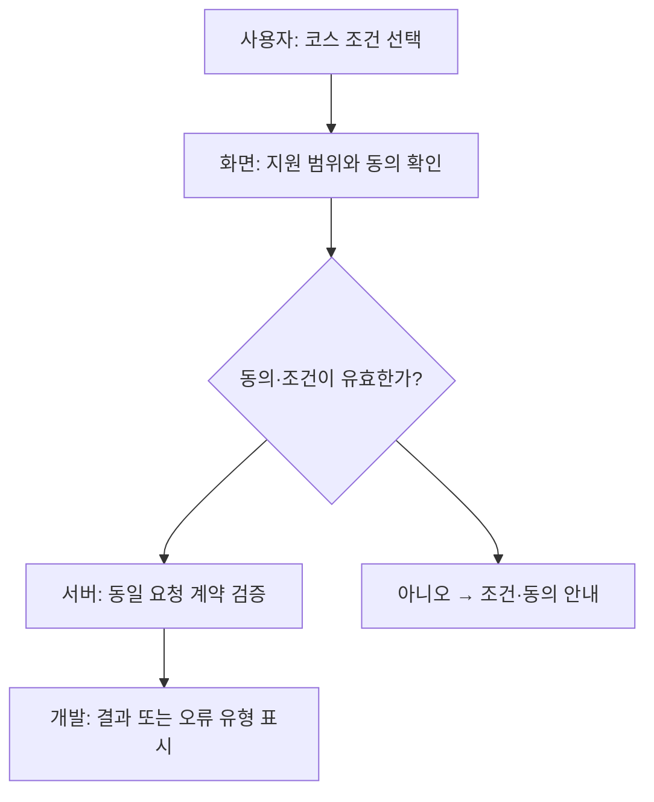
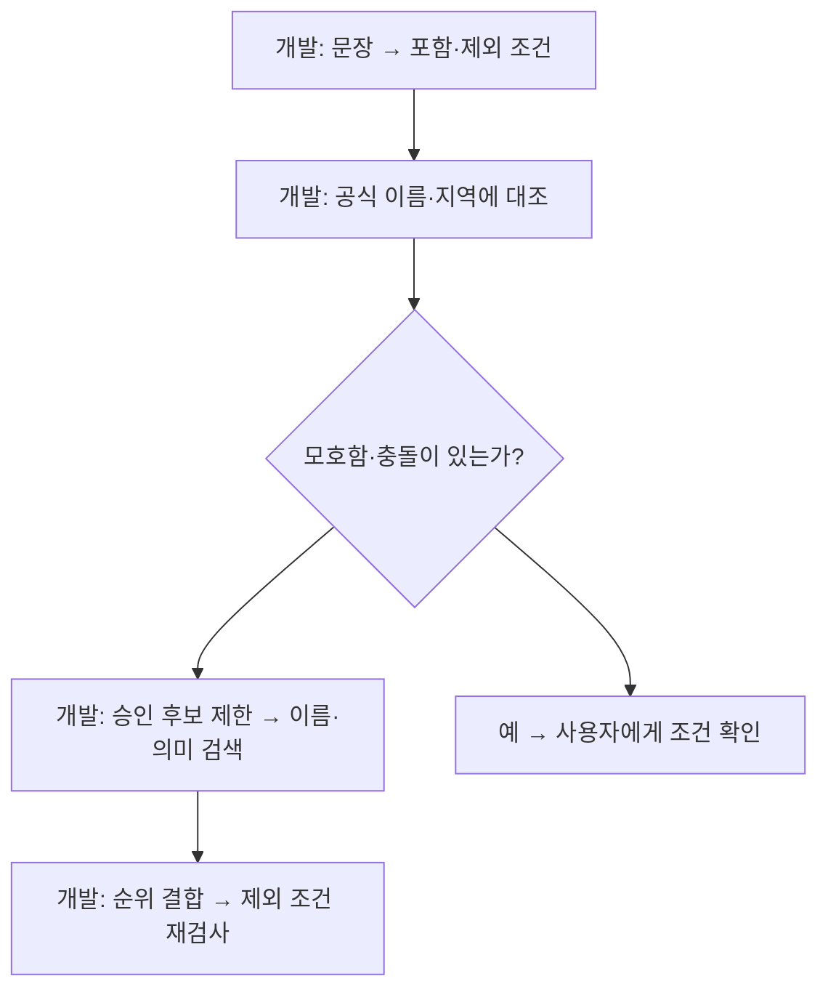
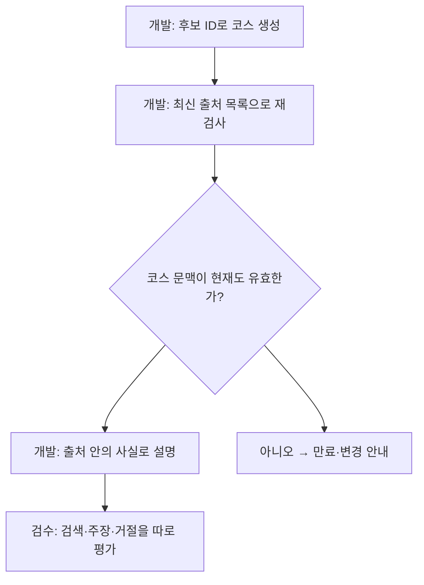
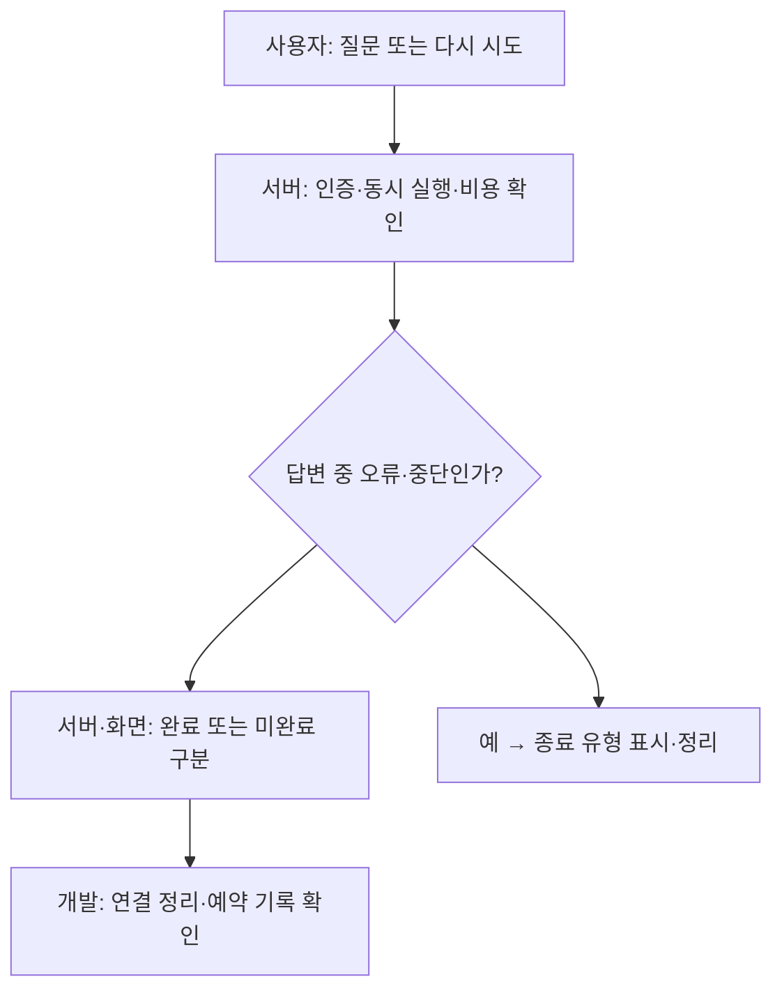
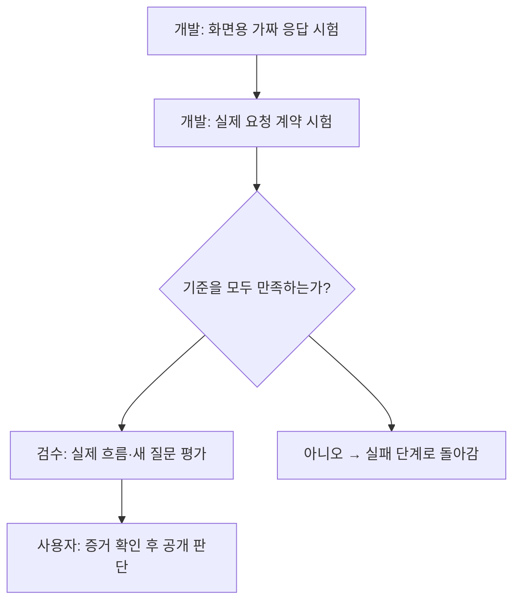

# KMovement 개선 적용 easy-guide

최종 목표: 선택 조건과 출처를 지키는 코스와 실제 화면 검증.

분석 완료 / 개선 설계 / 제품 수정·배포 미실행.

## 3줄 줄거리

1. 현재 코드의 요청·검색·출처·대화 연결을 확인했다.
2. 요청 계약을 먼저 맞추고 포함·제외 조건을 나눠야 한다.
3. 답변·비용·실제 흐름 시험 뒤 공개를 판단한다.

## 관계도와 저장소 연결

| 참고 저장소 | 내 기능의 역할 | 연결 상태 |
|---|---|---|
| [Ai-Travel-Planner](https://github.com/robo99oo/Ai-Travel-Planner) | 코스 초안과 검토 | 구조 참고 · 제안 |
| [Travel Planner](https://github.com/theertharajeevan/langGraph-multiagent-travel-planner) | 입력 확인과 역할 분리 | 구조 참고 · 제안 |
| [LangChain](https://github.com/langchain-ai/langchain) | 포함·제외 조건 표현 | 표현 방식 참고 · 제안 |
| [Chroma](https://github.com/chroma-core/chroma) | 조건에 맞는 후보 검색 | 현재 사용 + 개선 제안 |
| [Haystack](https://github.com/deepset-ai/haystack) | 조건 검사와 정렬 분리 | 설계 참고 · 제안 |
| [FastEmbed](https://github.com/qdrant/fastembed) | 이름·의미 순위 결합 | 비교 실험 제안 |
| [Ragas](https://github.com/vibrantlabsai/ragas) | 출처와 답변 평가 | 평가 연결 제안 |
| [LiteLLM](https://github.com/BerriAI/litellm) | 오류 원인·대체 경로 | 관측 우선 · 재시도 보류 |
| [Playwright](https://github.com/microsoft/playwright) | 사용자 화면 흐름 확인 | 기존 시험 + 보완 제안 |

## 1. 화면과 서버의 약속 맞추기

현재: 코스를 만드는 화면과 서버가 요구하는 값이 일부 다릅니다. 화면은 기본 예산을 보내지만, 서버가 요구하는 동의 표시를 함께 보내지 않는 경로가 있습니다.

적용: 코스 화면에서 일반 장소 안내의 범위를 확인하고 직접 동의한 경우에만 요청하도록 정리합니다. 어떤 화면에서 시작해도 같은 선택이 전달되도록 맞춥니다.

요청문: 코스를 만드는 모든 화면에서 선택한 조건과 동의 표시가 서버까지 동일하게 전달되는지 확인해줘. 동의하지 않으면 안내를 먼저 보여주고, 내 선택을 자동으로 동의로 바꾸지 마. 정상·미동의·지원하지 않는 지역을 각각 확인해줘.

완료 증거: 동의 전에는 확인 안내, 동의 후에는 요청 진행, 지원하지 않는 조건에는 구체적인 설명이 나타나는 결과.

미확인/실패 대응: 코드상 거절 분기는 확인했습니다. 현재 배포된 화면에서도 같은 오류가 재현되는지는 아직 확인하지 않았습니다.

## 2. 지역과 장소의 포함·제외를 나누기

현재: 문장 안의 지역 이름을 찾는 처리는 있지만 “종로는 빼고”처럼 제외하는 뜻을 별도 항목으로 다루지 않습니다. 검수한 다국어 이름을 먼저 찾는 검색도 제외 뜻을 구분하지 않습니다.

적용: 원하는 지역, 빼야 할 지역, 빼야 할 장소를 따로 정리합니다. 조건에 맞는 후보 안에서 이름과 뜻을 비교하고, 마지막에 제외한 장소가 다시 들어오지 않았는지 확인합니다.

요청문: 지역 포함·지역 제외·특정 장소 제외·장소 종류 제외를 각각 나눠줘. 특정 박물관 하나를 뺀 것을 모든 박물관 제외로 바꾸지 마. 모르는 지역 이름과 조건 충돌은 사용자에게 물어보고, 공개가 승인된 장소만 검색해줘.

완료 증거: “종로 제외”에서 종로가 나오지 않고, 특정 장소를 빼도 다른 적합한 장소는 남는 결과. 같은 뜻의 한국어·영어·일본어 요청 비교.

미확인/실패 대응: 이 개선을 구현한 뒤 정답률이 올라가는지는 아직 시험하지 않았습니다. 이전에 실패한 질문은 수정 확인용으로 쓰고 새 질문으로도 평가해야 합니다.

## 3. 맞는 장소와 근거 있는 답변 확인하기

현재: 현재 코드는 새로 만든 코스의 장소를 출처 목록과 다시 맞추고, 같은 코스를 설명할 때도 그 코스의 장소를 다시 확인합니다. 다만 장소가 맞다는 사실만으로 특정 가수의 방문이나 가격까지 확인되는 것은 아닙니다.

적용: 장소·가격·아티스트 관계를 따로 평가합니다. 코스에 대한 질문은 기존 코스를 설명하도록 하고, 새 코스를 만들려면 변경 내용을 확인하는 단계를 둡니다.

요청문: 장소를 제대로 찾았는지와 답변이 출처를 지켰는지를 따로 검사해줘. 출처에 없는 방문·촬영·가격을 단정하지 말고, 맞는 일반 장소 질문까지 과하게 거절하지 않는지도 확인해줘. 코스 설명 질문이 새 코스 생성으로 바뀌지 않게 해줘.

완료 증거: 검색 정답, 제외 위반, 출처 없는 주장, 올바른 거절, 과도한 거절을 나눠 기록한 평가표.

미확인/실패 대응: 출처가 있는 주소를 찾았다고 현재 영업이나 현장 입구까지 확인한 것은 아닙니다. 실제 생성 답변 전체의 품질 검증은 아직 끝나지 않았습니다.

## 4. 실패·중단·비용을 함께 다루기

현재: 답변을 멈추는 처리와 요청 횟수·비용 제한은 이미 있습니다. 현재 코드는 실패한 유료 요청을 자동으로 다시 보내지 않도록 되어 있습니다.

적용: 연결 실패, 오래 기다림, 사용자가 멈춤을 다른 상태로 보여줍니다. 먼저 어느 단계에서 실패했는지 기록하고, 다시 시도할 때도 기존 제한을 지키게 합니다.

요청문: 지금 있는 사용량 제한과 자동 재시도 없음 규칙을 유지하면서 오류 원인을 구분해줘. 답변을 멈췄을 때 새 답변이 붙지 않는지, 실패 뒤 다시 시도할 때 중복 요청이 생기지 않는지 확인해줘. 유료 자동 재시도는 이번에 켜지 마.

완료 증거: 연결 전 실패·답변 중 실패·사용자 중단·사용량 초과 각각의 화면과 요청 기록. 제한을 넘는 호출과 중복 답변 없음.

미확인/실패 대응: 이전 공급자 오류가 네트워크 문제인지 속도 제한인지는 아직 확정하지 않았습니다. 실패를 자동 재시도로 숨겨서 완료 처리하지 않습니다.

## 5. 같은 조건으로 화면 끝까지 시험하기

현재: 코스·검색·대화에 대한 시험 파일은 있습니다. 하지만 시험 파일이 있다는 사실만으로 로그인부터 저장까지 실제로 성공했다고 볼 수는 없습니다.

적용: 가짜 응답으로 화면 동작을 확인하는 시험과, 실제 서버를 연결하는 시험을 나눕니다. 로그인, 코스 생성, 같은 코스 설명, 중단, 다시 시도, 저장 결과를 끝까지 확인합니다.

요청문: 로그인부터 코스 생성·설명·중단·재시도·저장 결과까지 사용자 흐름을 확인해줘. 화면용 가짜 응답 시험과 실제 서버 시험 결과를 구분해줘. 새 질문으로 검색을 평가하고, 근거가 없는 관계 요청도 함께 검사해줘.

완료 증거: 기준 버전과 시험 데이터가 적힌 결과표, 단계별 성공·실패 증거, 휴대전화 폭에서 읽을 수 있는 화면.

미확인/실패 대응: 이번 작업은 보고서 작성입니다. 실제 사용자 계정 로그인, 유료 답변 호출, 운영 배포 검증은 수행하지 않았습니다.

## Before / After

현재 코드를 요약한 화면 재구성과 미구현 예상 모형을 HTML에 구분해 제시했다. 실제 캡처가 아니다. 현재는 동의 누락이 거절 분기로 이어지며, 제안은 사용자가 확인한 조건과 동의를 명시적으로 전달하는 것이다.

## 검증 상태

코드 정적 분석 완료. 운영 로그인·유료 모델 호출·전체 제품 시험 미실행. 10월 7일 48문항 실험의 일반 검색 첫 정답은 29/40, 상위5 정답은31/40이다. 오늘의 운영 성능이 아니다.

## 이력

[이전 GitHub 참고 저장소 조사 보고서](https://github.com/feed-mina/ME/blob/main/docs/2026-10-21/kmovement-github-references/kmovement-github-reference-report-2026-10-21.html)

## 보고서 자체 검수

각 판 9개 클릭 노드·5개 단계별 SVG 흐름도의 연결, 중복 ID·내부 링크, SVG 문법, 스크립트 문법을 검사했다. 쉬운판의 소스·함수명 노출 0건. 브라우저는 로컬 서버 연결 시간 초과와 파일 URL 보안 제한으로 실제 클릭·390px 렌더링을 확인하지 못했다. 제품 기능을 검증한 결과가 아니다.

