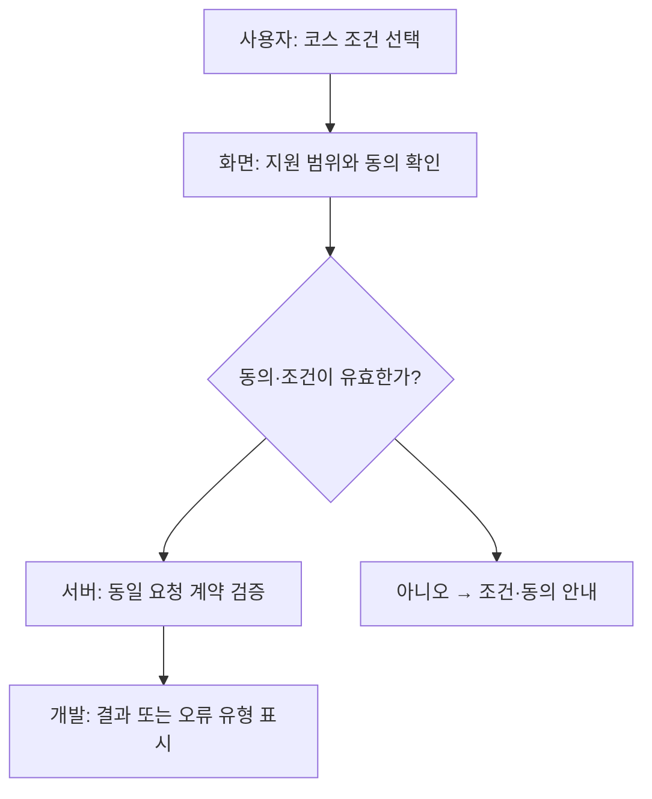
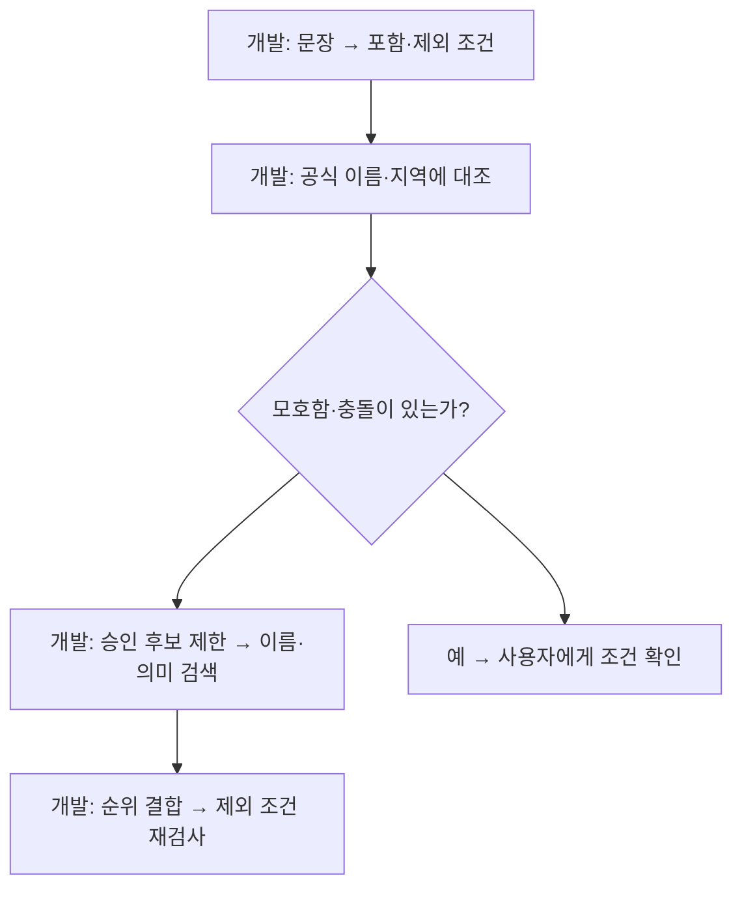
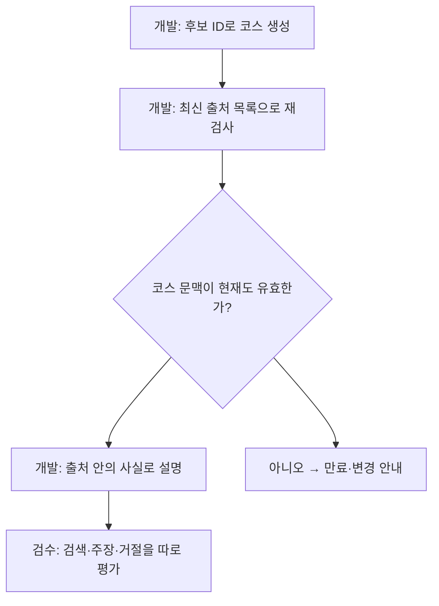
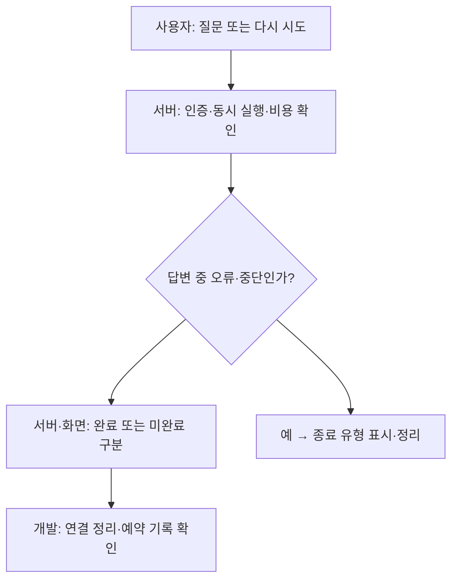
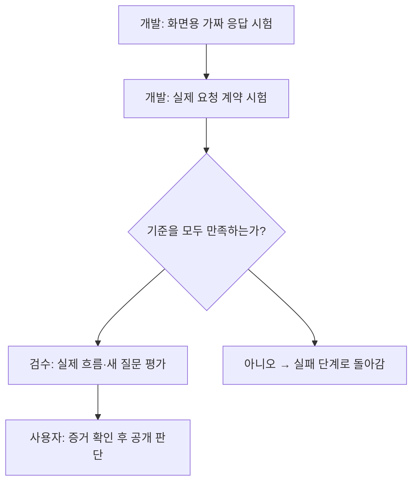

# KMovement 소스 연결 fix-guide

최종 목표: 선택 조건과 출처를 지키는 코스와 실제 화면 검증.

분석 완료 / 개선 설계 / 제품 수정·배포 미실행.

## 3줄 줄거리

1. 현재 코드의 요청·검색·출처·대화 연결을 확인했다.
2. 요청 계약을 먼저 맞추고 포함·제외 조건을 나눠야 한다.
3. 답변·비용·실제 흐름 시험 뒤 공개를 판단한다.

분석한 main 커밋: `111988aedf613aef1355db647931ebdf66e2a0d9`. 고정 커밋의 관련 파일 31개를 확인했다. 운영 설정과 실제 배포 재현은 미확인이다.

## 관계도와 저장소 연결

| 참고 저장소 | 내 기능의 역할 | 연결 상태 |
|---|---|---|
| [Ai-Travel-Planner](https://github.com/robo99oo/Ai-Travel-Planner) | 코스 초안과 검토 | 구조 참고 · 제안 |
| [Travel Planner](https://github.com/theertharajeevan/langGraph-multiagent-travel-planner) | 입력 확인과 역할 분리 | 구조 참고 · 제안 |
| [LangChain](https://github.com/langchain-ai/langchain) | 포함·제외 조건 표현 | 표현 방식 참고 · 제안 |
| [Chroma](https://github.com/chroma-core/chroma) | 조건에 맞는 후보 검색 | 현재 사용 + 개선 제안 |
| [Haystack](https://github.com/deepset-ai/haystack) | 조건 검사와 정렬 분리 | 설계 참고 · 제안 |
| [FastEmbed](https://github.com/qdrant/fastembed) | 이름·의미 순위 결합 | 비교 실험 제안 |
| [Ragas](https://github.com/vibrantlabsai/ragas) | 출처와 답변 평가 | 평가 연결 제안 |
| [LiteLLM](https://github.com/BerriAI/litellm) | 오류 원인·대체 경로 | 관측 우선 · 재시도 보류 |
| [Playwright](https://github.com/microsoft/playwright) | 사용자 화면 흐름 확인 | 기존 시험 + 보완 제안 |

## 1. 화면과 서버의 약속 맞추기

현재: RouteScreen.fetchAi는 budget을 비어 있지 않은 객체로 보내지만 acknowledgeUnverifiedConditions를 보내지 않습니다. PublicItineraryRequest의 기본값은 false이고 itinerary는 예산/아티스트가 있으면 동의 없이는 422를 반환합니다. 요청 프록시는 본문을 그대로 전달합니다.

적용: 요청 DTO(Data Transfer Object, 요청 데이터 형식)와 동의 상태를 공통으로 정합니다. RouteScreen·useKrideItinerary·채팅 itinerary 분기에서 같은 값을 생성하도록 연결합니다. 현재 지원 범위인 서울·당일치기 제한은 명시적으로 유지하고, 확장은 별도 검증으로 둡니다.

요청문: 목표: 코스 진입점의 요청 계약을 일치시킨다. 대상: RouteScreen.fetchAi, useKrideItinerary, 채팅 buildRequest와 두 JSON 프록시, PublicItineraryRequest/itinerary. 확인 사실: 기본 budget과 동의 기본값 false가 422 분기로 연결된다. 미확인: 배포 환경의 실제 재현. 범위: 필드 매핑과 명시적 동의 UI, 오류 분류. 완료: 미동의/동의/기간·지역 제한/아티스트 선택에 대한 프런트-서버 계약 시험, 사용자 동의 자동 설정 없음. 운영 배포는 포함하지 않는다.

완료 증거: 동의 전에는 확인 안내, 동의 후에는 요청 진행, 지원하지 않는 조건에는 구체적인 설명이 나타나는 결과.

미확인/실패 대응: 동의가 전달됐어도 422이면 regions·duration의 실제 값과 서버 허용값을 대조합니다. 프록시가 필드를 지우는지 확인하고 같은 요청의 반복 전송으로 해결하려 하지 않습니다.

- [fetchAi · 예산 전송](https://github.com/feed-mina/KMovement/blob/111988aedf613aef1355db647931ebdf66e2a0d9/subproject/SDUI/metadata-project/components/plugins/travel/RouteScreen.tsx#L59)
- [요청에 동의 값 포함](https://github.com/feed-mina/KMovement/blob/111988aedf613aef1355db647931ebdf66e2a0d9/subproject/SDUI/metadata-project/components/DynamicEngine/hook/useKrideItinerary.ts#L140)
- [채팅 요청 매핑](https://github.com/feed-mina/KMovement/blob/111988aedf613aef1355db647931ebdf66e2a0d9/subproject/SDUI/metadata-project/app/api/kride/chat/route.ts#L17)
- [요청 모델·동의 검사](https://github.com/feed-mina/KMovement/blob/111988aedf613aef1355db647931ebdf66e2a0d9/src/api/public_itinerary.py#L15)

## 2. 지역과 장소의 포함·제외를 나누기

현재: buildRequest는 extractMessageKeywords의 includes 검색으로 regions를 구성합니다. public_search는 catalogSha256가 있으면 search_reviewed로 분기합니다. 일반 경로는 ANN 후보 검색 후 주소로 지역을 거르고, 검수 경로는 name_matches를 앞세우지만 제외 의도를 받는 인자는 없습니다. 검수 색인의 메타데이터는 poiId·catalogSha256뿐입니다.

적용: 서버 기준의 조건 모델에 include/exclude region, exclude place IDs, facility type, unsupported relations를 분리합니다. 입력값은 승인된 지역·별칭 목록과 대조합니다. 일반·검수 경로에 같은 적격 후보 규칙을 적용합니다. 검수 컬렉션의 필드를 추가하려면 새 계약·새 컬렉션을 만들고 해시 검사를 갱신해야 합니다. 기존 색인에 없는 where 필드를 추가하는 것만으로 해결되지 않습니다.

요청문: 목표: 부정 조건이 긍정 조건으로 바뀌지 않는 검색. 대상: useKrideChatStream.buildRequest, public_search.search_public, multilingual_catalog.name_matches/search_reviewed/build_new_collection. 사실: 제외 인자 부재, 검수 메타데이터 두 필드, 모델·문서·카탈로그 해시 검사 존재. 가설: 구조화 조건과 선필터로 위반을 줄일 수 있다. 범위: 별도 조건 모델·적격 후보 집합·이름/의미 순위 결합 실험. 완료: 명시 제외 위반 0, 언어별 Hit@K, 다중 정답 집합 Recall, 원본 보존, 새 holdout 평가. 기존 모델 벡터와 새 모델 벡터를 혼용하지 않는다.

완료 증거: “종로 제외”에서 종로가 나오지 않고, 특정 장소를 빼도 다른 적합한 장소는 남는 결과. 같은 뜻의 한국어·영어·일본어 요청 비교.

미확인/실패 대응: 결과가 비면 조건을 몰래 완화하지 않습니다. 조건 해석·후보 제한·이름 일치·벡터 후보·최종 필터의 개수를 각각 기록해 사라진 지점을 찾습니다. 정확한 이름도 ANN 후보에 없으면 distance 조회에서 빠질 수 있다는 검수 경로의 한계를 따로 시험합니다.

- [extractMessageKeywords·buildRequest](https://github.com/feed-mina/KMovement/blob/111988aedf613aef1355db647931ebdf66e2a0d9/subproject/SDUI/metadata-project/lib/hooks/useKrideChatStream.ts#L84)
- [search_public · 두 경로 분기](https://github.com/feed-mina/KMovement/blob/111988aedf613aef1355db647931ebdf66e2a0d9/src/api/public_search.py#L114)
- [name_matches · build_new_collection · search_reviewed](https://github.com/feed-mina/KMovement/blob/111988aedf613aef1355db647931ebdf66e2a0d9/src/api/multilingual_catalog.py#L72)

## 3. 맞는 장소와 근거 있는 답변 확인하기

현재: ground_plan은 허용된 poiId만 사용하고 이름·좌표를 카탈로그 값으로 교체하며 중복을 제거합니다. generate_public은 생성 뒤 승인 목록을 다시 읽습니다. course_context는 사용자·만료·카탈로그 개정을 서명으로 묶고 stream_chat은 courseContext가 있으면 resolve_context로 해당 코스만 설명합니다. 일반 카탈로그 검사는 아티스트 관계의 사실 확인을 대신하지 않습니다.

적용: 기존 ground_plan·카탈로그 재조회·서명 검증을 보존합니다. Ragas의 Faithfulness는 제공 근거와 답변의 일치 보조 평가로 연결하고, 참조 장소 ID 기반 평가는 별도로 유지합니다. 근거 없는 관계 차단과 정상 질문의 과도한 거절을 독립 항목으로 둡니다.

요청문: 목표: 검색 성공과 생성 답변의 근거 충실도를 구분한다. 대상: ground_plan, issue_context/resolve_context, stream_chat, 기존 public itinerary/chat 시험. 사실: 출처 재검사와 서명된 코스 연결은 구현돼 있다. 가설: 별도 관계 증거·평가표가 단정 오류를 줄인다. 범위: 평가 어댑터·근거 분류·회귀 시험. 완료: 카탈로그 철회/만료/다른 사용자/변조 차단, 언어별 검색 지표, 근거 충실도와 과도한 거절 기록. 자동 점수만으로 공개 승인하지 않는다.

완료 증거: 검색 정답, 제외 위반, 출처 없는 주장, 올바른 거절, 과도한 거절을 나눠 기록한 평가표.

미확인/실패 대응: 장소 ID가 틀리면 검색 단계를 고치고, ID는 맞는데 주장이 틀리면 제공 문맥과 생성 결과를 대조합니다. 코스가 만료돼 409가 나오면 서명을 무시하지 말고 새 코스를 확인하도록 안내합니다.

- [ground_plan · 생성 후 재검사](https://github.com/feed-mina/KMovement/blob/111988aedf613aef1355db647931ebdf66e2a0d9/src/api/public_itinerary.py#L24)
- [issue_context · resolve_context](https://github.com/feed-mina/KMovement/blob/111988aedf613aef1355db647931ebdf66e2a0d9/src/api/course_context.py#L39)
- [stream_chat · 코스 문맥](https://github.com/feed-mina/KMovement/blob/111988aedf613aef1355db647931ebdf66e2a0d9/src/api/public_chat.py#L78)

## 4. 실패·중단·비용을 함께 다루기

현재: Groq와 AsyncGroq 모두 max_retries=0입니다. reserve_budget은 SQLite 트랜잭션으로 횟수·예상 비용을 예약하고 실패 예약도 유지합니다. SharedSlots와 stream_chat.cleanup은 동시 요청·연결 자원을 정리합니다. 브라우저 훅은 abortRef로 늦은 응답을 차단하고 consumeChatStream은 완료 프레임 없는 종료를 오류로 처리합니다.

적용: LiteLLM의 오류 분류·시간 제한·대체 경로 설계를 참고하되 현재 유료 자동 재시도 정책을 즉시 바꾸지 않습니다. 요청 ID·상태 코드·첫 응답 시간·종료 유형을 연결하고 프록시/SDK/화면의 중첩 재시도를 방지합니다. 재시도 도입은 총 시간·호출 수·예약 비용 계약을 먼저 정의한 후 별도 변경으로 둡니다.

요청문: 목표: 원인 추적과 취소·비용 불변식 유지. 대상: stream_chat, ai_runtime, SharedSlots, reserve_budget/record_usage, Next 스트림 프록시, useKrideChatStream, consumeChatStream. 사실: 재시도 0, 실패 예약 유지, 2개 슬롯·사용량 제한 존재. 미확인: 공급자 장애 원인. 범위: 관측·오류 매핑·취소 시험. 완료: 취소/타임아웃/부분 출력 실패/사용량 초과에 중복 호출 없음, 자원 해제와 예약 장부 기록. 모델 대체·유료 자동 재시도·운영 배포는 포함하지 않는다.

완료 증거: 연결 전 실패·답변 중 실패·사용자 중단·사용량 초과 각각의 화면과 요청 기록. 제한을 넘는 호출과 중복 답변 없음.

미확인/실패 대응: 사용량 초과면 재호출하지 않고 한도 안내를 표시합니다. 일부 답변 뒤 실패하면 해당 답변을 미완료로 표시하고 새 요청과 구분합니다. 동시 실행 제한은 서비스 프로세스들이 같은 잠금 경로를 쓰는지도 별도로 확인해야 합니다.

- [stream_chat · cleanup · events](https://github.com/feed-mina/KMovement/blob/111988aedf613aef1355db647931ebdf66e2a0d9/src/api/public_chat.py#L78)
- [reserve_budget · record_usage](https://github.com/feed-mina/KMovement/blob/111988aedf613aef1355db647931ebdf66e2a0d9/src/api/itinerary_budget.py#L24)
- [SharedSlots](https://github.com/feed-mina/KMovement/blob/111988aedf613aef1355db647931ebdf66e2a0d9/src/api/shared_admission.py#L6)
- [send · abort · retry](https://github.com/feed-mina/KMovement/blob/111988aedf613aef1355db647931ebdf66e2a0d9/subproject/SDUI/metadata-project/lib/hooks/useKrideChatStream.ts#L180)
- [완료·오류 프레임 처리](https://github.com/feed-mina/KMovement/blob/111988aedf613aef1355db647931ebdf66e2a0d9/subproject/SDUI/metadata-project/lib/kride/consumeChatStream.ts#L2)

## 5. 같은 조건으로 화면 끝까지 시험하기

현재: test_public_search/public_itinerary/public_chat와 useKrideChatStream 시험이 있습니다. AIChatV2.test.ts는 영어 대화 화면 시험이며 팬 여행의 전체 검증과는 범위가 다릅니다. RouteScreen의 화면 단위 시험과 실제 Python 요청 모델을 잇는 계약 시험을 보강하는 것이 우선입니다.

적용: Playwright 인증 상태 재사용은 시험 계정에만 적용하고 인증 파일은 게시하지 않습니다. UI mock 시험 → 실제 프록시+FastAPI 계약 → 제한된 실제 공급자 시험 → 새 holdout 평가 순서로 진행합니다. 코스 수정 검토 UX는 여행 예제의 상태 분리만 참고합니다.

요청문: 목표: 사용자 흐름과 검색 성능을 별도 증거로 마무리한다. 대상: RouteScreen·KRIDE_FOCUS·여행 채팅, Next 프록시, Python public 엔드포인트와 기존 시험. 사실: 관련 단위 시험 존재, 영어 대화 E2E는 별도 기능. 미확인: 현재 배포 전체 흐름. 범위: 시험 시나리오와 격리 환경 검증. 완료: 미동의/동의/정상/빈 후보/오류/취소/만료/저장, 390px·PC, 새 평가 질문. 실제 공급자 비용 시험은 허용 한도에서만 수행하고 배포 승인은 별도 기록한다.

완료 증거: 기준 버전과 시험 데이터가 적힌 결과표, 단계별 성공·실패 증거, 휴대전화 폭에서 읽을 수 있는 화면.

미확인/실패 대응: mock 시험만 성공하면 실제 서버 연결 완료로 보고하지 않습니다. 인증이 만료되면 시험 계정 세션을 갱신하고 권한 검사를 끄지 않습니다. 새 질문에서 기준 미달이면 공개 단계로 넘어가지 않고 실패 종류를 기록합니다.

- [검색 시험](https://github.com/feed-mina/KMovement/blob/111988aedf613aef1355db647931ebdf66e2a0d9/tests/test_public_search.py#L1)
- [코스 근거·비용 시험](https://github.com/feed-mina/KMovement/blob/111988aedf613aef1355db647931ebdf66e2a0d9/tests/test_public_itinerary.py#L1)
- [스트림 시험](https://github.com/feed-mina/KMovement/blob/111988aedf613aef1355db647931ebdf66e2a0d9/tests/test_public_chat.py#L1)
- [취소·대화 상태 시험](https://github.com/feed-mina/KMovement/blob/111988aedf613aef1355db647931ebdf66e2a0d9/subproject/SDUI/metadata-project/tests/hooks/useKrideChatStream.test.ts#L1)
- [기존 영어 대화 E2E · 범위 참고](https://github.com/feed-mina/KMovement/blob/111988aedf613aef1355db647931ebdf66e2a0d9/subproject/SDUI/metadata-project/tests/e2e/AIChatV2.test.ts#L1)

## 저장소별 실제 소스 연결

### Ai-Travel-Planner

외부 예제의 승인·수정 상태 구분을 코스 확정 UX에 참고합니다. 기존 courseContext는 사용자와 카탈로그에 묶인 설명용 참조이며 승인 상태 저장소와는 역할이 다릅니다.

한계: 예제의 MemorySaver는 영구 운영 저장소가 아닙니다. scheduler.py의 순환 배치는 실제 이동시간 계산이 아닙니다.

- [generate_public / ground_plan](https://github.com/feed-mina/KMovement/blob/111988aedf613aef1355db647931ebdf66e2a0d9/src/api/public_itinerary.py)
- [fetchAi / requestAiCourse](https://github.com/feed-mina/KMovement/blob/111988aedf613aef1355db647931ebdf66e2a0d9/subproject/SDUI/metadata-project/components/plugins/travel/RouteScreen.tsx)
- [issue_context](https://github.com/feed-mina/KMovement/blob/111988aedf613aef1355db647931ebdf66e2a0d9/src/api/course_context.py)
### Travel Planner

입력 확인을 생성 처리와 나누는 방식만 참고합니다. 현재 Pydantic 요청 검증과 지원 범위 검사를 유지하면서 모든 진입점의 필드를 통일합니다.

한계: 외부 검증 함수는 도시·관심사 빈 값 검사 수준입니다. 여행 지출 budget과 itinerary_budget의 AI 호출 비용 장부를 혼동하면 안 됩니다.

- [PublicItineraryRequest / itinerary](https://github.com/feed-mina/KMovement/blob/111988aedf613aef1355db647931ebdf66e2a0d9/src/api/public_itinerary.py)
- [요청 본문 구성](https://github.com/feed-mina/KMovement/blob/111988aedf613aef1355db647931ebdf66e2a0d9/subproject/SDUI/metadata-project/components/DynamicEngine/hook/useKrideItinerary.ts)
### LangChain

검색어와 조건식을 분리하는 표현을 참고해 부정문이 긍정 지역/이름 후보로 섞이지 않게 합니다. 실제 변경 위치는 자기 코드의 요청 모델과 서버 조건 해석기입니다.

한계: LLM이 만든 조건식도 허용 필드·값·연산자를 검사해야 합니다. LangChain 전체 도입은 필수가 아닙니다.

- [buildRequest / extractMessageKeywords](https://github.com/feed-mina/KMovement/blob/111988aedf613aef1355db647931ebdf66e2a0d9/subproject/SDUI/metadata-project/lib/hooks/useKrideChatStream.ts)
- [PublicItineraryRequest](https://github.com/feed-mina/KMovement/blob/111988aedf613aef1355db647931ebdf66e2a0d9/src/api/public_itinerary.py)
- [name_matches](https://github.com/feed-mina/KMovement/blob/111988aedf613aef1355db647931ebdf66e2a0d9/src/api/multilingual_catalog.py)
### Chroma

이미 Chroma 클라이언트를 사용합니다. 필요한 조건을 정규화한 뒤 필터링하거나 후보 집합을 제한합니다. 검수 컬렉션의 해시·차원·모델 검사는 보존합니다.

한계: 현재 검수 메타데이터에는 poiId와 catalogSha256만 있습니다. 지역 필드 추가는 새 색인 계약으로 다뤄야 합니다.

- [search_public / index_catalog](https://github.com/feed-mina/KMovement/blob/111988aedf613aef1355db647931ebdf66e2a0d9/src/api/public_search.py)
- [build_new_collection / search_reviewed](https://github.com/feed-mina/KMovement/blob/111988aedf613aef1355db647931ebdf66e2a0d9/src/api/multilingual_catalog.py)
- [get_chroma](https://github.com/feed-mina/KMovement/blob/111988aedf613aef1355db647931ebdf66e2a0d9/src/api/rag_client.py)
### Haystack

필터로 후보를 좁히는 책임을 독립시킵니다. public_catalog의 공개 적격 검사와 검색 의미 조건을 나누되, 결과 반환 전 최신 적격 여부를 다시 확인합니다.

한계: FilterRetriever 자체는 부정문 해석기나 의미 검색기가 아닙니다. 기존 코드를 Haystack으로 모두 옮길 필요는 없습니다.

- [public_catalog / search_public](https://github.com/feed-mina/KMovement/blob/111988aedf613aef1355db647931ebdf66e2a0d9/src/api/public_search.py)
- [search_reviewed](https://github.com/feed-mina/KMovement/blob/111988aedf613aef1355db647931ebdf66e2a0d9/src/api/multilingual_catalog.py)
### FastEmbed

이름 검색과 벡터 검색의 결과를 별도로 만들고 RRF(Reciprocal Rank Fusion, 역순위 결합)로 합치는 방식을 실험합니다. 검수 경로의 distance 누락으로 정확 이름 후보가 빠지는 경우도 먼저 재현합니다.

한계: 공식 예제는 영어 모델·Qdrant 기반입니다. 현재 다국어 E5 모델과 새 모델의 벡터를 섞지 않으며, 제외 규칙을 재정렬 점수로 덮지 않습니다.

- [name_matches / search_reviewed](https://github.com/feed-mina/KMovement/blob/111988aedf613aef1355db647931ebdf66e2a0d9/src/api/multilingual_catalog.py)
- [embed_texts_sync](https://github.com/feed-mina/KMovement/blob/111988aedf613aef1355db647931ebdf66e2a0d9/src/api/torchserve_client.py)
- [search_public](https://github.com/feed-mina/KMovement/blob/111988aedf613aef1355db647931ebdf66e2a0d9/src/api/public_search.py)
### Ragas

출처 문맥과 생성 답변을 평가 입력으로 연결합니다. 장소 ID 정답률은 별도 계산하고, 근거 없는 방문/가격 주장은 별도 판정합니다.

한계: 주어진 문맥에 충실해도 문맥 자체가 틀리면 실제 사실이 보장되지 않습니다. 자동 평가와 검수 결과를 구분합니다.

- [ground_plan](https://github.com/feed-mina/KMovement/blob/111988aedf613aef1355db647931ebdf66e2a0d9/src/api/public_itinerary.py)
- [sources / stream_chat](https://github.com/feed-mina/KMovement/blob/111988aedf613aef1355db647931ebdf66e2a0d9/src/api/public_chat.py)
- [resolve_context](https://github.com/feed-mina/KMovement/blob/111988aedf613aef1355db647931ebdf66e2a0d9/src/api/course_context.py)
- [근거 정합성 시험](https://github.com/feed-mina/KMovement/blob/111988aedf613aef1355db647931ebdf66e2a0d9/tests/test_public_itinerary.py)
### LiteLLM

현재 호출 직전에 예산 예약과 슬롯 점유가 있습니다. 이 경계를 유지하며 오류 관측을 보완합니다. Router 도입 시 예약 단위·대체 모델 비용·부분 스트림 처리를 새로 검토해야 합니다.

한계: 현재 max_retries=0이 명시돼 있습니다. 예제 설정을 복사해 자동 유료 재시도를 켜는 것은 이번 적용 권고가 아닙니다.

- [AsyncGroq / events / cleanup](https://github.com/feed-mina/KMovement/blob/111988aedf613aef1355db647931ebdf66e2a0d9/src/api/public_chat.py)
- [Groq / generate_public](https://github.com/feed-mina/KMovement/blob/111988aedf613aef1355db647931ebdf66e2a0d9/src/api/public_itinerary.py)
- [reserve_budget / record_usage](https://github.com/feed-mina/KMovement/blob/111988aedf613aef1355db647931ebdf66e2a0d9/src/api/itinerary_budget.py)
- [SharedSlots](https://github.com/feed-mina/KMovement/blob/111988aedf613aef1355db647931ebdf66e2a0d9/src/api/shared_admission.py)
### Playwright

기존 @playwright/test 사용을 확인했습니다. 팬 여행 시나리오는 별도로 인증 상태·코스 계약·저장 결과를 끝까지 검사해야 합니다.

한계: 기존 영어 대화 E2E를 팬 여행 검증 완료로 취급하지 않습니다. 실제 카카오 로그인은 별도 준비하고 인증 파일은 게시하지 않습니다.

- [기존 영어 대화 화면 시험](https://github.com/feed-mina/KMovement/blob/111988aedf613aef1355db647931ebdf66e2a0d9/subproject/SDUI/metadata-project/tests/e2e/AIChatV2.test.ts)
- [취소·재시도 상태 시험](https://github.com/feed-mina/KMovement/blob/111988aedf613aef1355db647931ebdf66e2a0d9/subproject/SDUI/metadata-project/tests/hooks/useKrideChatStream.test.ts)
- [코스 요청과 오류 패널](https://github.com/feed-mina/KMovement/blob/111988aedf613aef1355db647931ebdf66e2a0d9/subproject/SDUI/metadata-project/components/plugins/travel/RouteScreen.tsx)

## Before / After

현재 코드를 요약한 화면 재구성과 미구현 예상 모형을 HTML에 구분해 제시했다. 실제 캡처가 아니다. 현재는 동의 누락이 거절 분기로 이어지며, 제안은 사용자가 확인한 조건과 동의를 명시적으로 전달하는 것이다.

## 검증 상태

코드 정적 분석 완료. 운영 로그인·유료 모델 호출·전체 제품 시험 미실행. 10월 7일 48문항 실험의 일반 검색 첫 정답은 29/40, 상위5 정답은31/40이다. 오늘의 운영 성능이 아니다.

## 이력

[이전 GitHub 참고 저장소 조사 보고서](https://github.com/feed-mina/ME/blob/main/docs/2026-10-21/kmovement-github-references/kmovement-github-reference-report-2026-10-21.html)

## 보고서 자체 검수

각 판 9개 클릭 노드·5개 단계별 SVG 흐름도의 연결, 중복 ID·내부 링크, SVG 문법, 스크립트 문법을 검사했다. 쉬운판의 소스·함수명 노출 0건. 브라우저는 로컬 서버 연결 시간 초과와 파일 URL 보안 제한으로 실제 클릭·390px 렌더링을 확인하지 못했다. 제품 기능을 검증한 결과가 아니다.

