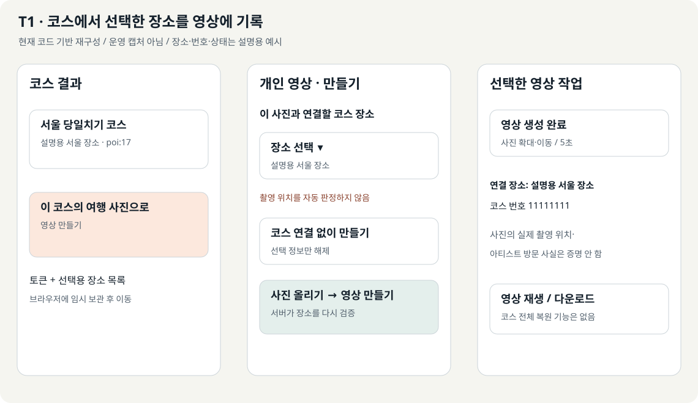
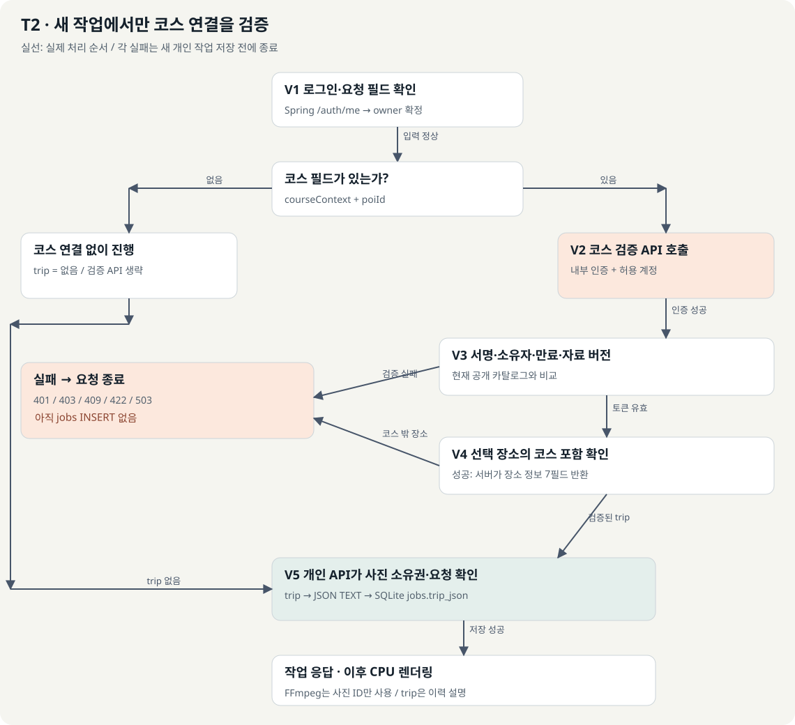
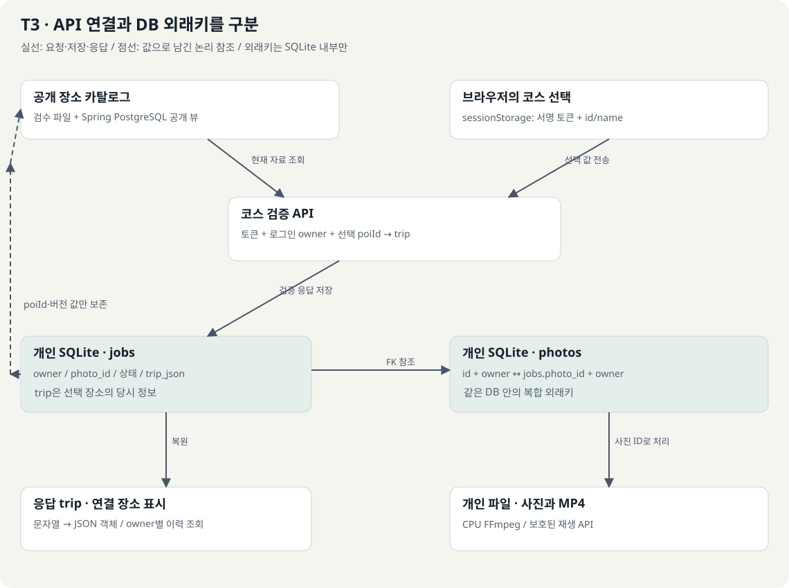

# 내 목록과 내 영상 연결 가이드

**P1~P5 구현 변경:** [구현 내용·검증·활성화 조건](implementation.md)을 추가했다. 이 문서 본문의 ‘제안/미구현’은 최초 설계 기준이며, 해당 변경은 PR 검토 단계다. 운영 배포 완료를 뜻하지 않는다.

**핵심 한 줄: 기존 저장소와 소유권 검사를 유지하고, 내 목록과 개인 영상에 공통 탐색 메뉴·로그인 복귀·조회 상태를 연결한다.**

작성일: 2026-10-26. 소스 대조: KMovement main `ba68455a101f2be0d5bec35ff09293d0f0d135a5`. 문서만 추가된 main과 조사용 소스를 대조했다. 아래 실행 코드는 PR #299 병합 상태와 같다. RunPod 콘솔 확인과 코스 연결 분석을 추가했다.

[HTML 보고서](guide.html) · [앞선 저장 경로 조사](../saved-item-media-storage-audit.md)

<a id="scope"></a>
## 1. 목표와 읽는 순서

| 구분 | 이번 가이드의 기준 |
|---|---|
| 제품과 독자 | KMovement에서 저장한 팬덤 정보와 개인 여행 영상을 관리하는 기능. 처음 보는 개발자도 화면에서 API와 저장값까지 따라갈 수 있게 설명한다. |
| 사용자 목표 | 내 목록에서 내 영상으로 이동하고, 로그인 후 돌아와 이전 작업을 재생한다. |
| 결과 형식 | 같은 원고의 HTML·Markdown, 코드 기반 현재 화면, 개선 예상 화면, 편집 가능한 SVG 그림 |
| 현재 완료 | 소스 추적과 가이드 작성. 문서 게시와 문서 자체 검수만 수행한다. |
| 구현 예정 | 공통 메뉴, 로그인 복귀 보강, 개인 영상 조회 상태·주소 복원. 아래 새 파일·함수·쿼리는 제안이다. |
| 범위 | 개인 영상 `/travel/video`와 내 목록·마이페이지 연결. 커뮤니티·Cloudinary 영상 통합은 후속 선택이다. |
| 읽는 순서 | 현재 화면 → 개선 화면 → 기능별 코드 → 인증·조회 계약 → 구현 순서 → 시험·복구 |

API(Application Programming Interface)는 프로그램의 요청·응답 창구, DB(Database)는 데이터베이스다. UI(User Interface)는 화면 구성, UX(User Experience)는 화면을 사용하는 과정이다. SVG(Scalable Vector Graphics)는 확대해도 선명한 그림 파일 형식이다.

[현재 화면](#current) · [개선 화면](#after) · [이동 흐름](#flow) · [함수와 파일](#files) · [로그인 복귀](#login) · [조회 상태](#history) · [API·DB](#contracts) · [구현 순서](#steps) · [시험](#tests) · [RunPod 운영](#runpod-operations) · [여행 코스와 trip_json](#trip-context)

<a id="current"></a>
## 2. 현재 화면에서 끊기는 부분


**G1은 실제 운영 캡처가 아닌 코드 기반 재구성이다.** 배치와 문구는 소스에서 확인했고, 이름·건수·영상 상태는 설명용 예시다. 운영 기능 활성화나 실제 사용자 데이터를 의미하지 않는다.

| 화면 번호 | 확인한 사용자 동작 | 담당 코드와 실제 결과 | 연결할 부분 |
|---|---|---|---|
| C1 마이페이지 | 아티스트·일정·상품 건수를 누른다 | `ProfileScreen()`이 세 저장 API를 각각 요청하고, 선택한 `kind`로 내 목록 이동. 실패 건수는 숫자 0 대신 미확인 기호로 남김 | 같은 메뉴에 개인 영상 진입 추가. 영상 전체 건수는 현재 API로 계산 불가 |
| C2 내 목록 | 종류·페이지 변경, 보기·삭제·되돌리기 | `PersonalSavedScreen()`이 `identity:kind:page`로 응답을 구분. 공개 항목만 보기 링크 표시. 삭제 후 다시 조회 | 개인 영상으로 가는 메뉴와 돌아올 종류·페이지 보존 |
| C3 개인 영상 | 사진 올리기·영상 만들기·이전 작업 선택 | `TravelVideoPage()`가 업로드·작업·이력을 전용 API로 조회. 완료 시 `videoUrl` 재생 | 마이·내 목록 링크, 로그인 복귀, 이력 상태 분리, 선택 작업 주소 복원 |

현재 개인 영상 화면에는 로그인과 코스 이동 링크만 있다. 이력 배열이 빈 초기 상태에서도 ‘아직 작업 기록이 없습니다’가 표시되고, 실패는 공용 오류 문구로 표시된다. 이전 페이지 결과도 새 조회가 끝날 때까지 남을 수 있다. 이를 ‘조회 성공 후 실제로 비어 있음’과 구분해야 한다.

현재 `safeLoginReturn()`은 홈과 제한된 `/view/...`만 허용한다. `/travel/video`는 기본 마이페이지로 바뀐다. 따라서 로그인 링크에 `returnTo`를 붙이는 수정만으로는 영상 화면 복귀가 완성되지 않는다.

<a id="after"></a>
## 3. 개선 화면: 두 화면을 같은 보관 공간처럼 탐색


**G2는 미구현 개선 예상 모형이다.** 개인 영상은 여전히 전용 API와 SQLite를 사용한다. ‘내 영상’은 이번 범위에서 개인 사진·영상 작업을 뜻한다.

- A1: 마이페이지에 ‘내 영상 보기’를 추가한다. 실제 전송·재생 준비가 된 환경에서만 진입을 노출한다.
- A2: 내 목록과 개인 영상에 ‘내 목록 / 내 영상’ 공통 탐색 메뉴를 둔다. 페이지 이동이므로 링크와 `aria-current="page"`를 사용한다.
- A3: 영상 화면에서 생성과 이력을 시각적으로 구분한다. ‘완료’ 작업만 재생할 수 있고, 실패 작업의 다시 만들기는 별도 쓰기 동작이다.
- A4: 조회 중·실패·빈 목록을 서로 다른 영역으로 표시한다. 일부 조회 실패가 다른 화면을 막지 않게 한다.
- A5: 목록의 종류·페이지와 선택한 영상 작업을 주소로 복원한다. 허용한 값만 읽고 사용자 번호·내부 키·사진 데이터는 주소에 넣지 않는다.

**연결하지 않는 의미:** 저장한 아티스트를 눌렀다고 그 아티스트와 관련된 사진을 자동 판정하지 않는다. 상품 후보 번호를 사진·영상 번호로 변환하지 않는다. 목록 저장 해제는 영상·원본 사진 삭제가 아니다.

<!-- INTERACTIVE_DEMO -->

HTML의 체험 영역은 설명용 모형이다. 버튼은 문서 안의 화면만 전환하며 실제 서비스 요청·업로드·로그인을 하지 않는다. Markdown에서는 G2와 아래 상태 표로 같은 내용을 읽을 수 있다.

<a id="flow"></a>
## 4. 화면 이동과 조회 분기


| 단계 | 입력·판단 | 결과와 화면 위치 |
|---|---|---|
| F1 공통 메뉴 | 사용자가 내 목록 또는 내 영상을 선택 | 허용된 내부 경로로 이동. 이 시점에는 저장·생성 API를 호출하지 않음 |
| F2 기능·인증 확인 | 영상 기능 설정, 로그인 준비·상태 | 기능 준비 중이면 안내. 비로그인이면 복귀 경로를 보존하고 로그인 안내 |
| F3 독립 조회 | 내 목록은 종류·페이지, 내 영상은 페이지·선택 작업 | 각각 자기 API 요청. 서로 순서대로 호출해야 하는 의존 관계 없음 |
| F4 응답 판정 | 성공·빈 결과·401·404·503·통신 실패 | 아래 상태 표에 맞춰 표시. 실패를 빈 목록으로 바꾸지 않음 |
| F5 선택·재생 | 검증된 작업 번호를 상태 API로 조회 | 소유자 검사 통과·완료 상태·재생 주소 확인 후 영상 표시 |

URL(Uniform Resource Locator)은 화면·파일의 주소다. UUID(Universally Unique Identifier)는 전역 고유 식별자로, 개인 영상 작업 번호에 사용된다.

**1차 제안 경로 계약 — 새 쿼리 파싱은 아직 없다.**

| 목적 | 사용할 주소 | 현재/제안 구분 |
|---|---|---|
| 저장 목록 | `/view/KPOP_SAVED_ITEMS?kind=events&page=2` | 현재 지원. 예시는 설명용 |
| 개인 영상 기본 | `/travel/video` | 현재 지원 |
| 영상 이력만 보기 | `/travel/video?view=history&page=2` | 새 파싱·화면 구분 구현 필요 |
| 선택 영상 다시 열기 | `/travel/video?view=history&page=2&job=<UUID>` | 새 구현 필요. 주소의 번호를 믿지 않고 소유자 재조회 |
| 새 영상 만들기 | `/travel/video?view=create` | 새 화면 모드 제안. 실제 생성은 명시적 버튼 클릭 |

1차에서는 내 목록으로 돌아오는 링크의 `kind`·`page`를 URL의 `returnTo`로 보낼 수 있다. 별도 `safePersonalReturn()`을 **새로 구현**해 정확히 마이페이지 또는 내 목록 경로만 허용하고 `kind`·`page`를 정규화한다. 중첩 복귀 경로, 외부 주소, 임의 경로는 마이페이지로 대체한다. 로그인 복귀용 저장값과 개인 화면 간 복귀값은 역할이 다르므로 같은 키를 덮어쓰지 않는다.

<a id="files"></a>
## 5. 핵심 기능과 수정할 파일

현재 파일 이름은 클릭하면 분석 기준 소스로 이동한다. ‘제안’ 행의 파일·함수는 아직 존재하지 않는다.

| 기능 | 파일·함수 | 받는 값 | 처리·반환·부수 효과 |
|---|---|---|---|
| 마이페이지 진입 | [AuthFlowScreen.tsx][profile] / `ProfileScreen()` | 인증 사용자, 세 종류별 `totalCount` | 각 요청은 독립 실행. 건수를 상태에 저장하고 목록 링크 표시. 반환은 화면 요소 |
| 내 목록 | [PersonalSaved.tsx][saved] / `PersonalSavedScreen()` | 인증 문맥, `kind`, `page`, 기존 `returnEvents` | API의 `.data`를 읽어 제목·공개 여부·페이지 표시. 삭제와 복구는 별도 요청 |
| 개인 영상 | [page.tsx][video] / `TravelVideoPage()` | 파일·사진 번호·작업·이력·코스 문맥 | 생성·재시도·이력 요청 후 상태 갱신. 완료 주소는 video 요소에 전달 |
| 공통 탐색 | 제안 `PersonalLibraryNav.tsx` | 활성 화면, 정규화된 목록 주소, 영상 활성 여부 | 링크 반환. 저장·업로드·외부 생성 요청을 하지 않음 |
| 이력 상태 분리 | 제안 `usePrivateVideoHistory.ts` | 인증된 사용자 식별자, 페이지, 갱신 계기 | 요청을 취소·분리하고 성공·빈 결과·오류 상태를 반환. 결과는 메모리에만 보관 |
| 복귀 검증 | [loginReturn.ts][return] / `safeLoginReturn()`, 제안 `safePersonalReturn()` | 사용자가 전달할 수 있는 내부 복귀 주소 | 제한된 경로·쿼리만 반환. 외부 주소를 허용하지 않음 |
| 로그인 완료 복귀 | [AuthContext.tsx][auth] / `consumeLoginReturn()` 사용 구간 | 검증된 로그인·역할, 저장한 복귀 힌트 | 허용된 로그인 완료 위치에서 `router.replace()`. 반환 데이터 없이 이동 효과 |
| 영상 소유자 전달 | [route.ts][proxy] / `proxy()` | 브라우저 요청·쿠키, 서버 설정 | Spring 신원 확인 후 내부 소유자 헤더를 구성하고 응답 스트림 반환 |
| 개인 영상 조회 | [app.py][private] / `history()`, `status()`, `video()` | 검증된 owner, 페이지 또는 UUID | SQLite 조회 또는 FileResponse 반환. 영상 URL은 응답 시 조립 |
| 저장 목록 조회 | [PersonalSavedService.java][savedservice] / `page()` | 종류·페이지·인증 사용자 | 테이블·공개 뷰 조회 후 `items,totalCount,page,pageSize,kind` 반환 |

제안 컴포넌트의 최소 모양이다. 고정 링크 연결 예시이며 상태 보존·플래그·스타일은 해당 단계에서 추가한다.

```tsx
import Link from 'next/link';

type Props = { active: 'saved' | 'videos'; videoEnabled: boolean };

export function PersonalLibraryNav({ active, videoEnabled }: Props) {
  return (
    <nav aria-label="나의 보관함">
      <Link href="/view/KPOP_SAVED_ITEMS"
        aria-current={active === 'saved' ? 'page' : undefined}>
        내 목록
      </Link>
      {videoEnabled && (
        <Link href="/travel/video"
          aria-current={active === 'videos' ? 'page' : undefined}>
          내 영상
        </Link>
      )}
    </nav>
  );
}
```

<a id="login"></a>
## 6. 로그인 후 원래 화면으로 돌아오기

**현재 확인:** `safeLoginReturn()`은 `/travel/video`를 거절하고, `loginReturnLabel()`에는 개인 영상 이름도 없다. `rememberLoginReturn()`은 같은 탭의 힌트를 저장하고 최대 10분 뒤 만료시킨다. 이것은 인증 수단이 아니다.

**수정 제안:** 기존 `/view/...` 허용 규칙을 유지하면서 `/travel/video`만 정확히 허용한다. `/travel/` 전체를 허용하거나 입력 주소를 그대로 이동시키지 않는다.

| 입력 | 기대 결과 — 구현 후 시험할 기준 |
|---|---|
| `/travel/video?view=history&page=2&job=<정상 UUID>` | 허용 쿼리만 보존한 내부 복귀 주소 |
| `https://outside.example/travel/video`, `//outside.example` | 기존 마이페이지 기본값 |
| 역슬래시·제어문자·중첩 복귀 주소 | 거절 또는 허용 쿼리에서 제거 |
| 잘못된 `view`, 음수·문자 페이지 | `history`와 1페이지 등 정한 기본값으로 정규화 |
| 임의 `owner`, 토큰·알 수 없는 쿼리 | 모두 제거 |
| 남의 작업 UUID | 주소 형식이 맞아도 서버 조회 404. 작업 제목·사진을 표시하지 않음 |

`LOGIN_PAGE?returnTo=...`와 복귀 힌트 저장, `safeLoginReturn()` 허용, `loginReturnLabel()` 설명 문구, 로그인 완료 후 실제 이동까지 함께 검증한다. 추가 회원 정보가 필요한 계정의 기존 흐름을 우회하지 않는다.

개인 영상은 클라이언트의 로그인 상태만으로 허용하지 않는다. 실제 조회·사진·재생 요청마다 기존 Next.js 프록시가 Spring `/api/auth/me`를 검증하고 내부 API가 owner를 적용하도록 유지한다. 만료된 쿠키를 갱신해야 한다면 기존 세션 갱신 경로와 조정하며 무한 재시도하지 않는다.

<a id="history"></a>
## 7. 조회 중·빈 결과·실패를 구분하기

현재 개인 영상의 `history: []`와 공용 `error`만으로는 상태를 충분히 표현하지 못한다. 새 이력 훅에서는 인증·페이지별 요청 키와 분명한 조회 상태를 둔다.

| 상태 | 사용자에게 보여줄 것 | 허용 동작 |
|---|---|---|
| 로그인 확인 중 | 계정 확인 중 | 이전 계정 데이터 숨김 |
| 비로그인 / 401 | 로그인 후 볼 수 있음 | 안전한 복귀 경로로 로그인 |
| 기능 준비 중 / 503 | 아직 준비 중 또는 연결 확인 필요 | 마이·내 목록으로 이동. 재배포 상태와 구별 |
| 조회 중 | 이력 뼈대 화면·진행 문구 | 생성 폼과 별개 상태. 오래된 페이지를 현재 결과처럼 표시하지 않음 |
| 조회 성공·결과 0개 | 아직 작업이 없음. 2페이지 이후면 이 페이지의 기록이 없음 | 새 영상 만들기 또는 이전 페이지 |
| 조회 성공·기록 있음 | 작업 상태·생성 시각·처리 방식 | 작업 선택. 총 개수는 추정하지 않음 |
| 통신 실패 | 불러오지 못함 | 해당 이력만 다시 조회. 빈 목록 안내를 동시에 표시하지 않음 |
| 선택 작업 404 | 작업을 찾을 수 없음 | 이력으로 복귀. 타인 소유·삭제 여부를 추측하지 않음 |
| 완료·영상 409 또는 재생 오류 | 아직 재생 불가 또는 파일 확인 필요 | 상태 다시 조회. 완료 배지만으로 재생 성공 처리하지 않음 |

제안 상태 타입의 설명용 예시다.

```ts
type HistoryState<T> =
  | { kind: 'loading'; requestKey: string }
  | { kind: 'ready'; requestKey: string; items: T[]; page: number }
  | { kind: 'error'; requestKey: string; message: string }
  | { kind: 'unauthenticated' }
  | { kind: 'unavailable'; message: string };
```

- 계정·페이지 변경 때 기존 요청을 AbortController로 취소하고, 결과를 반영하기 전 요청 키를 다시 비교한다.
- 계정이 바뀌면 선택 작업·사진·이력·코스의 이전 메모리 상태를 비운다. 브라우저 Blob 미리보기 주소는 해제한다. 코스 토큰은 새 계정에 그대로 적용하지 않는다.
- 조회 실패 재시도는 GET만 반복한다. 영상 생성 POST나 실패 작업 재생성을 자동으로 실행하지 않는다.
- 현재 이력 API는 20개 단위이며 `totalCount`가 없다. 20개 수신을 전체 건수라고 표시하지 않는다. 20개면 다음 페이지가 있을 가능성만 있고, 다음 조회가 비어 있을 수 있다.
- 현재 Next.js 페이지 전달 정규식은 1~9999를 허용하고 개인 API는 10000까지 허용한다. 제안 UI는 1~9999로 맞추고, 향후 범위를 늘릴 때 두 계층을 함께 변경한다.
- 같은 계정 재조회에서 이전 데이터를 잠시 유지하려면 ‘이전 결과’임을 명시한다. 다른 계정·페이지의 데이터를 새 결과로 보이게 해서는 안 된다.

<a id="contracts"></a>
## 8. 응답을 화면에 연결하기

| API·형태 | 실제 응답 필드 | 화면에 쓰는 값·주의 |
|---|---|---|
| GET `/api/v1/kpop/me/saved/{kind}?page=N` | `ApiResponse`의 `data.items`, `totalCount`, `page`, `pageSize`, `kind` | 저장 제목·공개 여부·총 건수·5개 단위 페이지 |
| GET `/api/travel-video/jobs?page=N` | 최상위 `items`, `page` | 개인 영상 이력 20개 단위. `.data.items`로 읽으면 안 됨 |
| GET `/api/travel-video/jobs/{jobId}` | `jobId`, `photoId`, `status`, `createdAt`, `videoUrl`, `trip`, `methodLabel` 등 | 선택 작업을 소유자 검사 후 표시. 완료면 재생 주소 제공 |
| GET `/api/travel-video/jobs/{jobId}/video` | JSON이 아닌 영상 바이트·범위 응답 | 같은 출처의 video 요소에서 재생. 쿠키 기반 인증 유지 |
| POST `/api/travel-video/jobs` | 작업 응답 | 명시적 생성 버튼용. 단순 화면 이동·조회에서는 호출하지 않음 |
| POST `/api/travel-video/jobs/{jobId}/retry` | 재시도 작업 응답 | 실패한 작업의 사용자 요청에만 사용 |

표시값의 단위도 맞춘다. `renderMilliseconds`는 밀리초이므로 1000으로 나누어 초로 표시한다. 현재 SQLite 생성 시각은 UTC(협정 세계시)의 `CURRENT_TIMESTAMP` 문자열이고 응답에 시간대가 붙지 않는다. 제안 조회 계층에서는 형식을 검증한 뒤 UTC임을 명시하고 한국 시간으로 표시한다. 설명용 예시: `2026-10-26 01:00:00` → `2026-10-26T01:00:00Z` → 한국 시간 오전 10시. 브라우저가 임의로 현지 시각으로 해석하게 두지 않는다. 기존 `VideoJob` 타입에도 화면에서 사용할 `createdAt` 등을 명시적으로 추가한다.


실선은 확인된 요청·조회·반환, 점선은 제안한 공통 탐색 의존이다. 실제 SQL 외래키를 뜻하는 선이 아니다. 1차 변경으로 새 DB 테이블을 추가하지 않는다.

| 저장 대상 | 실제 값 | 화면으로 돌아오는 연결 |
|---|---|---|
| `artist_follow`, `event_bookmark`, `saved_item` | 사용자별 카탈로그 번호 | `PersonalSavedService.page()`가 제목·공개 상태를 붙여 내 목록에 반환 |
| SQLite `photos` | UUID·owner·생성 시각 | 작업의 사진과 소유자를 확인하고 사진 API로 제공 |
| SQLite `jobs` | id·owner·photo_id·status·trip_json·render_ms 등 | 이력·상태 API가 화면용 필드로 변환 |
| 같은 저장 폴더 | `{photoId}.jpg`, `{jobId}.mp4` | 인증된 전용 API로 제공 |
| 기존 커뮤니티·Celery | PostgreSQL 영상 URL·결과 JSON | 별도 경로. 이번 공통 메뉴에 자동 섞지 않음 |

`item_ref`는 카탈로그 정수 번호이며 개인 영상 UUID와 다르다. DB 간 owner는 같은 사용자 번호를 뜻하지만 PostgreSQL과 SQLite 사이의 물리적 외래키는 없다. 화면 연결을 위해 저장 후보 행에 영상 URL을 추가하지 않는다.

<!-- INTERACTIVE_MAP -->

<a id="steps"></a>
## 9. 구현 순서와 완료 조건

아래는 실행 가이드이며 아직 서비스에 적용하지 않았다. 각 단계는 독립 커밋으로 검토할 수 있다.

| 순서 | 변경 | 영향·완료 증거 |
|---|---|---|
| P1 공통 이동 | `PersonalLibraryNav.tsx` 추가. `ProfileScreen`, 내 목록·영상 화면에 연결 | 링크만으로 이동하며 기존 저장·삭제·생성 동작 유지. 메뉴가 활성 경로 표시 |
| P2 로그인 복귀 | 복귀 허용 경로·문구·로그인 흐름과 인증 상태 연결 | 비로그인 진입 → 로그인 → 원래 내 영상 모드·페이지 복귀. 외부 경로 거절 |
| P3 이력 상태 | `usePrivateVideoHistory.ts` 제안 구현, 계정별 요청 취소·상태 분리 | 조회 중·실패·빈 결과가 분리되고 계정 전환 시 과거 데이터 제거 |
| P4 주소 복원 | `view,page,job` 및 제한된 개인 화면 `returnTo` 파싱 | 새로고침·뒤로가기 후 선택이 복원됨. UUID는 반드시 서버 재조회 |
| P5 접근성과 활성화 | 모바일 메뉴·키보드·상태 알림·플래그 적용 | 좁은 화면에서도 접근. 기능 꺼짐 안내. 기존 캐시 제외 유지 |
| P6 검수·문서·배포 | 실제 검수 결과 기록 후 배포 절차 진행 | 코드 시험과 실제 로그인·재생을 별도로 기록. 운영 적용 여부를 명시 |

전역 메뉴 [KrideNav.tsx][nav]의 마이 활성 조건에도 `/travel/video`를 포함해 현재 위치를 맞춘다. 현재 코드는 이 주소를 마이로 표시하지 않는다.

기능 노출 조건은 `NEXT_PUBLIC_PHOTO_VIDEO_ENABLED`이고 서버 허용은 `PHOTO_VIDEO_ENABLED`다. 공개 변수는 보통 빌드 때 고정되므로 서버 변수만 바꾸면 화면 버튼까지 바뀐다고 가정하지 않는다. 두 값이 true여도 API·워커·볼륨·인증이 준비됐다는 뜻은 아니다. 내부 키·주소 설정을 확인하고 활성화한다.

현재 PWA(Progressive Web App, 웹 앱을 앱처럼 쓰는 기술) 설정은 내 목록·마이페이지·개인 영상과 관련 GET 요청을 NetworkOnly로 처리한다. 이 규칙과 `private, no-store` 응답을 유지한다. 새 전용 주소를 추가하면 서비스 워커 캐시 제외도 함께 검토한다.

<a id="tests"></a>
## 10. 검수표와 실행 안내

아래 표는 **구현 후 실행할 시험 계획**이다. 문서 모형의 성공을 운영 기능 성공으로 기록하지 않는다.

| 시험 | 입력·상황 | 기대 결과 |
|---|---|---|
| 이동 | 내 목록 이벤트 2페이지 → 내 영상 → 돌아오기 | 허용된 이벤트·페이지 상태 복원 |
| 로그인 | 비로그인으로 영상 이력 주소 진입 | 로그인 후 동일 모드·허용 쿼리 복귀 |
| 주소 제한 | 외부 주소·역슬래시·owner·잘못된 job | 외부 이동 없음, 불필요한 쿼리 제거, 안전한 기본 상태 |
| 소유권 | 계정 A 작업 UUID를 계정 B에서 조회 | 404, A의 사진·상태·URL 표시 없음 |
| 계정 전환 | 늦은 A 응답 직전에 B로 전환 | A 데이터가 B 화면에 반영되지 않음 |
| 조회 상태 | 지연·네트워크 실패·성공 빈 결과 | 조회 중·오류·빈 상태가 각각 표시 |
| 페이지 | 20개 다음 빈 페이지·잘못된 page | 총 건수 추정 없음, 이전 페이지 이동 가능 |
| 작업 선택 | 새로고침·뒤로가기·실패 작업 | 허용 UUID 조회 후 선택 복원. 자동 재시도 없음 |
| 재생 | 완료 작업·없는 파일·Range 요청 | 정상 재생 또는 분명한 오류. 범위 응답·소유권 유지 |
| 독립성 | 목록 저장 해제·조회 재시도 | 사진·영상 삭제 없음, 생성 POST 호출 없음 |
| 활성화 | 공개 버튼·서버 플래그 불일치 | 노출 상태와 준비 오류를 구분. 민감 설정 노출 없음 |
| 모바일·키보드 | 390px 화면·Tab·Enter | 메뉴 접근·현재 위치·오류 안내를 읽을 수 있음 |

Windows PowerShell, 프런트엔드 폴더에서 실행할 기존 회귀시험 예시다. 의존성이 설치된 개발 환경을 사용한다. **이번 문서 작업에서는 앱 회귀시험 통과를 확인하지 않았다.** RunPod 분석 중 별도 라우팅 시험을 시도했으나 초기화가 지연되어 중단했다. 문서 화면 검수와 구분한다.

```powershell
Set-Location D:\KMovement\subproject\SDUI\metadata-project
npx jest tests/components/PersonalSaved.test.tsx tests/components/AuthFlowScreen.test.tsx tests/components/AuthLoginReturn.test.tsx tests/api/travelVideoProxy.test.ts tests/app/travelVideo.test.tsx --runInBand
npx tsc --noEmit --incremental false
```

새 메뉴·새 훅·딥링크·계정 전환 시험은 별도로 추가한다. 위 기존 파일들이 새 기능까지 검증해 주는 것은 아니다. 배포·재시작 후의 실제 로그인 → 이력 선택 → 재생은 별도의 E2E(End-to-End, 처음부터 끝까지 연결한 시험) 결과로 남긴다.

<a id="maintenance"></a>
## 11. 문제 진단과 되돌리기

| 증상 | 먼저 볼 위치 | 확인·조치 |
|---|---|---|
| 로그인 후 마이로 감 | `safeLoginReturn`, 복귀 문구·힌트 소비 | 정확한 영상 경로 허용과 로그인 완료 이동을 확인 |
| 내 영상이 0개로 보임 | 이력 GET과 전용 조회 상태 | 실패를 빈 배열로 변환하지 않았는지 확인 |
| 이전 계정 작업이 잠깐 보임 | 인증 변경·요청 키·선택 상태 | 즉시 메모리 비우기, 요청 취소, 응답 키 검증 |
| 내 목록은 되는데 영상만 실패 | 서버 플래그·프록시·내부 API·볼륨 | 단일 화면 장애로 표시. 목록 기능까지 숨기지 않음 |
| 완료인데 재생 안 됨 | 영상 GET 상태·파일 존재·Range | DB 상태와 파일을 각각 확인. 외부 주소로 우회하지 않음 |
| 링크가 사라지지 않음 | 공개 변수의 빌드값 | 서버 설정과 별개로 재빌드·릴리스 필요 여부 확인 |

연결 UI를 되돌릴 때는 P1~P5 관련 변경 커밋만 되돌린다. 개인 영상 기능 전체 중지가 필요하면 기존 운영 가이드에 따라 서버 플래그·공개 플래그를 따로 처리한다. **화면 되돌리기를 위해 SQLite·사진·영상·저장 후보를 삭제하지 않는다.** 이번 제안은 DB 스키마 변경이 없으므로 DB 하향 마이그레이션도 없다.

HTML은 외부 네트워크 없이 본문·그림·체험을 읽을 수 있다. Markdown은 같은 번호·표·그림을 정적으로 제공한다. 소스 링크와 GitHub 이동만 네트워크를 사용한다.

<a id="verification"></a>
## 12. 이번 문서의 확인 범위

- 확인 완료: 최신 main과 분석 소스의 일치, 화면 진입·실제 호출·응답·저장소 관계의 정적 추적.
- 구현 상태: 본문에서 ‘제안’으로 표시한 파일·쿼리·기능은 미구현. 애플리케이션 코드·운영 DB·배포는 변경하지 않는다.
- 화면 자료: 현재 화면은 코드 기반 재구성, 개선 화면과 체험은 설명용 모형. 실제 로그인 화면 캡처가 아니다.
- 문서 검수 결과: 1440px·390px 폭에서 가로 넘침 없음, 5개 그림과 13개 구역, 내부 목차·키보드 탭 전환·역할 설명 선택·그림 확대 및 Escape 닫기 확인. 외부 요청 0건, JavaScript 오류 0건. 모형의 조회 실패·빈 상태 표시 확인.
- 전제 조사: [저장 경로 조사 보고서](../saved-item-media-storage-audit.md). 그 조사에서 수행한 32개 시험을 이번 새 기능의 통과 실적으로 재사용하지 않는다.

[profile]: https://github.com/feed-mina/KMovement/blob/46a2d5ae83451befb0fa465acffe96257b7811d6/subproject/SDUI/metadata-project/components/screens/AuthFlowScreen.tsx
[saved]: https://github.com/feed-mina/KMovement/blob/46a2d5ae83451befb0fa465acffe96257b7811d6/subproject/SDUI/metadata-project/components/plugins/kpop/PersonalSaved.tsx
[video]: https://github.com/feed-mina/KMovement/blob/46a2d5ae83451befb0fa465acffe96257b7811d6/subproject/SDUI/metadata-project/app/travel/video/page.tsx
[return]: https://github.com/feed-mina/KMovement/blob/46a2d5ae83451befb0fa465acffe96257b7811d6/subproject/SDUI/metadata-project/lib/kride/loginReturn.ts
[auth]: https://github.com/feed-mina/KMovement/blob/46a2d5ae83451befb0fa465acffe96257b7811d6/subproject/SDUI/metadata-project/context/AuthContext.tsx
[proxy]: https://github.com/feed-mina/KMovement/blob/46a2d5ae83451befb0fa465acffe96257b7811d6/subproject/SDUI/metadata-project/app/api/travel-video/%5B...path%5D/route.ts
[private]: https://github.com/feed-mina/KMovement/blob/46a2d5ae83451befb0fa465acffe96257b7811d6/deploy/photo_video/app.py
[savedservice]: https://github.com/feed-mina/KMovement/blob/46a2d5ae83451befb0fa465acffe96257b7811d6/subproject/SDUI/SDUI-server/src/main/java/com/domain/demo_backend/domain/kpop/service/PersonalSavedService.java

[nav]: https://github.com/feed-mina/KMovement/blob/46a2d5ae83451befb0fa465acffe96257b7811d6/subproject/SDUI/metadata-project/components/layout/KrideNav.tsx

<a id="runpod-operations"></a>
## 13. RunPod 운영 경로 추가 분석

분석 기준: 2026-10-26(한국 시간), main 코드는 앞의 소스 대조 기준과 동일하다. **소스의 분기, 로그인한 RunPod 콘솔에서 관찰한 설정, 아직 확인하지 못한 운영 실적을 구분한다.**

### 13.1 먼저 구분할 운영 상태

| 확인 범위 | 이번에 확인한 사실 | 운영 판단 |
|---|---|---|
| GitHub 웹 자동 배포 | [2026-10-26 실행 기록](https://github.com/feed-mina/KMovement/actions/runs/40266168255)의 웹 배포 성공 | 웹 릴리스 증거. RunPod 작업자·GPU·엔드포인트 활성 증거는 아님 |
| Hostinger 서비스 구성 | Spring은 [`hostinger-g1`][rp-profile], FastAPI 주소 기본값은 `disabled-fastapi`. 별도 CPU 서비스는 `src.api.cpu_app:app` 실행 | 코드상 분리 구성. 운영의 환경 덮어쓰기·활성 이미지는 미확인 |
| CPU 서비스 라우트 | [`cpu_app.ALLOWED`][rp-cpu]가 코스·조회·채팅 등만 포함. `/jobs/runpod`·`/jobs/runpod/batch`·`/jobs/runpod/{job_id}` 없음 | CPU 서비스가 켜져 있어도 RunPod 게이트웨이가 열린 것은 아님 |
| EC2 배포 구성 | Spring의 `FASTAPI_URL`·`KRIDE_FASTAPI_URL`, FastAPI의 RunPod 키·세 엔드포인트 변수를 주입하는 코드가 존재 | 과거·별도 배포 경로의 설계 증거. 현재 EC2 실행 상태는 미확인 |
| 운영 서버 직접 조회 | SSH 연결이 현재 실행 환경에서 차단됨. 공개 상태 URL도 조회 도구에서 접근 불가 | 컨테이너 환경값·실제 Spring 접속 대상·운영 DB 작업 건수는 확인하지 못함 |
| RunPod 콘솔의 미디어 계열 | `KMovement` 엔드포인트에 저장소 `feed-mina/KMovement`, main, `deploy/media_motion/Dockerfile.runpod`, build context `.`가 연결됨 | 일반 미디어 이미지 계열임은 확인. Spring의 실효 `RUNPOD_MEDIA_ENDPOINT_ID`와 일치하는지는 미확인 |
| 미디어 작업자 설정 | GPU 1개·24GB 등급, Active workers 0, **Max workers 0**, idle timeout 300초, execution timeout 3600초. Overview에서 Idle·실행 작업자 0·진행 작업 0·대기 작업 0 | 관찰 시점 설정. 최소 작업자 0에 따른 유휴 상태와 다르게 **확장 상한도 0**이라는 해석. 설정을 변경하지 않음 |
| 미디어 최근 표시 범위 | Overview 기본 `Past hour`: Total·Completed·Retried·Failed 모두 0 | 최근 한 시간 표시 결과. 전체 사용 이력·하루 실적·영구 미사용으로 확대하지 않음 |
| Tora 후보 | 별도 141GB 엔드포인트가 목록에 있었음. 상세 조회는 Chrome 확장 UI 차단으로 중단 | GPU 크기와 이름만으로 Tora라고 확정하지 않음. 이미지·볼륨·설정·성공 작업 미확인 |

따라서 **미디어 계열 엔드포인트의 존재·저장소 연결·최대 작업자 0 설정은 확인했지만, Tora·일반 영상·배치의 실제 성공 사용은 입증하지 못했다.** 과거 미사용이나 전체 서비스 중지로 확대하지 않는다. 웹 배포 성공, 이미지 빌드 성공, 외부 생성 성공은 각각 다른 증거다.

미디어 Releases 최상단에는 Release #137·짧은 커밋 `1340024`가 표시됐다. 이는 콘솔의 릴리스 목록 관찰이며 현재 활성 이미지 digest나 최신 main 실행 증거는 아니다. 실행 작업자가 0이므로 실행 중인 이미지도 확인하지 못했다. Requests 탭은 과거 기록이 아니라 `/run` 입력·실행 도구여서 실행하지 않았다. Logs의 기본 Live 보기에는 항목이 보이지 않았지만 과거 로그가 없다는 뜻은 아니다. 편집 창은 값을 바꾸지 않고 Cancel로 닫았다.

### 13.2 단일 영상과 배치의 실제 분기

엔드포인트(endpoint)는 요청을 받는 실행 창구다. 여기서 `route`는 작업 종류, `photo_route`는 배치 안의 사진 처리 방식이다. 같은 필드가 아니다. I2V(Image-to-Video)는 사진을 입력해 영상을 만드는 방식이다.

| 화면·요청 | 최상위 작업 종류 | 제출할 엔드포인트 변수 | 작업자 내부 동작·판정 |
|---|---|---|---|
| 단일 Tora 버튼 | `route=tora_cogvideox_i2v` | `RUNPOD_TORA_ENDPOINT_ID` | 첫 번째 비낙서 사진과 궤적 프리셋. Spring이 `allow_fallback=false` 전송 |
| 단일 사진 AI 버튼 | `route=cogvideox_real` | `RUNPOD_MEDIA_ENDPOINT_ID` | CogVideoX 계열 실행. 대체 경로 허용 요청 |
| 단일 스케치·캐릭터 | `route=animated_drawings_worker` | `RUNPOD_MEDIA_ENDPOINT_ID` | 마지막 낙서 사진 우선. 없으면 첫 번째 비낙서 사진 사용 |
| 단일 3D 모션 | `route=3d_photo_inpainting_real` | `RUNPOD_MEDIA_ENDPOINT_ID` | 깊이·카메라 이동 계열 실행 |
| 현재 화면의 배치 버튼 | `route=batch_video`, `photo_route=auto` | **항상 미디어 변수** | 배치 작업자 안에서 사진·스케치를 분류하고 합성 |
| API로 Tora 배치를 명시 | `route=batch_video`, `photo_route=tora_cogvideox_i2v` | **여전히 미디어 변수** | 미디어 작업자 안에서 Tora 함수 실행 시도. 전용 Tora 엔드포인트로 다시 보내지 않음 |
| 신규 개인 영상 `/travel/video` | RunPod route 없음 | 사용하지 않음 | 개인 CPU 작업자가 FFmpeg로 영상 생성 |

근거: [커뮤니티 화면][rp-ui], [Spring 영상 서비스][rp-spring], [FastAPI 프록시][rp-api], [배치 작업자][rp-batch]. 현재 커뮤니티 진입 링크를 숨긴 정책도 유지되고 있어, 화면 코드의 존재만으로 사용자가 운영에서 도달한다고 단정하지 않는다.


R1은 **소스 기준 실행 분기**다. 콘솔의 미디어 계열 설정은 확인했으나, 운영 환경변수와 두 역할의 실제 매핑은 아직 확인하지 못했다.

### 13.3 현재 배치 자동 선택에서는 Tora가 나오지 않는다

`CommunityPage.submitBatchAnimation()`이 `photoRoute='auto'`를 명시적으로 전달한다. 서비스 기본값 `cogvideox_real`과 혼동하면 안 된다.

1. FastAPI가 최상위 `batch_video`를 미디어 엔드포인트에 제출한다.
2. `run_batch_video_case()`가 이미지를 사진·스케치로 분류한다.
3. 사진의 `_resolve_photo_route()`는 설명 문구를 만든 뒤 `route_media_motion()`을 호출한다.
4. [이 호출의 라우터][rp-router]는 `has_trajectory=True`를 전달하지 않는다. 라우터는 궤적이 있을 때만 Tora를 고르므로 현재 자동 분기에서는 Tora가 선택되지 않는다.
5. 동적 피사체 키워드는 CogVideoX, 정적 사진은 `3d_photo_light`, 그림 계열은 AnimatedDrawings로 갈 수 있다. 설명 생성 기능이 꺼져 있거나 실패하면 사진 경로는 CogVideoX로 기본 처리한다.

API는 Tora를 배치 사진 방식으로 허용하지만, 현재 화면 자동 선택이 그 방식을 사용한다는 뜻은 아니다. 또한 배치 화면은 최소 2장부터 열리지만 서버 DTO는 1~10장을 허용한다. 화면 조건과 서버 허용 범위도 구분한다.

### 13.4 배치 Tora의 운영상 주의점

Tora 배치를 명시하면 `_generate_photo_segment()`가 같은 작업자에서 `create_tora_cogvideox_video()`를 호출한다. 실패하면 CogVideoX를 시도하고, 다시 실패하면 `3d_photo_light`로 이어진다. 이 분기의 예외 처리에는 `cfg.allow_fallback` 확인이 없다.

따라서 다음과 같이 판정해야 한다.

- 단일 Tora: Spring이 대체 생성을 끄므로 Tora 처리 실패를 다른 모델 완료로 조용히 바꾸지 않도록 요청한다. 실제 RunPod의 이미지·설정 일치 여부는 별도 검증이 필요하다.
- Tora 배치: Tora가 실패해도 다른 방식으로 완성될 수 있다. **배치 COMPLETED를 Tora 성공으로 해석하면 안 된다.**
- 배치 메타데이터의 `actual_models`, `actual_model`, `photo_route`, `processed_images`, `failed_image_indexes`를 함께 확인한다. 현재 배치 결과는 `actual_model_executed`를 별도로 채우지 않으며, 실제 처리 모델과 요청 모델의 차이를 모든 경우에 공통 폴백 필드로 표시하는 구조도 아니다.
- Spring은 `actual_model` 등 일부 요약을 저장하지만 이미지별 `actual_models` 전체를 전용 컬럼에 보존하지 않는다. 배치 내부의 상세 생성 이력까지 DB에 남는다고 가정하지 않는다.

### 13.5 엔드포인트 ID 설정과 결과 조회

두 게이트웨이 모두 Tora·미디어 전용 변수가 비어 있으면 `RUNPOD_ENDPOINT_ID`를 대신 사용한다. 전용 변수 이름이 둘이라는 이유만으로 실제 GPU 창구도 둘이라고 볼 수 없다. 두 ID가 같거나 모두 레거시 ID를 사용하면 같은 창구로 간다.

| 구분 | 코드의 실제 처리 |
|---|---|
| 제출 | `/jobs/runpod` → 종류에 맞는 ID → `POST https://api.runpod.ai/v2/{endpoint}/run` |
| 배치 제출 | `/jobs/runpod/batch` → 미디어 ID → 같은 RunPod `/run`, 본문 최상위 종류는 `batch_video` |
| Spring 결과 조회 | 저장한 `runpod_job_id`로 게이트웨이 `GET /jobs/runpod/{job_id}` 호출 |
| 실제 RunPod 결과 조회 | `GET https://api.runpod.ai/v2/{endpoint}/status/{job_id}`. `status`도 엔드포인트 아래 경로임 |
| 전체 FastAPI의 탐색 순서 | 미디어 → Tora → 레거시. 빈 ID·중복 ID 제거 |
| [별도 Cloud Gateway][rp-gateway]의 탐색 순서 | Tora → 미디어 → 레거시. 빈 ID·중복 ID 제거 |
| 명시적 endpoint 조회 | 전체 FastAPI는 내부 요청의 `endpoint` 인자로 지정 가능하지만 현재 Spring 호출은 사용하지 않음 |

핵심 한계는 `submitToGateway()`가 제출 응답의 엔드포인트 정보를 DB에 저장하지 않고 **작업 ID와 route만 저장**한다는 점이다. 설정이 바뀐 후 예전 작업을 조회하면 현재 설정된 ID들을 탐색한다. 기존 엔드포인트를 목록에서 제거하면 과거 작업을 찾지 못할 수 있다.

개선이 필요하면 신규 작업부터 제공업체·엔드포인트 식별자·이미지 버전·요청 모델·실행 모델을 기록하고, 과거 작업은 기존 탐색을 유지하는 방식이 최소 변경이다. 이번에는 스키마·코드를 바꾸지 않았다.

### 13.6 이미지 빌드 성공과 운영 적용은 다르다

| 구성 | 소스에서 확인한 역할 | 아직 필요한 운영 증거 |
|---|---|---|
| [Dockerfile.tora][rp-toraimage] | Tora 전용 런타임, Tora 저장소·체크포인트·VAE·T5 경로. 시작 스크립트가 필요한 파일을 검증 | 실제 엔드포인트의 이미지 digest, 마운트·파일 존재, 기동 로그 |
| [Dockerfile.runpod][rp-mediaimage] | 미디어 작업자. TorchServe·Redis·Celery·RunPod handler를 관리 | 실제 미디어 이미지와 활성 프로세스·모델 가용성 |
| [Tora][rp-torawf]/[Media][rp-mediawf] GitHub 워크플로 | 각각 Docker 이미지 `latest`·커밋 태그를 레지스트리에 게시 | RunPod 엔드포인트가 그 이미지를 선택했는지. 워크플로 자체는 엔드포인트를 자동 교체하지 않음. 다만 콘솔에는 별도의 GitHub 저장소 연동·Releases가 존재하므로 자동 적용 여부는 그 연동에서도 확인해야 함 |
| `.runpod/hub.json` | 저장소에 선언한 설정 자료 | 실제 계정의 엔드포인트·작업자 수·GPU·볼륨이 일치하는지는 별도 확인 |

일반 미디어 Dockerfile에서 전용 Tora 저장소·체크포인트를 설치하는 단계는 확인되지 않았다. 별도 볼륨·이미지·환경 덮어쓰기가 없다면 미디어 작업자에서 명시적 Tora 배치를 성공시킬 전제가 부족할 수 있다는 **추론**이다. 실제 미디어 엔드포인트가 무엇을 실행 중인지 확인하기 전에는 실패를 확정하지 않는다.

### 13.7 운영 확정에 필요한 최소 증거

RunPod 로그인 후 미디어 설정을 일부 확인했다. 다음 증거를 기존 기록의 읽기 전용 조회로 보완한다. 새 과금 작업·워커 실행은 수행하지 않았다.

1. 운영 Spring의 활성 프로필과 **실효** `kride.fastapi.url`, 대상 서비스의 실행 모듈이 전체 FastAPI·Cloud Gateway·CPU 앱 중 무엇인지.
2. Tora·미디어·레거시 변수의 설정 여부와 동일 ID 여부. 보고서에는 키 원문을 쓰지 않고 별칭으로 표시.
3. 각 RunPod 엔드포인트의 연결 이미지 digest·GPU·볼륨·활성 작업자·최소/최대 작업자 설정.
4. 최근 기존 단일 Tora·일반 영상·배치의 요청 종류·엔드포인트·완료 시각·결과·실행 모델. 다른 사용자의 사진·본문·인증정보는 수집하지 않음.
5. PostgreSQL 작업의 `route`, `status`, `runpod_job_id`, `actual_model`, `actual_model_executed`, 결과 URL 보존 상태를 기존 외부 기록과 대조.
6. 개인 영상은 별도로 SQLite/FFmpeg 경로인지 확인하고, 위 RunPod 사용량과 섞어 집계하지 않음.

**현재 남은 확인:** Tora 후보 상세, 실제 서버의 엔드포인트 매핑·활성 이미지, 기존 작업·실행 모델·결과 저장 대조다. Chrome은 “다른 확장 프로그램 UI가 열려 있음”을 이유로 추가 조회를 차단했다. 이 제한을 우회하지 않았다. 운영 사용률·실행 성공률은 제시하지 않는다.

### 13.8 연결 가이드에 반영할 결정

- 내 목록 ↔ 개인 영상의 P1~P5는 기존 SQLite·FFmpeg 경로로 계속 설계한다. RunPod 운영 확인을 완료 조건으로 잘못 묶지 않는다.
- 외부 AI 생성 도입은 운영 게이트웨이와 실제 이미지·모델 성공 증거부터 확보한 뒤 별도 단계로 둔다.
- Tora 배치가 필요하면 전용 실행을 조정하는 구조를 설계하거나 검증된 작업자에만 허용한다. 현재 미디어 배치에서 Tora를 요청했다는 사실만으로 Tora 완료를 표시하지 않는다.
- 엔드포인트와 실행 이미지·모델의 이력 보존은 신규 작업부터 추가하는 방안을 검토하고, 기존 작업은 현재 탐색 방식으로 호환한다. 이번 분석에서는 실제 적용하지 않았다.

[rp-ui]: https://github.com/feed-mina/KMovement/blob/b5822659c7bc0e0adc20cf69f921a23edf191992/subproject/SDUI/metadata-project/components/community/CommunityPage.tsx
[rp-spring]: https://github.com/feed-mina/KMovement/blob/b5822659c7bc0e0adc20cf69f921a23edf191992/subproject/SDUI/SDUI-server/src/main/java/com/domain/demo_backend/domain/community/service/AnimationService.java
[rp-api]: https://github.com/feed-mina/KMovement/blob/b5822659c7bc0e0adc20cf69f921a23edf191992/src/api/fastapi_server.py
[rp-batch]: https://github.com/feed-mina/KMovement/blob/b5822659c7bc0e0adc20cf69f921a23edf191992/deploy/media_motion/batch_video_worker.py

[rp-cpu]: https://github.com/feed-mina/KMovement/blob/b5822659c7bc0e0adc20cf69f921a23edf191992/src/api/cpu_app.py
[rp-profile]: https://github.com/feed-mina/KMovement/blob/b5822659c7bc0e0adc20cf69f921a23edf191992/subproject/SDUI/SDUI-server/src/main/resources/application-hostinger-g1.yml
[rp-toraimage]: https://github.com/feed-mina/KMovement/blob/b5822659c7bc0e0adc20cf69f921a23edf191992/deploy/media_motion/Dockerfile.tora
[rp-mediaimage]: https://github.com/feed-mina/KMovement/blob/b5822659c7bc0e0adc20cf69f921a23edf191992/deploy/media_motion/Dockerfile.runpod
[rp-torawf]: https://github.com/feed-mina/KMovement/blob/b5822659c7bc0e0adc20cf69f921a23edf191992/.github/workflows/deploy-runpod-tora.yml
[rp-mediawf]: https://github.com/feed-mina/KMovement/blob/b5822659c7bc0e0adc20cf69f921a23edf191992/.github/workflows/deploy-runpod.yml
[rp-gateway]: https://github.com/feed-mina/KMovement/blob/b5822659c7bc0e0adc20cf69f921a23edf191992/deploy/cloud_gateway/app.py
[rp-router]: https://github.com/feed-mina/KMovement/blob/b5822659c7bc0e0adc20cf69f921a23edf191992/deploy/media_motion/routers.py

<a id="trip-context"></a>
## 14. 개인 영상과 여행 코스의 간접 연결, trip_json의 의미

**간접 연결은 ‘코스에서 고른 장소를 서버가 검증한 뒤 개인 영상 작업에 설명 정보로 붙이는 것’이다.** 여행 DB와 영상 DB를 합치거나 코스로 영상을 자동 생성한다는 뜻은 아니다. 예를 들어 사용자가 코스의 한 장소를 직접 골라 사진 한 장을 올리면, 영상 작업에 그 장소의 번호·이름·주소와 코스 식별 정보가 함께 보존된다. 현재 영상은 사진만으로 확대·이동 효과를 만든다.

### 14.1 화면에서 어떤 값이 이동하는가



T1은 코드 기반 재구성이며 장소명·번호는 설명용 예시다. 실제 운영 화면이나 사용자 사진이 아니다. 버튼은 `NEXT_PUBLIC_PHOTO_VIDEO_ENABLED=true`이고 코스 응답에 `courseContext`와 장소가 있을 때만 나타난다.

| 단계 | 사용자 행동과 화면 | 실제 함수·값과 결과 |
|---|---|---|
| T1 코스에서 이동 | 코스 결과의 ‘이 코스의 여행 사진으로 영상 만들기’ | `ItineraryPanel` → `PhotoVideoCourseLink`. 서명 토큰과 `{id,name}` 장소 목록만 `sessionStorage['kride_photo_video_course']`에 쓰고 `/travel/video`로 이동. 클릭 함수는 별도 데이터를 반환하지 않음 |
| T2 직접 장소 선택 | 개인 영상의 ‘이 사진과 연결할 코스 장소’에서 한 곳 선택 | `TravelVideoPage`가 저장값을 읽어 `course` 상태에 놓음. `poiId`는 처음 빈 값. 자동 선택·촬영 위치 자동 판정 없음 |
| T3 사진과 생성 요청 | 사진 업로드 후 영상 만들기 | `upload()` → `/photos`에서 `photoId` 수신. `generate()` → `/jobs`에 `photoId`, `requestId`, 선택적으로 `courseContext`, `poiId` 전송 |
| T4 연결 완료 표시 | 선택 작업에 연결 장소·코스 번호·안내 문구 | 응답 `job.trip.placeName`, `itineraryId` 앞 8자리, `notice` 표시. 코스 전체를 복원하는 링크는 현재 없음 |

‘코스 연결 없이 만들기’는 화면의 코스·선택 장소와 sessionStorage 값을 지운다. 이후 생성은 `trip` 없이 가능하다. 단, 이미 생성된 작업의 연결 정보는 수정하지 않는다. 계정 전환 때 남은 브라우저 코스 값은 서버 소유권 검증에서 거절되지만, 화면의 옛 장소명까지 자동 제거하는 구현은 확인되지 않았다. 로그인·로그아웃·계정 전환 때 정리하는 보강이 필요하다.

### 14.2 검증 API가 확인하는 범위와 실제 호출 순서

코스 생성 API `/api/public/itinerary`는 추천 결과의 장소를 현재 공개 자료와 대조하고, 조건·예산 검사를 통과한 장소가 있을 때 `issue_context()`로 토큰을 발급한다. 이 최초 추천에는 Groq 호출이 있을 수 있다. **영상 연결 시의 `/video-context`는 새 추천·RunPod 작업을 만들지 않는다.**



| 단계 | 담당 코드와 입력 | 확인·처리 | 반환 또는 중단 |
|---|---|---|---|
| V1 로그인과 요청 정리 | Next `proxy()`, 쿠키·사진·요청 번호·선택 정보 | Spring `/api/auth/me`에서 실효 `userSqno` 확인. POST의 같은 사이트 조건 검사. 브라우저가 보낸 `trip` 등 허용 외 필드는 거절 | 인증 실패 401/503, 잘못된 입력 422. 아직 개인 작업을 저장하지 않음 |
| V2 연결 API 호출 | 코스 필드가 있으면 `POST /api/public/itinerary/video-context` | 서버가 `X-Kride-Token`, 로그인 소유자의 `X-Kride-User`, `courseContext`, `poiId` 전달. 코스 필드가 모두 없으면 이 단계를 생략 | 내부 연결 설정이 없으면 503. 코스 사용 계정은 `KRIDE_AI_TEST_USERS` 허용 목록에도 있어야 하며 불허 시 403 |
| V3 코스 토큰 확인 | `video_context()` → `resolve_context(token,user,public_catalog())` | HMAC-SHA256 서명, 버전 1, 소유자 해시 일치, 만료 전·잔여 최대 1시간, 현재 카탈로그 지문 일치, 장소 목록 구조 확인 | 변조·다른 계정·만료·자료 변경 409. 키 설정 문제 503 |
| V4 선택 장소 확인 | 검증된 코스의 장소 목록과 `poiId` | 선택 번호가 해당 코스 목록에 실제 있는지 확인. 이름·주소는 현재 서버 자료에서 가져옴 | 코스 밖 장소 422. 성공하면 아래 7필드 객체 반환 |
| V5 작업 보존 | Next가 응답을 `normalized.trip`으로 넣어 개인 API `/jobs`에 전달 | 개인 API가 내부 키·owner·`TripContext` 형식과 사진 소유권·제한·중복 요청을 확인. `enqueue()`가 JSON 문자열로 변환해 SQLite에 INSERT | 작업 응답 202 또는 기존 동일 요청 반환. 실패 시 새 작업 미저장 |

검증 대상은 **서버가 발급한 코스 참조와 현재 장소 자료의 일치**다. 사진 속 장소, EXIF/GPS 위치, 실제 방문·아티스트 방문, 예약 가능 여부를 보증하지 않는다. 또한 `/video-context`는 최초 코스의 방문 날짜·시간·예산 계산을 다시 실행하지 않는다. 토큰에 그 조건 전체가 저장돼 있지 않다. 최초 추천 조건 검사와 영상 연결 검사를 같은 의미로 부르면 안 된다.

### 14.3 trip_json에 들어가는 정확한 값

`trip_json`은 개인 SQLite `jobs.trip_json`의 **선택적인 TEXT 열**이다. `json.dumps(body.trip.model_dump(), ensure_ascii=False, sort_keys=True)`로 만든 문자열이며, 코스 연결이 없으면 SQL `NULL`이다. 전체 여행 일정 JSON이라는 이름으로 이해하면 범위가 지나치게 넓어진다.

| 필드 | 의미·형식 | 화면 또는 검증 용도 |
|---|---|---|
| `itineraryId` | 코스 참조 발급 시 만든 무작위 UUID의 하이픈 없는 32자리 소문자 16진수 | 같은 코스 발급 건을 구별. 화면은 앞 8자리 표시. PostgreSQL 코스 행의 PK라는 근거 없음 |
| `catalogRevision` | `catalog_revision()`이 현재 **전체 공개 카탈로그의 지정 필드**로 만든 SHA-256, 64자리 16진수 | 발급 당시 자료 버전. 선택하지 않은 다른 장소의 관련 필드 변경도 토큰을 무효화할 수 있음 |
| `poiId` | 사용자가 선택한 장소 번호, 1~150자 | 추천용 숫자 장소는 `poi:<poi_sqno>` 형식. 서버 카탈로그의 ID이며 `saved_item.item_ref`와 같은 키가 아님 |
| `placeName` | 서버에서 읽은 장소명, 1~500자 | 완료·이력의 연결 장소 표시. 현재 API는 기본 카탈로그 이름을 반환하며 화면의 번역 이름과 다를 수 있음 |
| `placeAddress` | 서버에서 읽은 주소, 최대 1,000자 | 연결 당시 주소 보존. 현재 개인 영상 화면은 표시하지 않음 |
| `contextIssuedAt` | 토큰 `exp - 3600`을 UTC ISO 8601로 변환한 발급 시각 | 영상 완료 시각이나 검증 완료 시각이 아님 |
| `notice` | 연결 의미와 한계를 설명하는 서버 문구, 최대 500자 | 코스 장소 선택이며 촬영 위치·방문 증거가 아니라는 안내 |

설명용 예시다. 아래 번호·지문·장소·시각은 운영 데이터가 아니다. JSON 객체가 SQLite TEXT에 직렬화되어 들어가며, 속성 순서는 의미가 없다.

```json
{
  "itineraryId": "11111111111141118111111111111111",
  "catalogRevision": "aaaaaaaaaaaaaaaaaaaaaaaaaaaaaaaaaaaaaaaaaaaaaaaaaaaaaaaaaaaaaaaa",
  "poiId": "poi:17",
  "placeName": "설명용 서울 장소",
  "placeAddress": "설명용 서울 주소",
  "contextIssuedAt": "2026-10-26T00:00:00+00:00",
  "notice": "코스에서 사용자가 선택한 장소입니다. 사진의 실제 촬영 위치나 아티스트 방문 사실을 증명하지 않습니다."
}
```

여기에 전체 `itinerary`·아침/오후/저녁 순서·지도·방문 날짜·예산·전체 장소 목록·`courseContext` 원문·토큰 서명·소유자 해시·만료 시각·Cloudinary URL은 들어가지 않는다. 소유자는 같은 행의 `owner`, 사진은 `photo_id`로 따로 연결된다.

### 14.4 DB 관계와 영상 파일은 어디에 남는가



T3에서 실선은 현재 API 호출·저장·응답, 점선은 값으로만 남기는 논리 참조다. SQLite `photos ↔ jobs`만 해당 영역의 실제 복합 외래키다. `itineraryId`·`poiId`·`catalogRevision`에는 여행 DB를 향한 외래키가 없다.

| 저장 위치 | 보존하는 것 | 보존하지 않는 것·연결 경계 |
|---|---|---|
| 공개 장소 자료 | `public_catalog()`가 검수 파일과 Spring 공개 API를 조합. 숫자 장소의 `/api/v1/tour/recommendation-catalog`는 PostgreSQL `verified_visit_catalog` 뷰를 조회 | `saved_item`을 읽지 않음. 뷰는 `tour_poi`·방문 정책·검수된 아티스트 관계를 기반으로 함 |
| 브라우저 sessionStorage | 서명된 `courseContext`와 화면 선택용 `{id,name}` 목록 | 서버의 영구 코스 저장소가 아님. URL에 토큰을 넣지 않음. 서명은 변조 방지이며 암호화가 아님 |
| 개인 `${PHOTO_VIDEO_DATA_DIR}/workflow.sqlite3` | `photos`의 번호·owner, `jobs`의 상태·번호·`trip_json`·재시도 관계 | 기본 루트 `/data/photo-video`. 사진·MP4 바이너리와 Cloudinary URL은 저장하지 않음 |
| 같은 개인 데이터 디렉터리 | `<photoId>.jpg`, `<jobId>.mp4` | 코스별 폴더·RunPod 객체·Cloudinary 객체로 이동하지 않음 |
| 작업 응답 | `job_response()`가 JSON 문자열을 객체 `trip`으로 복원, 완료 시 `/api/travel-video/jobs/<id>/video` 조립 | 영상 URL을 DB에 영구 컬럼으로 쓰는 구조가 아님. 재생마다 로그인·owner·상태·파일 확인 |

`worker.run_once()`는 작업 행에서 사진 ID를 골라 `render_photo(source,target)`를 호출한다. `trip_json`을 읽어 자막·장소 이미지·카메라 경로를 만들지 않는다. 따라서 코스를 붙여도 현재 5초 사진 확대·이동 MP4의 생성 방식은 같다. RunPod의 `job_id`, Tora의 route, 커뮤니티 PostgreSQL 작업 번호는 이 개인 `jobId`와 별개다.

### 14.5 만료·재시도·중복 요청의 의미

- **새 코스 연결 생성:** 토큰은 발급 후 1시간 안에 검증돼야 한다. 현재 전체 카탈로그 지문이 달라지면 그 전에도 409가 된다. 브라우저가 장소명을 고쳐도 서버 반환 이름·주소로 정리된다.
- **저장된 이력·재생:** 이미 저장한 `trip_json`은 당시 연결을 설명하는 스냅샷이다. 이력·상태·재생은 토큰을 다시 검증하지 않으므로 토큰 만료가 곧 영상 만료는 아니다. 현재 장소가 여전히 승인됐다는 보증도 아니다.
- **실패한 작업의 재시도:** `/jobs/<id>/retry`는 원작업의 `photo_id`와 `trip_json`을 복사한다. 이 경로는 `/video-context`를 다시 호출하지 않는다. 같은 소유자·사진·실패 원작업·같은 연결 내용 조건을 DB도 강제한다.
- **같은 생성 요청 재전송:** `(owner,request_id)`가 같으면 사진·재시도 원본·직렬화된 연결 정보까지 같아야 기존 작업을 돌려준다. 다르면 409. 다만 프록시가 코스 검증을 먼저 하므로 토큰이 만료된 뒤 `/jobs`를 재전송하면 기존 작업 중복 확인까지 도달하지 못할 수 있다. 이때 이력/상태 조회로 기존 작업부터 확인한다.
- **신뢰 경계:** 개인 Python API는 내부 키·owner와 `TripContext` 형식을 확인하지만 서명 토큰을 자체 검증하지 않는다. 검증 책임은 Next→코스 API에 있다. 개인 API의 외부 비공개·키 보호가 유지돼야 이 전제가 성립한다.

### 14.6 연결 화면을 위한 최소 변경과 검증 기준

현재 요구에는 DB 통합이 필요하지 않다. 내 목록은 기존 PostgreSQL 저장 항목, 내 영상은 기존 SQLite 이력으로 계속 조회하면서 공통 탐색을 제공한다. 코스와 연결된 작업은 기존 `trip` 응답만으로 구분할 수 있다. `saved_item.item_ref`에 개인 `jobId`나 URL을 넣는 방식은 현재 정수 타입·허용 대상과 맞지 않는다.

| 제안 | 최소 변경 위치와 사용자 소유권·기존 데이터 보존 | 완료 기준 |
|---|---|---|
| 연결 의미를 화면에 설명 | 개인 영상 카드·상세에 기존 장소명·연결 안내를 표시. ‘촬영 장소 인증’ 대신 ‘사용자가 선택한 코스 장소’로 설명 | 연결 없는 과거 작업도 정상 표시. 주소·시각을 추가하면 위 필드 의미를 유지 |
| 코스 임시 선택 정리 | 계정 전환·로그아웃 시 sessionStorage와 `course`·`poiId` 정리. API 소유권 검사는 유지 | 다른 계정의 옛 장소명이 남지 않음. 원작업·사진·파일은 삭제하지 않음 |
| 코스 연계 이력 탐색 | 필요 시 기존 owner 조건 **안에서** `trip.itineraryId`별 묶기·표시를 추가. 전체 조회/서버 필터가 없는 현재 페이지에서 전역 건수를 추정하지 않음 | 선택 코스·연결 없는 작업을 각각 조회해도 다른 계정 작업이 섞이지 않음 |
| 원래 코스 다시 열기 | 전체 코스 영구 복원은 후속 설계. `trip_json`만으로 일정을 재구성하지 않음. 필요하면 owner가 있는 별도 불변 코스 스냅샷 저장/API를 추가하고 신규 연결부터 사용 | 과거 작업은 ‘연결 장소 정보만 있음’으로 유지. 임의 코스 생성·추정 백필 없음 |
| 생성 요청 실패 복구 | 코스 검증 오류와 전송 실패를 구분하고 이력/상태 확인을 제공. 멱등 조회 경로를 추가한다면 owner·requestId로만 기존 작업을 확인 | 오류 후 자동으로 새 요청 ID나 새 과금 작업을 만들지 않음 |

정적 분석은 [코스 토큰][trip-token]·[코스 생성/검증 API][trip-api]·[공개 장소 자료][trip-catalog]·[Spring 공개 뷰 조회][trip-spring]·[현재 화면 버튼][trip-link]·[Next 프록시][proxy]·[개인 API][private]·[개인 DB 제약][trip-db]·[CPU 작업자][trip-worker]를 대조했다.

이번 추가 검증에서는 조사용 소스 루트에서 `python -m unittest tests.test_course_context -q`를 실행해 **6개 통과**했다. 순서·식별자, 다른 소유자·변조, 만료·자료 변경, 잘못된 장소 목록, 지문에서 임시 조회 시각 제외, 검수된 번역을 확인한 단위 시험이다. `pytest` 기반 API·DB 시험은 현재 선택된 Python에 pytest가 없어 재실행하지 못했다. 따라서 운영 로그인→코스 선택→사진 업로드→SQLite 저장→재생 성공으로 확대하지 않는다. 앞선 문서의 과거 시험 결과와 이번 실행을 구분한다.

운영 검증은 기능 플래그·허용 계정·코스 API 주소·서명 키의 **설정 여부**·개인 데이터 볼륨·배포 버전을 먼저 대조해야 한다. 키나 토큰 원문을 수집하지 않는다. 실제 업로드·새 영상 생성 없이 가능한 설정·기존 본인 작업 조회부터 확인하고, 새 생성 검증은 별도 작업으로 진행한다. 이번 보고서 갱신은 운영 데이터·DB·애플리케이션 코드를 변경하지 않았다.

[trip-token]: https://github.com/feed-mina/KMovement/blob/ba68455a101f2be0d5bec35ff09293d0f0d135a5/src/api/course_context.py
[trip-api]: https://github.com/feed-mina/KMovement/blob/ba68455a101f2be0d5bec35ff09293d0f0d135a5/src/api/public_itinerary.py
[trip-catalog]: https://github.com/feed-mina/KMovement/blob/ba68455a101f2be0d5bec35ff09293d0f0d135a5/src/api/public_search.py
[trip-spring]: https://github.com/feed-mina/KMovement/blob/ba68455a101f2be0d5bec35ff09293d0f0d135a5/subproject/SDUI/SDUI-server/src/main/java/com/domain/demo_backend/domain/tour/controller/VerifiedVisitCatalogController.java
[trip-link]: https://github.com/feed-mina/KMovement/blob/ba68455a101f2be0d5bec35ff09293d0f0d135a5/subproject/SDUI/metadata-project/components/fields/kride/PhotoVideoCourseLink.tsx
[trip-db]: https://github.com/feed-mina/KMovement/blob/ba68455a101f2be0d5bec35ff09293d0f0d135a5/deploy/photo_video/database.py
[trip-worker]: https://github.com/feed-mina/KMovement/blob/ba68455a101f2be0d5bec35ff09293d0f0d135a5/deploy/photo_video/worker.py
