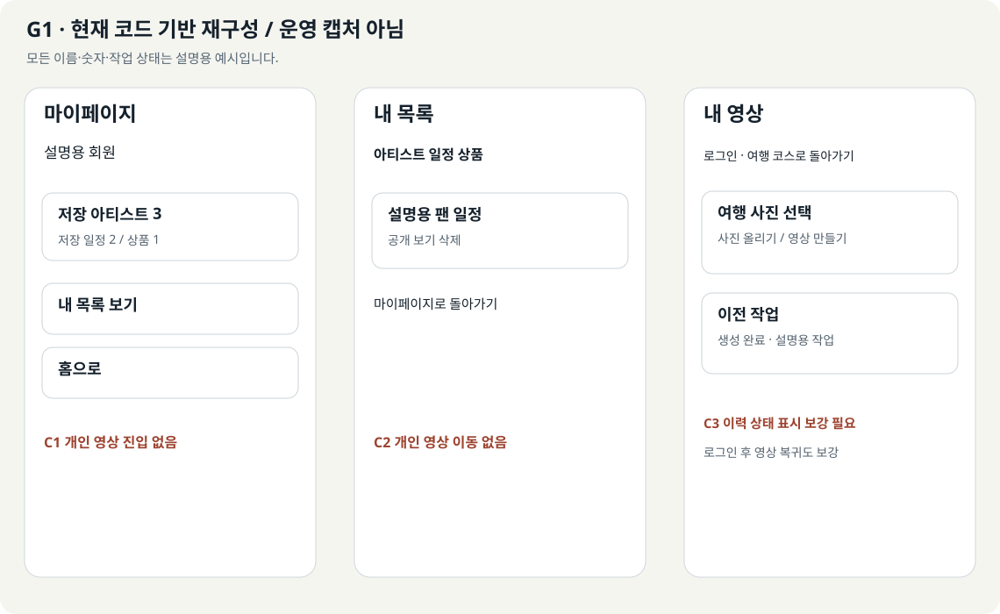
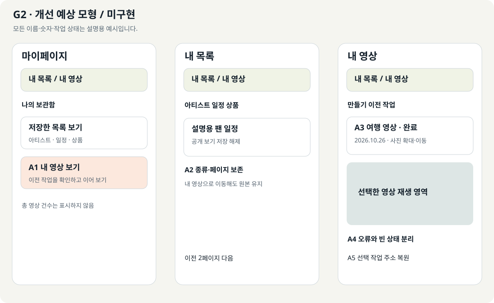
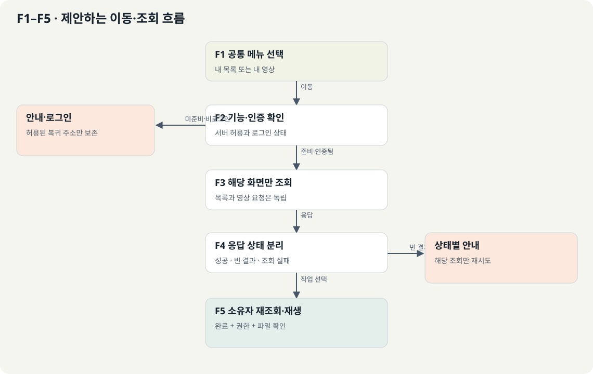
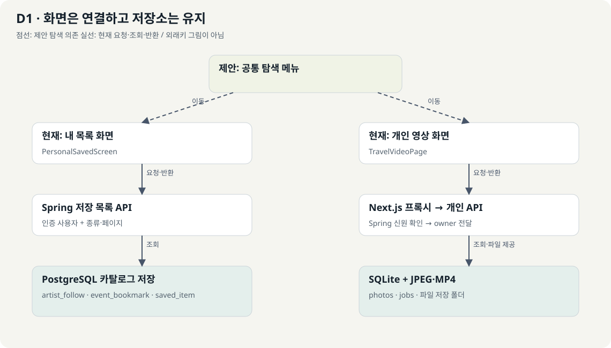
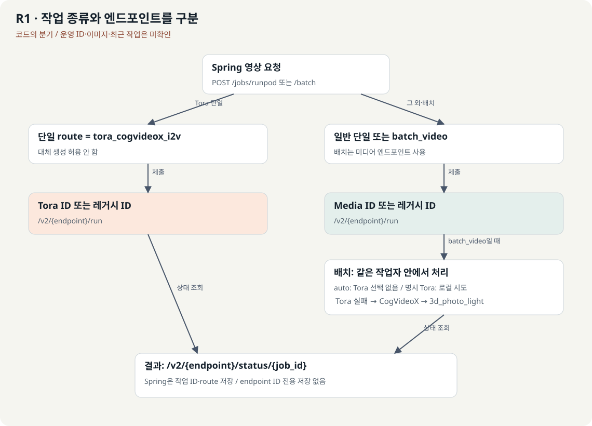

# 내 목록과 내 영상 연결 가이드

**핵심 한 줄: 기존 저장소와 소유권 검사를 유지하고, 내 목록과 개인 영상에 공통 탐색 메뉴·로그인 복귀·조회 상태를 연결한다.**

작성일: 2026-10-26. 소스 기준: KMovement main `46a2d5ae83451befb0fa465acffe96257b7811d6`. 이 main은 직전 분석 이후 문서만 추가됐으며 아래 실행 코드는 PR #299 병합 상태와 같다.

[HTML 보고서](guide.html) · [앞선 저장 경로 조사](../saved-item-media-storage-audit.md)

<a id="scope"></a>
## 1. 목표와 읽는 순서

| 구분 | 이번 가이드의 기준 |
|---|---|
| 제품과 독자 | KMovement에서 저장한 팬덤 정보와 개인 여행 영상을 관리하는 기능. 처음 보는 개발자도 화면에서 API와 저장값까지 따라갈 수 있게 설명한다. |
| 사용자 목표 | 내 목록에서 내 영상으로 이동하고, 로그인 후 돌아와 이전 작업을 재생한다. |
| 결과 형식 | 같은 원고의 HTML·Markdown, 코드 기반 현재 화면, 개선 예상 화면, 편집 가능한 SVG 그림 |
| 현재 완료 | 소스 추적과 가이드 작성. 문서 게시와 문서 자체 검수만 수행한다. |
| 구현 예정 | 공통 메뉴, 로그인 복귀 보강, 개인 영상 조회 상태·주소 복원. 아래 새 파일·함수·쿼리는 제안이다. |
| 범위 | 개인 영상 `/travel/video`와 내 목록·마이페이지 연결. 커뮤니티·Cloudinary 영상 통합은 후속 선택이다. |
| 읽는 순서 | 현재 화면 → 개선 화면 → 기능별 코드 → 인증·조회 계약 → 구현 순서 → 시험·복구 |

API(Application Programming Interface)는 프로그램의 요청·응답 창구, DB(Database)는 데이터베이스다. UI(User Interface)는 화면 구성, UX(User Experience)는 화면을 사용하는 과정이다. SVG(Scalable Vector Graphics)는 확대해도 선명한 그림 파일 형식이다.

[현재 화면](#current) · [개선 화면](#after) · [이동 흐름](#flow) · [함수와 파일](#files) · [로그인 복귀](#login) · [조회 상태](#history) · [API·DB](#contracts) · [구현 순서](#steps) · [시험](#tests)

<a id="current"></a>
## 2. 현재 화면에서 끊기는 부분



**G1은 실제 운영 캡처가 아닌 코드 기반 재구성이다.** 배치와 문구는 소스에서 확인했고, 이름·건수·영상 상태는 설명용 예시다. 운영 기능 활성화나 실제 사용자 데이터를 의미하지 않는다.

| 화면 번호 | 확인한 사용자 동작 | 담당 코드와 실제 결과 | 연결할 부분 |
|---|---|---|---|
| C1 마이페이지 | 아티스트·일정·상품 건수를 누른다 | `ProfileScreen()`이 세 저장 API를 각각 요청하고, 선택한 `kind`로 내 목록 이동. 실패 건수는 숫자 0 대신 미확인 기호로 남김 | 같은 메뉴에 개인 영상 진입 추가. 영상 전체 건수는 현재 API로 계산 불가 |
| C2 내 목록 | 종류·페이지 변경, 보기·삭제·되돌리기 | `PersonalSavedScreen()`이 `identity:kind:page`로 응답을 구분. 공개 항목만 보기 링크 표시. 삭제 후 다시 조회 | 개인 영상으로 가는 메뉴와 돌아올 종류·페이지 보존 |
| C3 개인 영상 | 사진 올리기·영상 만들기·이전 작업 선택 | `TravelVideoPage()`가 업로드·작업·이력을 전용 API로 조회. 완료 시 `videoUrl` 재생 | 마이·내 목록 링크, 로그인 복귀, 이력 상태 분리, 선택 작업 주소 복원 |

현재 개인 영상 화면에는 로그인과 코스 이동 링크만 있다. 이력 배열이 빈 초기 상태에서도 ‘아직 작업 기록이 없습니다’가 표시되고, 실패는 공용 오류 문구로 표시된다. 이전 페이지 결과도 새 조회가 끝날 때까지 남을 수 있다. 이를 ‘조회 성공 후 실제로 비어 있음’과 구분해야 한다.

현재 `safeLoginReturn()`은 홈과 제한된 `/view/...`만 허용한다. `/travel/video`는 기본 마이페이지로 바뀐다. 따라서 로그인 링크에 `returnTo`를 붙이는 수정만으로는 영상 화면 복귀가 완성되지 않는다.

<a id="after"></a>
## 3. 개선 화면: 두 화면을 같은 보관 공간처럼 탐색



**G2는 미구현 개선 예상 모형이다.** 개인 영상은 여전히 전용 API와 SQLite를 사용한다. ‘내 영상’은 이번 범위에서 개인 사진·영상 작업을 뜻한다.

- A1: 마이페이지에 ‘내 영상 보기’를 추가한다. 실제 전송·재생 준비가 된 환경에서만 진입을 노출한다.
- A2: 내 목록과 개인 영상에 ‘내 목록 / 내 영상’ 공통 탐색 메뉴를 둔다. 페이지 이동이므로 링크와 `aria-current="page"`를 사용한다.
- A3: 영상 화면에서 생성과 이력을 시각적으로 구분한다. ‘완료’ 작업만 재생할 수 있고, 실패 작업의 다시 만들기는 별도 쓰기 동작이다.
- A4: 조회 중·실패·빈 목록을 서로 다른 영역으로 표시한다. 일부 조회 실패가 다른 화면을 막지 않게 한다.
- A5: 목록의 종류·페이지와 선택한 영상 작업을 주소로 복원한다. 허용한 값만 읽고 사용자 번호·내부 키·사진 데이터는 주소에 넣지 않는다.

**연결하지 않는 의미:** 저장한 아티스트를 눌렀다고 그 아티스트와 관련된 사진을 자동 판정하지 않는다. 상품 후보 번호를 사진·영상 번호로 변환하지 않는다. 목록 저장 해제는 영상·원본 사진 삭제가 아니다.

<!-- INTERACTIVE_DEMO -->

HTML의 체험 영역은 설명용 모형이다. 버튼은 문서 안의 화면만 전환하며 실제 서비스 요청·업로드·로그인을 하지 않는다. Markdown에서는 G2와 아래 상태 표로 같은 내용을 읽을 수 있다.

<a id="flow"></a>
## 4. 화면 이동과 조회 분기



| 단계 | 입력·판단 | 결과와 화면 위치 |
|---|---|---|
| F1 공통 메뉴 | 사용자가 내 목록 또는 내 영상을 선택 | 허용된 내부 경로로 이동. 이 시점에는 저장·생성 API를 호출하지 않음 |
| F2 기능·인증 확인 | 영상 기능 설정, 로그인 준비·상태 | 기능 준비 중이면 안내. 비로그인이면 복귀 경로를 보존하고 로그인 안내 |
| F3 독립 조회 | 내 목록은 종류·페이지, 내 영상은 페이지·선택 작업 | 각각 자기 API 요청. 서로 순서대로 호출해야 하는 의존 관계 없음 |
| F4 응답 판정 | 성공·빈 결과·401·404·503·통신 실패 | 아래 상태 표에 맞춰 표시. 실패를 빈 목록으로 바꾸지 않음 |
| F5 선택·재생 | 검증된 작업 번호를 상태 API로 조회 | 소유자 검사 통과·완료 상태·재생 주소 확인 후 영상 표시 |

URL(Uniform Resource Locator)은 화면·파일의 주소다. UUID(Universally Unique Identifier)는 전역 고유 식별자로, 개인 영상 작업 번호에 사용된다.

**1차 제안 경로 계약 — 새 쿼리 파싱은 아직 없다.**

| 목적 | 사용할 주소 | 현재/제안 구분 |
|---|---|---|
| 저장 목록 | `/view/KPOP_SAVED_ITEMS?kind=events&page=2` | 현재 지원. 예시는 설명용 |
| 개인 영상 기본 | `/travel/video` | 현재 지원 |
| 영상 이력만 보기 | `/travel/video?view=history&page=2` | 새 파싱·화면 구분 구현 필요 |
| 선택 영상 다시 열기 | `/travel/video?view=history&page=2&job=<UUID>` | 새 구현 필요. 주소의 번호를 믿지 않고 소유자 재조회 |
| 새 영상 만들기 | `/travel/video?view=create` | 새 화면 모드 제안. 실제 생성은 명시적 버튼 클릭 |

1차에서는 내 목록으로 돌아오는 링크의 `kind`·`page`를 URL의 `returnTo`로 보낼 수 있다. 별도 `safePersonalReturn()`을 **새로 구현**해 정확히 마이페이지 또는 내 목록 경로만 허용하고 `kind`·`page`를 정규화한다. 중첩 복귀 경로, 외부 주소, 임의 경로는 마이페이지로 대체한다. 로그인 복귀용 저장값과 개인 화면 간 복귀값은 역할이 다르므로 같은 키를 덮어쓰지 않는다.

<a id="files"></a>
## 5. 핵심 기능과 수정할 파일

현재 파일 이름은 클릭하면 분석 기준 소스로 이동한다. ‘제안’ 행의 파일·함수는 아직 존재하지 않는다.

| 기능 | 파일·함수 | 받는 값 | 처리·반환·부수 효과 |
|---|---|---|---|
| 마이페이지 진입 | [AuthFlowScreen.tsx][profile] / `ProfileScreen()` | 인증 사용자, 세 종류별 `totalCount` | 각 요청은 독립 실행. 건수를 상태에 저장하고 목록 링크 표시. 반환은 화면 요소 |
| 내 목록 | [PersonalSaved.tsx][saved] / `PersonalSavedScreen()` | 인증 문맥, `kind`, `page`, 기존 `returnEvents` | API의 `.data`를 읽어 제목·공개 여부·페이지 표시. 삭제와 복구는 별도 요청 |
| 개인 영상 | [page.tsx][video] / `TravelVideoPage()` | 파일·사진 번호·작업·이력·코스 문맥 | 생성·재시도·이력 요청 후 상태 갱신. 완료 주소는 video 요소에 전달 |
| 공통 탐색 | 제안 `PersonalLibraryNav.tsx` | 활성 화면, 정규화된 목록 주소, 영상 활성 여부 | 링크 반환. 저장·업로드·외부 생성 요청을 하지 않음 |
| 이력 상태 분리 | 제안 `usePrivateVideoHistory.ts` | 인증된 사용자 식별자, 페이지, 갱신 계기 | 요청을 취소·분리하고 성공·빈 결과·오류 상태를 반환. 결과는 메모리에만 보관 |
| 복귀 검증 | [loginReturn.ts][return] / `safeLoginReturn()`, 제안 `safePersonalReturn()` | 사용자가 전달할 수 있는 내부 복귀 주소 | 제한된 경로·쿼리만 반환. 외부 주소를 허용하지 않음 |
| 로그인 완료 복귀 | [AuthContext.tsx][auth] / `consumeLoginReturn()` 사용 구간 | 검증된 로그인·역할, 저장한 복귀 힌트 | 허용된 로그인 완료 위치에서 `router.replace()`. 반환 데이터 없이 이동 효과 |
| 영상 소유자 전달 | [route.ts][proxy] / `proxy()` | 브라우저 요청·쿠키, 서버 설정 | Spring 신원 확인 후 내부 소유자 헤더를 구성하고 응답 스트림 반환 |
| 개인 영상 조회 | [app.py][private] / `history()`, `status()`, `video()` | 검증된 owner, 페이지 또는 UUID | SQLite 조회 또는 FileResponse 반환. 영상 URL은 응답 시 조립 |
| 저장 목록 조회 | [PersonalSavedService.java][savedservice] / `page()` | 종류·페이지·인증 사용자 | 테이블·공개 뷰 조회 후 `items,totalCount,page,pageSize,kind` 반환 |

제안 컴포넌트의 최소 모양이다. 고정 링크 연결 예시이며 상태 보존·플래그·스타일은 해당 단계에서 추가한다.

```tsx
import Link from 'next/link';

type Props = { active: 'saved' | 'videos'; videoEnabled: boolean };

export function PersonalLibraryNav({ active, videoEnabled }: Props) {
  return (
    <nav aria-label="나의 보관함">
      <Link href="/view/KPOP_SAVED_ITEMS"
        aria-current={active === 'saved' ? 'page' : undefined}>
        내 목록
      </Link>
      {videoEnabled && (
        <Link href="/travel/video"
          aria-current={active === 'videos' ? 'page' : undefined}>
          내 영상
        </Link>
      )}
    </nav>
  );
}
```

<a id="login"></a>
## 6. 로그인 후 원래 화면으로 돌아오기

**현재 확인:** `safeLoginReturn()`은 `/travel/video`를 거절하고, `loginReturnLabel()`에는 개인 영상 이름도 없다. `rememberLoginReturn()`은 같은 탭의 힌트를 저장하고 최대 10분 뒤 만료시킨다. 이것은 인증 수단이 아니다.

**수정 제안:** 기존 `/view/...` 허용 규칙을 유지하면서 `/travel/video`만 정확히 허용한다. `/travel/` 전체를 허용하거나 입력 주소를 그대로 이동시키지 않는다.

| 입력 | 기대 결과 — 구현 후 시험할 기준 |
|---|---|
| `/travel/video?view=history&page=2&job=<정상 UUID>` | 허용 쿼리만 보존한 내부 복귀 주소 |
| `https://outside.example/travel/video`, `//outside.example` | 기존 마이페이지 기본값 |
| 역슬래시·제어문자·중첩 복귀 주소 | 거절 또는 허용 쿼리에서 제거 |
| 잘못된 `view`, 음수·문자 페이지 | `history`와 1페이지 등 정한 기본값으로 정규화 |
| 임의 `owner`, 토큰·알 수 없는 쿼리 | 모두 제거 |
| 남의 작업 UUID | 주소 형식이 맞아도 서버 조회 404. 작업 제목·사진을 표시하지 않음 |

`LOGIN_PAGE?returnTo=...`와 복귀 힌트 저장, `safeLoginReturn()` 허용, `loginReturnLabel()` 설명 문구, 로그인 완료 후 실제 이동까지 함께 검증한다. 추가 회원 정보가 필요한 계정의 기존 흐름을 우회하지 않는다.

개인 영상은 클라이언트의 로그인 상태만으로 허용하지 않는다. 실제 조회·사진·재생 요청마다 기존 Next.js 프록시가 Spring `/api/auth/me`를 검증하고 내부 API가 owner를 적용하도록 유지한다. 만료된 쿠키를 갱신해야 한다면 기존 세션 갱신 경로와 조정하며 무한 재시도하지 않는다.

<a id="history"></a>
## 7. 조회 중·빈 결과·실패를 구분하기

현재 개인 영상의 `history: []`와 공용 `error`만으로는 상태를 충분히 표현하지 못한다. 새 이력 훅에서는 인증·페이지별 요청 키와 분명한 조회 상태를 둔다.

| 상태 | 사용자에게 보여줄 것 | 허용 동작 |
|---|---|---|
| 로그인 확인 중 | 계정 확인 중 | 이전 계정 데이터 숨김 |
| 비로그인 / 401 | 로그인 후 볼 수 있음 | 안전한 복귀 경로로 로그인 |
| 기능 준비 중 / 503 | 아직 준비 중 또는 연결 확인 필요 | 마이·내 목록으로 이동. 재배포 상태와 구별 |
| 조회 중 | 이력 뼈대 화면·진행 문구 | 생성 폼과 별개 상태. 오래된 페이지를 현재 결과처럼 표시하지 않음 |
| 조회 성공·결과 0개 | 아직 작업이 없음. 2페이지 이후면 이 페이지의 기록이 없음 | 새 영상 만들기 또는 이전 페이지 |
| 조회 성공·기록 있음 | 작업 상태·생성 시각·처리 방식 | 작업 선택. 총 개수는 추정하지 않음 |
| 통신 실패 | 불러오지 못함 | 해당 이력만 다시 조회. 빈 목록 안내를 동시에 표시하지 않음 |
| 선택 작업 404 | 작업을 찾을 수 없음 | 이력으로 복귀. 타인 소유·삭제 여부를 추측하지 않음 |
| 완료·영상 409 또는 재생 오류 | 아직 재생 불가 또는 파일 확인 필요 | 상태 다시 조회. 완료 배지만으로 재생 성공 처리하지 않음 |

제안 상태 타입의 설명용 예시다.

```ts
type HistoryState<T> =
  | { kind: 'loading'; requestKey: string }
  | { kind: 'ready'; requestKey: string; items: T[]; page: number }
  | { kind: 'error'; requestKey: string; message: string }
  | { kind: 'unauthenticated' }
  | { kind: 'unavailable'; message: string };
```

- 계정·페이지 변경 때 기존 요청을 AbortController로 취소하고, 결과를 반영하기 전 요청 키를 다시 비교한다.
- 계정이 바뀌면 선택 작업·사진·이력·코스의 이전 메모리 상태를 비운다. 브라우저 Blob 미리보기 주소는 해제한다. 코스 토큰은 새 계정에 그대로 적용하지 않는다.
- 조회 실패 재시도는 GET만 반복한다. 영상 생성 POST나 실패 작업 재생성을 자동으로 실행하지 않는다.
- 현재 이력 API는 20개 단위이며 `totalCount`가 없다. 20개 수신을 전체 건수라고 표시하지 않는다. 20개면 다음 페이지가 있을 가능성만 있고, 다음 조회가 비어 있을 수 있다.
- 현재 Next.js 페이지 전달 정규식은 1~9999를 허용하고 개인 API는 10000까지 허용한다. 제안 UI는 1~9999로 맞추고, 향후 범위를 늘릴 때 두 계층을 함께 변경한다.
- 같은 계정 재조회에서 이전 데이터를 잠시 유지하려면 ‘이전 결과’임을 명시한다. 다른 계정·페이지의 데이터를 새 결과로 보이게 해서는 안 된다.

<a id="contracts"></a>
## 8. 응답을 화면에 연결하기

| API·형태 | 실제 응답 필드 | 화면에 쓰는 값·주의 |
|---|---|---|
| GET `/api/v1/kpop/me/saved/{kind}?page=N` | `ApiResponse`의 `data.items`, `totalCount`, `page`, `pageSize`, `kind` | 저장 제목·공개 여부·총 건수·5개 단위 페이지 |
| GET `/api/travel-video/jobs?page=N` | 최상위 `items`, `page` | 개인 영상 이력 20개 단위. `.data.items`로 읽으면 안 됨 |
| GET `/api/travel-video/jobs/{jobId}` | `jobId`, `photoId`, `status`, `createdAt`, `videoUrl`, `trip`, `methodLabel` 등 | 선택 작업을 소유자 검사 후 표시. 완료면 재생 주소 제공 |
| GET `/api/travel-video/jobs/{jobId}/video` | JSON이 아닌 영상 바이트·범위 응답 | 같은 출처의 video 요소에서 재생. 쿠키 기반 인증 유지 |
| POST `/api/travel-video/jobs` | 작업 응답 | 명시적 생성 버튼용. 단순 화면 이동·조회에서는 호출하지 않음 |
| POST `/api/travel-video/jobs/{jobId}/retry` | 재시도 작업 응답 | 실패한 작업의 사용자 요청에만 사용 |

표시값의 단위도 맞춘다. `renderMilliseconds`는 밀리초이므로 1000으로 나누어 초로 표시한다. 현재 SQLite 생성 시각은 UTC(협정 세계시)의 `CURRENT_TIMESTAMP` 문자열이고 응답에 시간대가 붙지 않는다. 제안 조회 계층에서는 형식을 검증한 뒤 UTC임을 명시하고 한국 시간으로 표시한다. 설명용 예시: `2026-10-26 01:00:00` → `2026-10-26T01:00:00Z` → 한국 시간 오전 10시. 브라우저가 임의로 현지 시각으로 해석하게 두지 않는다. 기존 `VideoJob` 타입에도 화면에서 사용할 `createdAt` 등을 명시적으로 추가한다.



실선은 확인된 요청·조회·반환, 점선은 제안한 공통 탐색 의존이다. 실제 SQL 외래키를 뜻하는 선이 아니다. 1차 변경으로 새 DB 테이블을 추가하지 않는다.

| 저장 대상 | 실제 값 | 화면으로 돌아오는 연결 |
|---|---|---|
| `artist_follow`, `event_bookmark`, `saved_item` | 사용자별 카탈로그 번호 | `PersonalSavedService.page()`가 제목·공개 상태를 붙여 내 목록에 반환 |
| SQLite `photos` | UUID·owner·생성 시각 | 작업의 사진과 소유자를 확인하고 사진 API로 제공 |
| SQLite `jobs` | id·owner·photo_id·status·trip_json·render_ms 등 | 이력·상태 API가 화면용 필드로 변환 |
| 같은 저장 폴더 | `{photoId}.jpg`, `{jobId}.mp4` | 인증된 전용 API로 제공 |
| 기존 커뮤니티·Celery | PostgreSQL 영상 URL·결과 JSON | 별도 경로. 이번 공통 메뉴에 자동 섞지 않음 |

`item_ref`는 카탈로그 정수 번호이며 개인 영상 UUID와 다르다. DB 간 owner는 같은 사용자 번호를 뜻하지만 PostgreSQL과 SQLite 사이의 물리적 외래키는 없다. 화면 연결을 위해 저장 후보 행에 영상 URL을 추가하지 않는다.

<!-- INTERACTIVE_MAP -->

<a id="steps"></a>
## 9. 구현 순서와 완료 조건

아래는 실행 가이드이며 아직 서비스에 적용하지 않았다. 각 단계는 독립 커밋으로 검토할 수 있다.

| 순서 | 변경 | 영향·완료 증거 |
|---|---|---|
| P1 공통 이동 | `PersonalLibraryNav.tsx` 추가. `ProfileScreen`, 내 목록·영상 화면에 연결 | 링크만으로 이동하며 기존 저장·삭제·생성 동작 유지. 메뉴가 활성 경로 표시 |
| P2 로그인 복귀 | 복귀 허용 경로·문구·로그인 흐름과 인증 상태 연결 | 비로그인 진입 → 로그인 → 원래 내 영상 모드·페이지 복귀. 외부 경로 거절 |
| P3 이력 상태 | `usePrivateVideoHistory.ts` 제안 구현, 계정별 요청 취소·상태 분리 | 조회 중·실패·빈 결과가 분리되고 계정 전환 시 과거 데이터 제거 |
| P4 주소 복원 | `view,page,job` 및 제한된 개인 화면 `returnTo` 파싱 | 새로고침·뒤로가기 후 선택이 복원됨. UUID는 반드시 서버 재조회 |
| P5 접근성과 활성화 | 모바일 메뉴·키보드·상태 알림·플래그 적용 | 좁은 화면에서도 접근. 기능 꺼짐 안내. 기존 캐시 제외 유지 |
| P6 검수·문서·배포 | 실제 검수 결과 기록 후 배포 절차 진행 | 코드 시험과 실제 로그인·재생을 별도로 기록. 운영 적용 여부를 명시 |

전역 메뉴 [KrideNav.tsx][nav]의 마이 활성 조건에도 `/travel/video`를 포함해 현재 위치를 맞춘다. 현재 코드는 이 주소를 마이로 표시하지 않는다.

기능 노출 조건은 `NEXT_PUBLIC_PHOTO_VIDEO_ENABLED`이고 서버 허용은 `PHOTO_VIDEO_ENABLED`다. 공개 변수는 보통 빌드 때 고정되므로 서버 변수만 바꾸면 화면 버튼까지 바뀐다고 가정하지 않는다. 두 값이 true여도 API·워커·볼륨·인증이 준비됐다는 뜻은 아니다. 내부 키·주소 설정을 확인하고 활성화한다.

현재 PWA(Progressive Web App, 웹 앱을 앱처럼 쓰는 기술) 설정은 내 목록·마이페이지·개인 영상과 관련 GET 요청을 NetworkOnly로 처리한다. 이 규칙과 `private, no-store` 응답을 유지한다. 새 전용 주소를 추가하면 서비스 워커 캐시 제외도 함께 검토한다.

<a id="tests"></a>
## 10. 검수표와 실행 안내

아래 표는 **구현 후 실행할 시험 계획**이다. 문서 모형의 성공을 운영 기능 성공으로 기록하지 않는다.

| 시험 | 입력·상황 | 기대 결과 |
|---|---|---|
| 이동 | 내 목록 이벤트 2페이지 → 내 영상 → 돌아오기 | 허용된 이벤트·페이지 상태 복원 |
| 로그인 | 비로그인으로 영상 이력 주소 진입 | 로그인 후 동일 모드·허용 쿼리 복귀 |
| 주소 제한 | 외부 주소·역슬래시·owner·잘못된 job | 외부 이동 없음, 불필요한 쿼리 제거, 안전한 기본 상태 |
| 소유권 | 계정 A 작업 UUID를 계정 B에서 조회 | 404, A의 사진·상태·URL 표시 없음 |
| 계정 전환 | 늦은 A 응답 직전에 B로 전환 | A 데이터가 B 화면에 반영되지 않음 |
| 조회 상태 | 지연·네트워크 실패·성공 빈 결과 | 조회 중·오류·빈 상태가 각각 표시 |
| 페이지 | 20개 다음 빈 페이지·잘못된 page | 총 건수 추정 없음, 이전 페이지 이동 가능 |
| 작업 선택 | 새로고침·뒤로가기·실패 작업 | 허용 UUID 조회 후 선택 복원. 자동 재시도 없음 |
| 재생 | 완료 작업·없는 파일·Range 요청 | 정상 재생 또는 분명한 오류. 범위 응답·소유권 유지 |
| 독립성 | 목록 저장 해제·조회 재시도 | 사진·영상 삭제 없음, 생성 POST 호출 없음 |
| 활성화 | 공개 버튼·서버 플래그 불일치 | 노출 상태와 준비 오류를 구분. 민감 설정 노출 없음 |
| 모바일·키보드 | 390px 화면·Tab·Enter | 메뉴 접근·현재 위치·오류 안내를 읽을 수 있음 |

Windows PowerShell, 프런트엔드 폴더에서 실행할 기존 회귀시험 예시다. 의존성이 설치된 개발 환경을 사용한다. **이번 문서 작업에서는 앱 회귀시험 통과를 확인하지 않았다.** RunPod 분석 중 별도 라우팅 시험을 시도했으나 초기화가 지연되어 중단했다. 문서 화면 검수와 구분한다.

```powershell
Set-Location D:\KMovement\subproject\SDUI\metadata-project
npx jest tests/components/PersonalSaved.test.tsx tests/components/AuthFlowScreen.test.tsx tests/components/AuthLoginReturn.test.tsx tests/api/travelVideoProxy.test.ts tests/app/travelVideo.test.tsx --runInBand
npx tsc --noEmit --incremental false
```

새 메뉴·새 훅·딥링크·계정 전환 시험은 별도로 추가한다. 위 기존 파일들이 새 기능까지 검증해 주는 것은 아니다. 배포·재시작 후의 실제 로그인 → 이력 선택 → 재생은 별도의 E2E(End-to-End, 처음부터 끝까지 연결한 시험) 결과로 남긴다.

<a id="maintenance"></a>
## 11. 문제 진단과 되돌리기

| 증상 | 먼저 볼 위치 | 확인·조치 |
|---|---|---|
| 로그인 후 마이로 감 | `safeLoginReturn`, 복귀 문구·힌트 소비 | 정확한 영상 경로 허용과 로그인 완료 이동을 확인 |
| 내 영상이 0개로 보임 | 이력 GET과 전용 조회 상태 | 실패를 빈 배열로 변환하지 않았는지 확인 |
| 이전 계정 작업이 잠깐 보임 | 인증 변경·요청 키·선택 상태 | 즉시 메모리 비우기, 요청 취소, 응답 키 검증 |
| 내 목록은 되는데 영상만 실패 | 서버 플래그·프록시·내부 API·볼륨 | 단일 화면 장애로 표시. 목록 기능까지 숨기지 않음 |
| 완료인데 재생 안 됨 | 영상 GET 상태·파일 존재·Range | DB 상태와 파일을 각각 확인. 외부 주소로 우회하지 않음 |
| 링크가 사라지지 않음 | 공개 변수의 빌드값 | 서버 설정과 별개로 재빌드·릴리스 필요 여부 확인 |

연결 UI를 되돌릴 때는 P1~P5 관련 변경 커밋만 되돌린다. 개인 영상 기능 전체 중지가 필요하면 기존 운영 가이드에 따라 서버 플래그·공개 플래그를 따로 처리한다. **화면 되돌리기를 위해 SQLite·사진·영상·저장 후보를 삭제하지 않는다.** 이번 제안은 DB 스키마 변경이 없으므로 DB 하향 마이그레이션도 없다.

HTML은 외부 네트워크 없이 본문·그림·체험을 읽을 수 있다. Markdown은 같은 번호·표·그림을 정적으로 제공한다. 소스 링크와 GitHub 이동만 네트워크를 사용한다.

<a id="verification"></a>
## 12. 이번 문서의 확인 범위

- 확인 완료: 최신 main과 분석 소스의 일치, 화면 진입·실제 호출·응답·저장소 관계의 정적 추적.
- 구현 상태: 본문에서 ‘제안’으로 표시한 파일·쿼리·기능은 미구현. 애플리케이션 코드·운영 DB·배포는 변경하지 않는다.
- 화면 자료: 현재 화면은 코드 기반 재구성, 개선 화면과 체험은 설명용 모형. 실제 로그인 화면 캡처가 아니다.
- 문서 검수 결과: 1440px·390px 폭에서 가로 넘침 없음, 5개 그림과 13개 구역, 내부 목차·키보드 탭 전환·역할 설명 선택·그림 확대 및 Escape 닫기 확인. 외부 요청 0건, JavaScript 오류 0건. 모형의 조회 실패·빈 상태 표시 확인.
- 전제 조사: [저장 경로 조사 보고서](../saved-item-media-storage-audit.md). 그 조사에서 수행한 32개 시험을 이번 새 기능의 통과 실적으로 재사용하지 않는다.

[profile]: https://github.com/feed-mina/KMovement/blob/46a2d5ae83451befb0fa465acffe96257b7811d6/subproject/SDUI/metadata-project/components/screens/AuthFlowScreen.tsx
[saved]: https://github.com/feed-mina/KMovement/blob/46a2d5ae83451befb0fa465acffe96257b7811d6/subproject/SDUI/metadata-project/components/plugins/kpop/PersonalSaved.tsx
[video]: https://github.com/feed-mina/KMovement/blob/46a2d5ae83451befb0fa465acffe96257b7811d6/subproject/SDUI/metadata-project/app/travel/video/page.tsx
[return]: https://github.com/feed-mina/KMovement/blob/46a2d5ae83451befb0fa465acffe96257b7811d6/subproject/SDUI/metadata-project/lib/kride/loginReturn.ts
[auth]: https://github.com/feed-mina/KMovement/blob/46a2d5ae83451befb0fa465acffe96257b7811d6/subproject/SDUI/metadata-project/context/AuthContext.tsx
[proxy]: https://github.com/feed-mina/KMovement/blob/46a2d5ae83451befb0fa465acffe96257b7811d6/subproject/SDUI/metadata-project/app/api/travel-video/%5B...path%5D/route.ts
[private]: https://github.com/feed-mina/KMovement/blob/46a2d5ae83451befb0fa465acffe96257b7811d6/deploy/photo_video/app.py
[savedservice]: https://github.com/feed-mina/KMovement/blob/46a2d5ae83451befb0fa465acffe96257b7811d6/subproject/SDUI/SDUI-server/src/main/java/com/domain/demo_backend/domain/kpop/service/PersonalSavedService.java

[nav]: https://github.com/feed-mina/KMovement/blob/46a2d5ae83451befb0fa465acffe96257b7811d6/subproject/SDUI/metadata-project/components/layout/KrideNav.tsx

<a id="runpod-operations"></a>
## 13. RunPod 운영 경로 추가 분석

분석 기준: 2026-10-26, main `b5822659c7bc0e0adc20cf69f921a23edf191992`. 이전 가이드 작성 이후 애플리케이션 소스 변경은 없다. **아래 표는 현재 코드의 동작이며 실제 운영 계정의 사용 실적과 구분한다.**

### 13.1 먼저 구분할 운영 상태

| 확인 범위 | 이번에 확인한 사실 | 운영 판단 |
|---|---|---|
| GitHub 웹 자동 배포 | [2026-10-26 실행 기록](https://github.com/feed-mina/KMovement/actions/runs/40266168255)의 웹 배포 성공 | 웹 릴리스 증거. RunPod 작업자·GPU·엔드포인트 활성 증거는 아님 |
| Hostinger 서비스 구성 | Spring은 [`hostinger-g1`][rp-profile], FastAPI 주소 기본값은 `disabled-fastapi`. 별도 CPU 서비스는 `src.api.cpu_app:app` 실행 | 코드상 분리 구성. 운영의 환경 덮어쓰기·활성 이미지는 미확인 |
| CPU 서비스 라우트 | [`cpu_app.ALLOWED`][rp-cpu]가 코스·조회·채팅 등만 포함. `/jobs/runpod`·`/jobs/runpod/batch`·`/jobs/runpod/{job_id}` 없음 | CPU 서비스가 켜져 있어도 RunPod 게이트웨이가 열린 것은 아님 |
| EC2 배포 구성 | Spring의 `FASTAPI_URL`·`KRIDE_FASTAPI_URL`, FastAPI의 RunPod 키·세 엔드포인트 변수를 주입하는 코드가 존재 | 과거·별도 배포 경로의 설계 증거. 현재 EC2 실행 상태는 미확인 |
| 운영 서버 직접 조회 | SSH 연결이 현재 실행 환경에서 차단됨. 공개 상태 URL도 조회 도구에서 접근 불가 | 컨테이너 환경값·실제 Spring 접속 대상·운영 DB 작업 건수는 확인하지 못함 |
| RunPod 콘솔 | Serverless 페이지 접근 시 로그인 필요 화면 확인 | 엔드포인트 ID·연결 이미지·현재 작업자·최근 성공 작업은 미확인 |

따라서 **현재 Tora·미디어 엔드포인트가 운영에서 정상 사용 중이라는 결론은 아직 낼 수 없다.** 반대로 미사용·중지 상태라고 확정할 근거도 없다. 웹 배포 성공, 이미지 빌드 성공, 외부 생성 성공은 각각 다른 증거다.

### 13.2 단일 영상과 배치의 실제 분기

엔드포인트(endpoint)는 요청을 받는 실행 창구다. 여기서 `route`는 작업 종류, `photo_route`는 배치 안의 사진 처리 방식이다. 같은 필드가 아니다. I2V(Image-to-Video)는 사진을 입력해 영상을 만드는 방식이다.

| 화면·요청 | 최상위 작업 종류 | 제출할 엔드포인트 변수 | 작업자 내부 동작·판정 |
|---|---|---|---|
| 단일 Tora 버튼 | `route=tora_cogvideox_i2v` | `RUNPOD_TORA_ENDPOINT_ID` | 첫 번째 비낙서 사진과 궤적 프리셋. Spring이 `allow_fallback=false` 전송 |
| 단일 사진 AI 버튼 | `route=cogvideox_real` | `RUNPOD_MEDIA_ENDPOINT_ID` | CogVideoX 계열 실행. 대체 경로 허용 요청 |
| 단일 스케치·캐릭터 | `route=animated_drawings_worker` | `RUNPOD_MEDIA_ENDPOINT_ID` | 마지막 낙서 사진 우선. 없으면 첫 번째 비낙서 사진 사용 |
| 단일 3D 모션 | `route=3d_photo_inpainting_real` | `RUNPOD_MEDIA_ENDPOINT_ID` | 깊이·카메라 이동 계열 실행 |
| 현재 화면의 배치 버튼 | `route=batch_video`, `photo_route=auto` | **항상 미디어 변수** | 배치 작업자 안에서 사진·스케치를 분류하고 합성 |
| API로 Tora 배치를 명시 | `route=batch_video`, `photo_route=tora_cogvideox_i2v` | **여전히 미디어 변수** | 미디어 작업자 안에서 Tora 함수 실행 시도. 전용 Tora 엔드포인트로 다시 보내지 않음 |
| 신규 개인 영상 `/travel/video` | RunPod route 없음 | 사용하지 않음 | 개인 CPU 작업자가 FFmpeg로 영상 생성 |

근거: [커뮤니티 화면][rp-ui], [Spring 영상 서비스][rp-spring], [FastAPI 프록시][rp-api], [배치 작업자][rp-batch]. 현재 커뮤니티 진입 링크를 숨긴 정책도 유지되고 있어, 화면 코드의 존재만으로 사용자가 운영에서 도달한다고 단정하지 않는다.



R1은 **소스 기준 실행 분기**다. 운영에 두 엔드포인트가 실제로 분리되어 있다는 의미가 아니다.

### 13.3 현재 배치 자동 선택에서는 Tora가 나오지 않는다

`CommunityPage.submitBatchAnimation()`이 `photoRoute='auto'`를 명시적으로 전달한다. 서비스 기본값 `cogvideox_real`과 혼동하면 안 된다.

1. FastAPI가 최상위 `batch_video`를 미디어 엔드포인트에 제출한다.
2. `run_batch_video_case()`가 이미지를 사진·스케치로 분류한다.
3. 사진의 `_resolve_photo_route()`는 설명 문구를 만든 뒤 `route_media_motion()`을 호출한다.
4. [이 호출의 라우터][rp-router]는 `has_trajectory=True`를 전달하지 않는다. 라우터는 궤적이 있을 때만 Tora를 고르므로 현재 자동 분기에서는 Tora가 선택되지 않는다.
5. 동적 피사체 키워드는 CogVideoX, 정적 사진은 `3d_photo_light`, 그림 계열은 AnimatedDrawings로 갈 수 있다. 설명 생성 기능이 꺼져 있거나 실패하면 사진 경로는 CogVideoX로 기본 처리한다.

API는 Tora를 배치 사진 방식으로 허용하지만, 현재 화면 자동 선택이 그 방식을 사용한다는 뜻은 아니다. 또한 배치 화면은 최소 2장부터 열리지만 서버 DTO는 1~10장을 허용한다. 화면 조건과 서버 허용 범위도 구분한다.

### 13.4 배치 Tora의 운영상 주의점

Tora 배치를 명시하면 `_generate_photo_segment()`가 같은 작업자에서 `create_tora_cogvideox_video()`를 호출한다. 실패하면 CogVideoX를 시도하고, 다시 실패하면 `3d_photo_light`로 이어진다. 이 분기의 예외 처리에는 `cfg.allow_fallback` 확인이 없다.

따라서 다음과 같이 판정해야 한다.

- 단일 Tora: Spring이 대체 생성을 끄므로 Tora 처리 실패를 다른 모델 완료로 조용히 바꾸지 않도록 요청한다. 실제 RunPod의 이미지·설정 일치 여부는 별도 검증이 필요하다.
- Tora 배치: Tora가 실패해도 다른 방식으로 완성될 수 있다. **배치 COMPLETED를 Tora 성공으로 해석하면 안 된다.**
- 배치 메타데이터의 `actual_models`, `actual_model`, `photo_route`, `processed_images`, `failed_image_indexes`를 함께 확인한다. 현재 배치 결과는 `actual_model_executed`를 별도로 채우지 않으며, 실제 처리 모델과 요청 모델의 차이를 모든 경우에 공통 폴백 필드로 표시하는 구조도 아니다.
- Spring은 `actual_model` 등 일부 요약을 저장하지만 이미지별 `actual_models` 전체를 전용 컬럼에 보존하지 않는다. 배치 내부의 상세 생성 이력까지 DB에 남는다고 가정하지 않는다.

### 13.5 엔드포인트 ID 설정과 결과 조회

두 게이트웨이 모두 Tora·미디어 전용 변수가 비어 있으면 `RUNPOD_ENDPOINT_ID`를 대신 사용한다. 전용 변수 이름이 둘이라는 이유만으로 실제 GPU 창구도 둘이라고 볼 수 없다. 두 ID가 같거나 모두 레거시 ID를 사용하면 같은 창구로 간다.

| 구분 | 코드의 실제 처리 |
|---|---|
| 제출 | `/jobs/runpod` → 종류에 맞는 ID → `POST https://api.runpod.ai/v2/{endpoint}/run` |
| 배치 제출 | `/jobs/runpod/batch` → 미디어 ID → 같은 RunPod `/run`, 본문 최상위 종류는 `batch_video` |
| Spring 결과 조회 | 저장한 `runpod_job_id`로 게이트웨이 `GET /jobs/runpod/{job_id}` 호출 |
| 실제 RunPod 결과 조회 | `GET https://api.runpod.ai/v2/{endpoint}/status/{job_id}`. `status`도 엔드포인트 아래 경로임 |
| 전체 FastAPI의 탐색 순서 | 미디어 → Tora → 레거시. 빈 ID·중복 ID 제거 |
| [별도 Cloud Gateway][rp-gateway]의 탐색 순서 | Tora → 미디어 → 레거시. 빈 ID·중복 ID 제거 |
| 명시적 endpoint 조회 | 전체 FastAPI는 내부 요청의 `endpoint` 인자로 지정 가능하지만 현재 Spring 호출은 사용하지 않음 |

핵심 한계는 `submitToGateway()`가 제출 응답의 엔드포인트 정보를 DB에 저장하지 않고 **작업 ID와 route만 저장**한다는 점이다. 설정이 바뀐 후 예전 작업을 조회하면 현재 설정된 ID들을 탐색한다. 기존 엔드포인트를 목록에서 제거하면 과거 작업을 찾지 못할 수 있다.

개선이 필요하면 신규 작업부터 제공업체·엔드포인트 식별자·이미지 버전·요청 모델·실행 모델을 기록하고, 과거 작업은 기존 탐색을 유지하는 방식이 최소 변경이다. 이번에는 스키마·코드를 바꾸지 않았다.

### 13.6 이미지 빌드 성공과 운영 적용은 다르다

| 구성 | 소스에서 확인한 역할 | 아직 필요한 운영 증거 |
|---|---|---|
| [Dockerfile.tora][rp-toraimage] | Tora 전용 런타임, Tora 저장소·체크포인트·VAE·T5 경로. 시작 스크립트가 필요한 파일을 검증 | 실제 엔드포인트의 이미지 digest, 마운트·파일 존재, 기동 로그 |
| [Dockerfile.runpod][rp-mediaimage] | 미디어 작업자. TorchServe·Redis·Celery·RunPod handler를 관리 | 실제 미디어 이미지와 활성 프로세스·모델 가용성 |
| [Tora][rp-torawf]/[Media][rp-mediawf] GitHub 워크플로 | 각각 Docker 이미지 `latest`·커밋 태그를 레지스트리에 게시 | RunPod 엔드포인트가 그 이미지를 선택했는지. 워크플로 자체는 엔드포인트를 자동 교체하지 않음 |
| `.runpod/hub.json` | 저장소에 선언한 설정 자료 | 실제 계정의 엔드포인트·작업자 수·GPU·볼륨이 일치하는지는 별도 확인 |

일반 미디어 Dockerfile에서 전용 Tora 저장소·체크포인트를 설치하는 단계는 확인되지 않았다. 별도 볼륨·이미지·환경 덮어쓰기가 없다면 미디어 작업자에서 명시적 Tora 배치를 성공시킬 전제가 부족할 수 있다는 **추론**이다. 실제 미디어 엔드포인트가 무엇을 실행 중인지 확인하기 전에는 실패를 확정하지 않는다.

### 13.7 운영 확정에 필요한 최소 증거

RunPod 로그인과 운영 읽기 권한이 확보되면 새 과금 작업을 제출하지 않고 기존 정보부터 확인한다.

1. 운영 Spring의 활성 프로필과 **실효** `kride.fastapi.url`, 대상 서비스의 실행 모듈이 전체 FastAPI·Cloud Gateway·CPU 앱 중 무엇인지.
2. Tora·미디어·레거시 변수의 설정 여부와 동일 ID 여부. 보고서에는 키 원문을 쓰지 않고 별칭으로 표시.
3. 각 RunPod 엔드포인트의 연결 이미지 digest·GPU·볼륨·활성 작업자·최소/최대 작업자 설정.
4. 최근 기존 단일 Tora·일반 영상·배치의 요청 종류·엔드포인트·완료 시각·결과·실행 모델. 다른 사용자의 사진·본문·인증정보는 수집하지 않음.
5. PostgreSQL 작업의 `route`, `status`, `runpod_job_id`, `actual_model`, `actual_model_executed`, 결과 URL 보존 상태를 기존 외부 기록과 대조.
6. 개인 영상은 별도로 SQLite/FFmpeg 경로인지 확인하고, 위 RunPod 사용량과 섞어 집계하지 않음.

**현재 남은 확인:** RunPod 콘솔 로그인과 운영 설정·기존 작업 기록 조회다. 확인 전까지 운영 사용률·실행 성공률·사용 엔드포인트 수는 수치로 제시하지 않는다.

### 13.8 연결 가이드에 반영할 결정

- 내 목록 ↔ 개인 영상의 P1~P5는 기존 SQLite·FFmpeg 경로로 계속 설계한다. RunPod 운영 확인을 완료 조건으로 잘못 묶지 않는다.
- 외부 AI 생성 도입은 운영 게이트웨이와 실제 이미지·모델 성공 증거부터 확보한 뒤 별도 단계로 둔다.
- Tora 배치가 필요하면 전용 실행을 조정하는 구조를 설계하거나 검증된 작업자에만 허용한다. 현재 미디어 배치에서 Tora를 요청했다는 사실만으로 Tora 완료를 표시하지 않는다.
- 엔드포인트와 실행 이미지·모델의 이력 보존은 신규 작업부터 추가하는 방안을 검토하고, 기존 작업은 현재 탐색 방식으로 호환한다. 이번 분석에서는 실제 적용하지 않았다.

[rp-ui]: https://github.com/feed-mina/KMovement/blob/b5822659c7bc0e0adc20cf69f921a23edf191992/subproject/SDUI/metadata-project/components/community/CommunityPage.tsx
[rp-spring]: https://github.com/feed-mina/KMovement/blob/b5822659c7bc0e0adc20cf69f921a23edf191992/subproject/SDUI/SDUI-server/src/main/java/com/domain/demo_backend/domain/community/service/AnimationService.java
[rp-api]: https://github.com/feed-mina/KMovement/blob/b5822659c7bc0e0adc20cf69f921a23edf191992/src/api/fastapi_server.py
[rp-batch]: https://github.com/feed-mina/KMovement/blob/b5822659c7bc0e0adc20cf69f921a23edf191992/deploy/media_motion/batch_video_worker.py

[rp-cpu]: https://github.com/feed-mina/KMovement/blob/b5822659c7bc0e0adc20cf69f921a23edf191992/src/api/cpu_app.py
[rp-profile]: https://github.com/feed-mina/KMovement/blob/b5822659c7bc0e0adc20cf69f921a23edf191992/subproject/SDUI/SDUI-server/src/main/resources/application-hostinger-g1.yml
[rp-toraimage]: https://github.com/feed-mina/KMovement/blob/b5822659c7bc0e0adc20cf69f921a23edf191992/deploy/media_motion/Dockerfile.tora
[rp-mediaimage]: https://github.com/feed-mina/KMovement/blob/b5822659c7bc0e0adc20cf69f921a23edf191992/deploy/media_motion/Dockerfile.runpod
[rp-torawf]: https://github.com/feed-mina/KMovement/blob/b5822659c7bc0e0adc20cf69f921a23edf191992/.github/workflows/deploy-runpod-tora.yml
[rp-mediawf]: https://github.com/feed-mina/KMovement/blob/b5822659c7bc0e0adc20cf69f921a23edf191992/.github/workflows/deploy-runpod.yml
[rp-gateway]: https://github.com/feed-mina/KMovement/blob/b5822659c7bc0e0adc20cf69f921a23edf191992/deploy/cloud_gateway/app.py
[rp-router]: https://github.com/feed-mina/KMovement/blob/b5822659c7bc0e0adc20cf69f921a23edf191992/deploy/media_motion/routers.py
