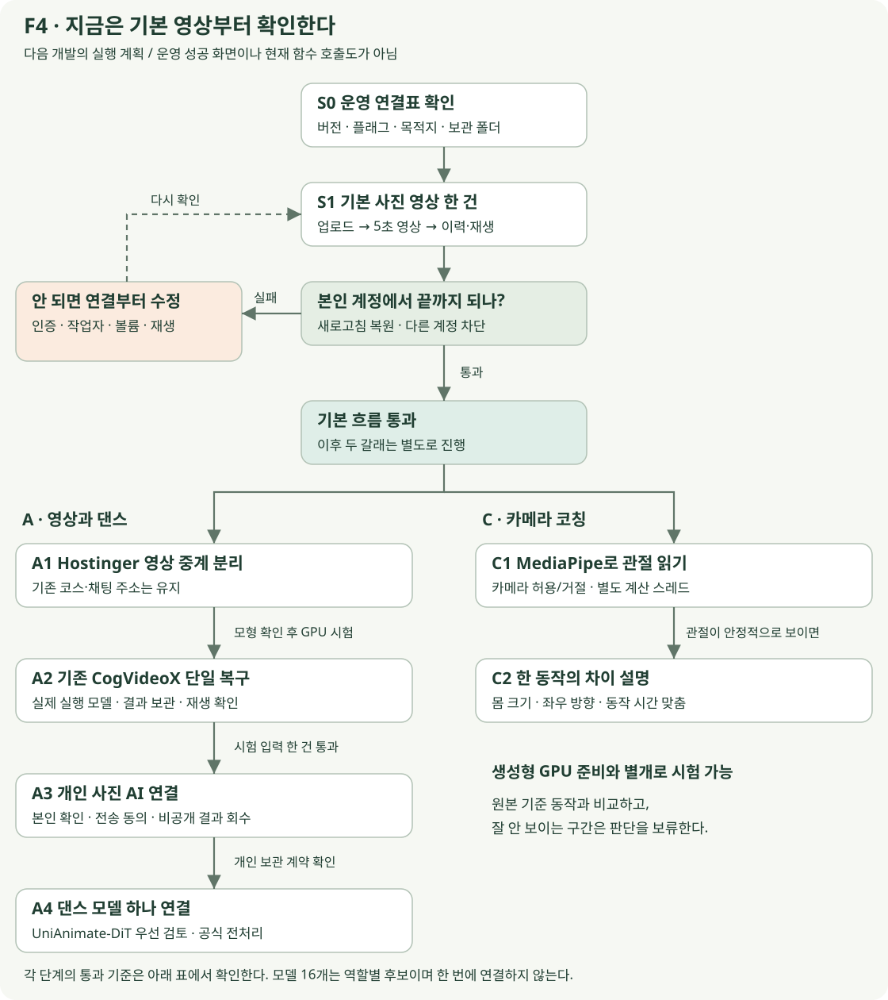

# 기존 영상을 되살리고 댄스와 코칭을 연결하는 방법 — 자연어 해설

**공개 모델 16개 계열의 역할과 전체 실행 계획을 쉬운 말로 풀어쓴 보고서다.** 각 모델에 무엇을 넣는지, 무엇이 나오는지, KMovement에서 어디에 쓸 수 있는지를 설명한다.

[이 보고서 HTML](models-explained.html) · [원래 기술 보고서](README.md) · [코드 자연어 해설](code-explained.md)

## 1. 앞선 자연어 보고서에 들어 있던 범위

앞선 코드 자연어 해설에는 사진 업로드·작업 생성·저장·재생, Hostinger 설정, 새 모델을 붙이는 개념이 들어 있다. 그러나 공개 모델 16개 각각의 역할은 원래 기술 보고서 링크로 안내했다. 따라서 모델별 전체 설명은 그 보고서에 포함되어 있지 않았다.

이 문서는 그 빈 부분을 채우면서 원래 보고서의 서버 이전·모델 조합·개발 순서까지 함께 설명한다. 2026-10-26에 작성한 원래 보고서의 조사 결과와 같은 소스 기준을 사용한다. 모델을 새로 실행하거나 성능을 측정한 보고서는 아니다.

“16개”는 원래 비교표의 묶음 기준이다. LTX-Video와 후속 LTX-2는 한 계열로 센다. 포즈 추출 도구도 포함하므로 16개 모두가 사진을 영상으로 만드는 생성 모델인 것은 아니다.

## 2. 먼저 네 종류의 일을 구분한다

| 할 일 | 쉬운 설명 | 해당 묶음 |
|---|---|---|
| 사진 속 사람을 춤추게 하기 | 사진의 외모를 참고하고 별도 동작의 자세를 따라 영상을 만든다. | UniAnimate-DiT, MimicMotion, MusePose, Champ, Moore-AnimateAnyone |
| 일반 사진에 움직임 만들기 | 사진과 움직임 설명을 바탕으로 다음 장면들을 만든다. | CogVideoX, Wan2.1, LTX, HunyuanVideo-I2V |
| 얼굴 표정·말하는 모습 만들기 | 얼굴 사진에 표정을 옮기거나 음성에 맞는 말하는 영상을 만든다. | LivePortrait, Hallo3, Hallo2 |
| 자세를 읽고 비교하기 | 영상에서 관절이나 몸의 움직임을 찾는다. 점수 계산은 별도다. | MMPose, MediaPipe, GVHMR, WHAM |

GPU(Graphics Processing Unit)는 큰 영상 계산을 하는 장치다. 포즈는 관절의 위치·방향으로 표현한 자세다. 가중치는 모델이 학습한 숫자 파일이며, 추론은 그 숫자를 이용해 새 결과를 만드는 실행이다.

## 3. UniAnimate-DiT — 사진 속 사람에게 다른 영상의 동작을 입히기

[공식 저장소](https://github.com/ali-vilab/UniAnimate-DiT)

기준 인물의 사진과 움직임을 알려 주는 포즈 자료를 받는다. 사진은 “누구처럼 보이게 할지”, 포즈는 “어떻게 움직일지”를 알려 준다. 결과는 사진 속 인물의 모습을 참고해 동작을 수행하는 영상이다.

KMovement에서는 사용자가 올린 전신 사진과 사용 허락된 안무를 연결하는 댄스 생성 후보로 쓸 수 있다. 먼저 저장소가 제공하는 포즈 준비 방법과 추론 예제를 그대로 재현한 뒤 서비스에 연결한다.

**설명용 예시:** 사용자가 전신 사진과 준비된 짧은 팔 동작을 고르면 그 외모를 참고한 동작 영상을 만든다. 사진에 없는 몸 부분이나 가려진 얼굴이 정확히 유지된다는 보장은 없다.

원래 보고서에서 댄스 우선 후보로 제안했지만 실제 품질 비교를 끝냈다는 뜻은 아니다. 공식 예제의 특정 설정에서는 480p 약 23GB, 720p 약 36GB의 GPU 메모리를 안내한다. 이를 모든 길이·설정·학습에 공통인 수치로 사용하지 않는다.

## 4. MimicMotion — 같은 댄스 목적을 다른 방식으로 시험하기

[공식 저장소](https://github.com/Tencent/MimicMotion)

사진과 동작 안내를 이용해 사람의 움직이는 영상을 만든다. 자세 추정 결과가 얼마나 믿을 만한지 반영하는 방식과 여러 구간의 움직임을 이어 가는 처리가 특징이다.

KMovement에서는 UniAnimate-DiT와 같은 사진·동작을 넣어 비교할 대안이다. 두 모델을 무조건 연달아 통과시키기보다 각각 만든 결과의 얼굴·손·배경·움직임을 비교한다.

**설명용 예시:** 같은 사진과 안무로 두 모델을 각각 실행하고, 손이 덜 깨지고 배경이 덜 흔들리는 쪽을 고른다. 긴 동작을 다룰 수 있다는 설명이 즉시 생성된다는 뜻은 아니다. 코드의 공개 조건과 기반 모델·가중치의 사용 조건도 따로 확인한다.

## 5. MusePose — 사진과 안무의 몸 비율 차이를 맞춰 보기

[공식 저장소](https://github.com/TMElyralab/MusePose)

기준 사진과 동작 영상의 몸 비율 차이를 조절하는 포즈 정렬 과정과, 그 자세를 따라 영상을 만드는 기능을 제공한다. 여기서 정렬은 동작을 사진 속 몸에 적용하기 좋게 맞추는 일이다.

KMovement에서는 다양한 체형의 사진을 처리할 때 어떤 전처리가 필요한지 연구하는 데 유용하다. 다만 이 저장소의 정렬 결과가 다른 모델에도 그대로 맞는다고 판단하면 안 된다. 관절 순서와 그림 크기 등을 확인해야 한다.

**설명용 예시:** 팔 길이가 다른 인물의 동작을 참고할 때 사진의 몸 비율에 맞춰 자세 안내를 조정한다. 원래 조사에서는 코드와 공개 학습 가중치의 조건이 달랐다. 코드는 MIT지만 공개 가중치는 비상업 연구용이라고 안내하므로 서비스에 바로 적용할 모델로 확정하지 않는다.

## 6. Champ — 평면 관절뿐 아니라 몸의 입체 정보도 사용하기

[공식 저장소](https://github.com/fudan-generative-vision/champ)

몸의 관절점만 사용하는 것에서 더 나아가 깊이·표면 방향·몸 부위 같은 안내 자료를 함께 사용한다. 깊이는 무엇이 앞뒤에 있는지, 표면 방향은 몸의 어느 면이 어느 쪽을 향하는지 알려 준다.

KMovement에서는 몸을 돌리거나 팔과 다리가 겹치는 장면을 연구할 후속 후보로 볼 수 있다. 필요한 입체 자료를 준비하는 단계도 개발해야 하므로 단순 사진 한 장만 넣는 연결보다 복잡하다.

**설명용 예시:** 옆으로 돌아서는 동작을 만들 때 몸의 입체 방향을 안내 자료로 제공한다. 입체 자료를 쓴다는 이유만으로 모든 회전 장면의 품질이 보장되는 것은 아니다.

## 7. Moore-AnimateAnyone — 인물 모습과 자세를 결합하는 구조 배우기

[공식 저장소](https://github.com/MooreThreads/Moore-AnimateAnyone)

사진의 모습을 참고하는 부분과 움직임을 안내하는 부분을 연결한 구현이다. “외모 유지”와 “자세 제어”를 프로그램 안에서 어떻게 나누는지 살펴볼 수 있다.

KMovement에서는 직접 구조를 이해하거나 작은 실험을 설계할 때 참고한다. 원래 보고서는 이를 학습·비교용 후보로 분류했으며, 바로 운영에 넣을 최상위 품질 모델로 확정한 것은 아니다.

**설명용 예시:** 개발자가 기준 사진을 참고하는 처리와 포즈를 읽는 처리를 따로 살펴보고, 자신의 모델 연결 코드에 어떤 역할이 필요한지 정리한다.

## 8. CogVideoX — 기존 여행 사진 AI 연결부터 살리기

[공식 저장소](https://github.com/zai-org/CogVideo)

사진과 문장으로 적은 움직임 지시를 바탕으로 영상을 만드는 계열이다. 춤의 정확한 관절 순서를 따라가는 전용 기능과 일반적인 사진 움직임 생성은 구분해야 한다.

KMovement에는 이미 cogvideox_real이라는 실행 경로가 있어 기존 연결을 복구할 때 먼저 살펴볼 수 있다. 여기서 “복구”는 화면 버튼뿐 아니라 작업 접수·결과 저장·재생까지 연결하는 일이다. 현재 개인 영상 화면은 FFmpeg로 사진을 확대·이동하는 방식이며 이 AI 경로와 직접 연결되지 않았다.

**설명용 예시:** 해변 사진을 입력하고 “카메라가 천천히 앞으로 이동한다”는 지시로 짧은 클립을 만든다. 현재 구현에 파일이 있다는 사실만으로 운영 생성이 성공한다고 판단하지 않는다. 모델 크기·버전별 사용 조건도 구분한다.

## 9. Wan2.1 — 같은 여행 사진을 다른 생성 모델과 비교하기

[공식 저장소](https://github.com/Wan-Video/Wan2.1)

일반 사진과 문장 설명을 이용한 영상 생성 후보다. KMovement에서는 CogVideoX와 같은 입력으로 결과를 비교해 장소 보존·인물 표현·움직임이 어느 쪽에서 나은지 확인한다.

**설명용 예시:** 같은 건물 사진에서 천천히 옆으로 이동하는 클립을 각각 만든 뒤 간판이나 건물 모양이 얼마나 유지되는지 비교한다. 한 모델의 결과를 다른 모델에 다시 넣으면 원래 장소가 더 바뀔 수 있어 먼저 독립 비교를 권장한다.

원래 보고서에서 강조한 점은 메모리 수치를 다른 작업에 옮겨 쓰지 않는 것이다. 작은 텍스트→영상 모델의 메모리 사례를 사진→영상 모델의 요구량으로 설명하면 안 된다. 사진→영상의 실제 가중치와 설정을 기준으로 확인한다.

## 10. LTX-Video·LTX-2 — 빠른 미리보기를 비교할 계열

[LTX-Video](https://github.com/Lightricks/LTX-Video) · [LTX-2](https://github.com/Lightricks/LTX-2)

영상 생성에 걸리는 시간을 줄이는 방향의 후보로 살펴볼 수 있다. 원래 조사 당시 LTX-Video 문서는 LTX-2를 주 개발 저장소로 안내하고 있었다. 이 보고서는 두 저장소를 하나의 LTX 계열로 묶어 설명한다.

KMovement에서는 완성본을 오래 기다리기 전에 짧은 미리보기를 제공할 수 있을지 비교한다. 다만 “빠른 모델”이라는 소개만으로 사용자의 GPU나 긴 대기열에서도 빠르다고 약속하지 않는다.

**설명용 예시:** 사진에서 만들 움직임을 짧은 클립으로 확인하고, 사용자가 계속 진행할지 선택하는 실험을 한다. 예전 모델의 속도·사용 조건·연결 도구를 후속 모델에 그대로 적용하지 않는다.

## 11. HunyuanVideo-I2V — 고해상도 결과를 후속으로 비교하기

[공식 저장소](https://github.com/Tencent-Hunyuan/HunyuanVideo-I2V)

사진을 바탕으로 움직이는 영상을 만들고 특정 효과를 위한 미세학습도 살펴볼 수 있는 후보다. KMovement에서는 상품·인물·관광 장면의 고해상도 결과를 연구하는 후속 단계에 둔다.

**설명용 예시:** 먼저 작은 시험에서 생성 품질을 확인한 뒤 홍보용 장면의 품질을 다른 모델과 비교한다. 원래 조사에서 공식 기본 구성은 720p 최소 60GB·권장 80GB GPU 메모리를 안내했다. 별도 경량화 시험 없이 작은 GPU에서도 된다고 설명하지 않는다.

사진 한 건의 생성 성공과 여러 사용자의 요청을 안정적으로 처리하는 서비스 운영은 별도 평가가 필요하다.

## 12. LivePortrait — 얼굴의 표정과 고개 움직임을 옮기기

[공식 저장소](https://github.com/KlingAIResearch/LivePortrait)

기준 얼굴 사진에 다른 영상 등의 표정과 고개 움직임을 옮기는 데 쓰는 도구다. 눈·입의 움직임과 원래 화면으로 자연스럽게 붙이는 처리를 살펴볼 수 있다.

KMovement에서는 얼굴이 충분히 크고 잘 보이는 경우에 선택적으로 시험한다. 전신 댄스에서 작게 보이거나 가려진 얼굴을 항상 복원하는 만능 보정기로 이해하면 안 된다.

**설명용 예시:** 같은 댄스 결과의 얼굴 처리 전후를 비교하고, 목 경계·입·흔들림이 나빠지면 원본을 선택한다. 도구 코드와 얼굴 검출용 부속 가중치의 조건이 다를 수 있다. 원래 조사에서 InsightFace 검출 가중치의 비상업 조건과 교체 필요성을 확인했다.

## 13. Hallo3 — 얼굴 사진과 음성으로 말하는 영상 만들기

[공식 저장소](https://github.com/fudan-generative-vision/hallo3)

얼굴 사진과 음성을 받아 그 음성에 맞춰 말하는 인물 영상을 만드는 후보다. 댄스 동작을 만드는 일과는 입력·목적이 다르다.

KMovement에서는 여행 안내 캐릭터가 코스나 장소를 설명하는 독립 기능에 활용할 수 있다. 댄스 생성마다 반드시 거쳐야 할 단계로 넣을 필요는 없다.

**설명용 예시:** 사용 허락된 얼굴 사진과 직접 준비한 장소 설명 음성으로 짧은 안내 영상을 만든다. 사진 속 인물의 실제 발언으로 오인되지 않게 표현하며, 기반 CogVideo 계열 등 함께 사용하는 모델의 조건도 확인한다.

## 14. Hallo2 — 긴 음성 안내와 고해상도 얼굴 영상 연구하기

[공식 저장소](https://github.com/fudan-generative-vision/hallo2)

긴 음성을 다루는 얼굴 영상과 고해상도 처리 과정을 살펴볼 수 있다. Hallo3와 함께 안내 영상 목적에서 비교할 후보다. 버전 숫자만으로 모든 상황에서 더 좋은 모델이라고 판단하지 않는다.

KMovement에서는 긴 여행 설명 영상이 실제로 필요해졌을 때 시험한다. 춤 영상 전체를 넣으면 자동으로 고화질로 고쳐 주는 범용 편집기로 이해하면 안 된다.

**설명용 예시:** 여러 장소를 설명하는 긴 음성에서 얼굴 모습이 끝까지 유지되는지 확인한다. 고해상도 처리에 포함된 다른 도구의 사용 조건도 별도로 확인한다.

## 15. MMPose — 영상에서 관절 위치를 읽는 서버 도구

[공식 저장소](https://github.com/open-mmlab/mmpose)

사람의 몸에서 어깨·팔꿈치·무릎 같은 관절이 어디에 있는지 추정한다. 움직이는 영상을 읽으면 시간에 따른 자세 자료를 얻을 수 있다. 사람 영상을 새로 그려 주는 생성 모델과는 역할이 다르다.

KMovement에서는 사용 허락된 기준 안무를 미리 분석해 보관하거나 댄스 생성에 필요한 전처리를 연구할 때 쓴다. 특정 생성 모델에서 요구하는 포즈 형식과 맞는지도 확인해야 한다.

**설명용 예시:** 기준 안무에서 각 프레임의 팔·다리 위치를 추출한다. 추출된 좌표만으로 춤 점수가 자동으로 생기는 것은 아니다. 시간 맞춤과 비교 기준은 직접 구현한다.

## 16. MediaPipe — 웹 카메라 앞에서 움직이는 사람의 자세 읽기

[공식 저장소](https://github.com/google-ai-edge/mediapipe)

브라우저나 기기에서 사람의 관절 위치를 추정하는 도구다. KMovement에서는 카메라로 춤을 연습하며 피드백을 받는 별도 기능의 출발점으로 볼 수 있다.

**설명용 예시:** 기준 동작과 사용자의 팔 각도 차이를 보여 준다. 키·몸 크기·거울 방향·움직이는 속도가 다르므로 비교 전에 보정해야 한다. 관절 추정 결과만으로 전문 춤 실력이나 동작 안전성을 평가한다고 소개하지 않는다.

관절을 읽는 처리가 화면 조작을 막지 않도록 별도 작업 스레드에서 실행하는 구성이 필요하다. 또한 MediaPipe의 33개 관절을 다른 생성 모델의 전신·손·얼굴 포즈 형식과 그대로 같다고 취급하면 안 된다.

## 17. GVHMR — 영상 속 몸의 입체 움직임을 복원하기

[공식 저장소](https://github.com/zju3dv/GVHMR)

평면의 관절 위치를 넘어 몸의 자세와 공간에서의 이동을 입체적으로 복원하려는 도구다. KMovement에서는 3D 캐릭터가 안무를 따라 하는 후속 연구에 참고할 수 있다.

**설명용 예시:** 춤 영상에서 몸의 회전과 이동 자료를 얻고 이를 3D 캐릭터에 옮기는 과정을 실험한다. 결과를 캐릭터에 적용하려면 몸의 관절 구조·크기·좌표를 맞추는 처리가 추가로 필요하다. 파일 이름만 바꿔 곧바로 캐릭터 애니메이션이 되는 것은 아니다.

모든 장면에서 발 미끄러짐이 사라진다고 보장하지 않는다. 원래 조사에서 교육·연구·비영리 이용 제한이 확인되어 서비스 적용 전 조건 확인이 필요한 후보로 분류했다.

## 18. WHAM — 움직이는 카메라에서도 몸의 움직임 읽기

[공식 저장소](https://github.com/yohanshin/WHAM)

카메라가 움직이는 영상에서 사람의 전역 움직임과 입체적인 몸을 복원하는 후보다. KMovement에서는 무대·야외 동작의 3D 자료를 연구할 때 GVHMR와 비교할 수 있다.

**설명용 예시:** 촬영자가 움직이며 찍은 춤 영상에서 몸이 실제로 움직인 정도와 카메라 움직임을 구분하는 복원을 시험한다. 실제 영상의 가림·화질·촬영 조건에 따라 결과가 달라질 수 있다.

코드 공개 조건과 함께 사용하는 몸 모델·가중치·자료의 조건을 각각 확인한다. 캐릭터에 옮기고 필요한 파일 형식으로 내보내는 작업은 추가 개발이다.

## 19. 세 가지 완성 기능으로 조합하기

16개를 모두 설치하거나 하나의 긴 실행 순서로 묶을 필요는 없다. 기능별로 필요한 담당을 고르고, 같은 역할의 후보는 우선 각각 비교한다.

| 만들 기능 | 자연어로 설명한 순서 | 첫 선택 |
|---|---|---|
| 여행 사진 영상 | 사진을 확인하고 일반 생성 모델 하나로 움직임을 만든 뒤 길이·색·자막을 정리한다. | 기존 CogVideoX 연결부터 복구 |
| 사진 속 인물의 댄스 | 인물 사진과 허락된 안무를 준비하고 모델 전용 포즈 자료를 만든 뒤 댄스 영상을 생성한다. | UniAnimate 또는 MimicMotion 하나 |
| 실시간 춤 코칭 | 카메라에서 관절을 읽고 몸 크기·방향·동작 시간을 맞춰 기준 동작과 비교한다. | MediaPipe와 별도 비교 알고리즘 |

댄스 생성 후 얼굴 처리는 조건을 확인한 선택 단계다. 안무용 포즈 자료를 만드는 일과 사용자의 춤을 채점하는 일도 서로 다르다.

FFmpeg는 최종 영상의 길이·코덱·프레임·소리·자막을 정리하는 미디어 도구다. 모델이 잘못 만든 얼굴이나 관절을 자동으로 바로잡는 학습 모델은 아니다.

## 20. 여러 저장소를 연결할 때 필요한 통역 담당

어댑터는 우리 서비스의 요청을 각 모델이 받는 형식으로 바꾸는 연결 코드다. 모델마다 사진 크기·포즈 관절 순서·프레임 수·출력 파일이 다르므로 필요하다.

| 전달할 것 | 자연어로 풀어 쓴 확인 |
|---|---|
| 사진 | “이 모델이 요구하는 크기·색상·전신 또는 얼굴 조건에 맞는가?” |
| 포즈 | “관절의 순서와 손·얼굴 정보, 그림 크기, 시간 간격이 맞는가?” |
| 입체 자료 | “몸 모델·좌표·카메라·깊이·표면 안내를 이 모델이 읽을 수 있는가?” |
| 영상 | “다음 편집 단계에서 길이·해상도·프레임·소리가 맞는가?” |
| 실행 결과 | “어떤 모델 버전으로 만들었고 어디에 저장됐는가?” |

모델별 실행 환경도 나눈다. 어떤 모델이 필요한 프로그램 버전을 바꾸더라도 다른 모델까지 함께 영향을 받지 않게 하기 위해서다.

ComfyUI는 실행 단계를 화면에서 연결해 시험하는 도구다. 지원하는 연결 부품과 모델 버전을 확인한 뒤 사용한다. 서로 다른 저장소가 ComfyUI에서 자동으로 호환되는 것은 아니다. 먼저 공식 실행 예제로 모델 하나를 재현한 뒤 연결 도구로 옮긴다.

## 21. Hostinger 이전을 쉬운 말로 읽기

현재 개인 영상은 일반 작업자가 사진을 확대·이동해 만든다. 기존 커뮤니티 AI 영상은 별도의 중계 창구를 거쳐 Runpod에 요청한다. 두 길은 나뉘어 있다.

Hostinger는 로그인 확인·작업 기록·파일 보관·중계를 담당하게 하고, 큰 계산은 GPU 서버에 맡기는 구성이 원래 보고서의 첫 제안이다.

| 선택 | 쉬운 설명 |
|---|---|
| Hostinger + 기존 Runpod | 접수·보관 장소를 Hostinger로 정리하고 기존 GPU 계산 창구를 재사용한다. |
| Hostinger + 별도 Hostinger GPU | 관리와 GPU 공급자를 Hostinger 쪽으로 모으되 새 GPU 제출·조회·복구 창구를 구현한다. |

일반 VPS를 가지고 있다는 사실만으로 큰 영상 모델을 계산할 GPU가 준비된 것은 아니다. 주소만 바꾸는 일도 서버 이전 전체를 뜻하지 않는다. 실제 중계 서비스·연결망·키·모델 이미지·저장 위치가 준비돼야 한다.

현재 Hostinger CPU 앱에는 기존 영상 제출 경로가 빠져 있다. 영상 전용 중계 주소를 추가하는 이유는 코스·채팅 서버와 목적지를 따로 관리하기 위해서다. 자세한 설정 문법은 [코드 자연어 해설](code-explained.md)에 있다.

## 22. 개인 사진을 AI 서버에 보내고 결과를 돌려받기

사용자가 로그인해서 보는 개인 사진 주소를 GPU 서버에 보내는 것만으로 파일을 읽을 수 있는 것은 아니다. GPU 서버는 사용자의 로그인 쿠키를 갖고 있지 않다.

서버는 본인 사진인지와 외부 전송 동의를 확인하고, 해당 사진만 제한된 시간에 읽게 하는 전달 방식을 준비해야 한다. 결과도 개인 저장소로 가져와 파일을 확인한 다음 본인만 볼 수 있는 재생 창구에 연결한다. 이는 아직 추가 개발 제안이다.

사진 번호는 원본을 가리키고, 개인 작업 번호는 우리 서비스의 이력을 가리키며, Runpod 작업 번호는 외부 계산 이력을 가리킨다. 이 번호들을 연결해 기록해야 한다.

외부 생성 성공 후 결과 다운로드만 실패하면 같은 결과를 다시 받아야 한다. 답변이 끊겼다고 무조건 새 생성을 요청하면 중복 실행·과금이 생길 수 있다. 접수 여부를 모를 때는 그 상태를 남겨 확인하는 절차가 필요하다.

## 23. 코스 정보는 설명 자료로 활용하기

trip_json은 선택한 코스 장소의 이름·주소·자료 버전 등을 보관한 메모에 가깝다. 사진의 실제 촬영 장소를 판정한 값이나 전체 코스를 복원하는 파일은 아니다.

KMovement에서는 먼저 장소 이름을 자막으로 쓰거나 완료 화면에서 어떤 코스에 연결했는지 보여 주는 데 활용할 수 있다. 코스에 특정 가수 이름이 있다고 사진 속 사람이 그 가수이거나 그 장소에 실제 방문했다고 설명하지 않는다.

사진을 움직이는 현재 작업자는 이 메모로 장면을 새로 생성하지 않는다. AI 요청의 설명에 사용할지는 별도로 설계할 일이다.

## 24. 연결부터 시작하고 학습은 필요할 때 진행하기

| 단계 | 쉬운 설명 | 확인할 결과 |
|---|---|---|
| 추론 연결 | 공개된 모델을 준비하고 허락된 입력 한 건으로 결과를 만든다. | 정상 입력·출력·시간·실패 기록 |
| 비교·조합 | 같은 목적의 모델을 비교하고 필요한 편집·전처리를 연결한다. | 인물·장소 보존, 동작, 지연, 비용 |
| 미세학습 | 반복되는 부족함이 있을 때 허락된 자료로 모델 일부를 조정한다. | 기존 모델보다 실제로 좋아졌는지 검증 |

LoRA(Low-Rank Adaptation)는 큰 모델 전체 대신 작은 추가 가중치를 학습하는 방식이다. 모든 모델에서 같은 LoRA 파일을 공유할 수 있는 것은 아니다. 학습용 메모리도 추론용 메모리와 다르다.

품질은 손·발·얼굴·배경·움직임을 살피고, 시간은 대기·모델 실행·파일 전달로 나눠 측정한다. 실패도 기록해야 어떤 입력과 설정에서 실제로 사용할 수 있는지 판단할 수 있다.

## 25. 단계별로 되살리는 실행 계획

다음은 개발 계획이며 이번 보고서 작성으로 구현 완료 처리하지 않는다.

| 순서 | 자연어로 풀어 쓴 작업 | 완료 판단 |
|---|---|---|
| P0 | 현재 운영 목적지·이미지·파일 보관·GPU 창구를 읽기 전용으로 확인한다. | 어디서 무엇을 실행하는지 근거 확보 |
| P1 | Hostinger의 영상 전용 중계 창구를 준비한다. | 접수·조회 연결, 코스·채팅 영향 확인 |
| P2 | 기존 CogVideoX로 허락된 사진 한 건을 끝까지 처리한다. | 생성·저장·재생 완료 |
| P3 | 개인 AI 작업에 동의·모델·외부 번호·결과 회수를 연결한다. | 소유권·중복·재시작 복구 검증 |
| P4 | 댄스 모델 하나와 승인된 안무를 연결한다. | 포즈 준비부터 재생까지 재현 |
| P5 | 대안 모델과 선택형 얼굴 처리를 비교한다. | 전후 품질·시간·비용 비교 |
| P6 | 실시간 코칭을 독립 화면으로 만든다. | 관절 추출·시간 맞춤·피드백 확인 |
| P7 | 필요할 때 미세학습 또는 GPU 공급자 이전을 진행한다. | 개선·제출·조회·복구 검증 |

첫 목표는 기존 여행 사진 AI 영상 한 건을 저장·재생까지 완성하는 것이다. 이후 댄스 생성과 코칭을 붙이면 문제가 생긴 위치를 구분하기 쉽다.

## 26. 파일을 지우지 않고 되돌릴 수 있게 준비하기

새 요청을 막는 일과 이미 만들어진 파일을 지우는 일은 다르다. 되돌릴 때는 새 모델 선택을 비활성화하고 기존 작업 번호·사진·완료 영상을 보존하는 방식으로 준비한다.

DB는 작업 이력을, 실제 파일은 사진·영상 내용을 보관한다. 둘을 함께 백업해야 복구할 수 있다. 진행 중인 외부 작업은 원래 공급자의 작업 번호로 계속 확인한다.

“사이트가 열림”, “모델 이미지 준비”, “외부 생성 완료”, “개인 재생 완료”를 각각 확인한다. 한 단계의 성공을 전체 기능 성공으로 기록하지 않는다.

## 27. 문서 범위와 관련 보고서

이 보고서는 원래 기술 보고서 전체의 목적·모델 역할·연결 방식·실행 순서를 자연어로 다시 설명한 것이다. 새 실측·새 GPU 시험·운영 이전을 수행하지 않았다. 설명용 사례는 제품 구현 완료나 실제 생성 결과가 아니다.

- [원래 기술 보고서](README.md): 저장소 비교 근거·설정 예제·시험과 복구 기준.
- [코드 자연어 해설](code-explained.md): 함수·설정·DB 처리를 구체적으로 읽는 방법.
- [문서 검수 기록](models-explained-verification.json): 표시·목차·모델 목록 확인 결과.

모델별 성능·사용 조건·가격은 실제 적용 전에 선택한 코드·가중치 버전을 기준으로 다시 확인한다. 이 문서에 설명한 후보를 모두 상용 서비스에 사용할 수 있다고 확정한 것은 아니다.

## 28. 지금은 어디부터 시작하면 되는가 — 병합 후 실행 순서

**지금의 첫 일은 새 모델을 설치하는 것이 아니라, 운영 사이트에서 기본 사진 영상 한 건이 저장·재생되는지 확인하는 것이다.** 그다음 첫 개발 PR로 Hostinger의 영상 전용 중계 연결을 만든다. 기존 CogVideoX 한 건을 되살리고 개인 결과 보관까지 연결한 뒤 댄스 모델 하나를 붙인다. 코칭은 생성형 GPU와 분리해 병행할 수 있다.

아래 S0·S1·A1~A4·C1·C2는 이 추가 실행표의 번호다. 이미 병합한 **보관함 P1~P5를 다시 개발하라는 뜻이 아니다.** 25장의 P0~P7은 남은 작업 목록으로 읽되, 코칭 P6는 앞의 모든 생성 모델이 끝나야만 시작할 수 있는 의존 관계가 아니다.

### 28.1 병합 후 현재 위치를 먼저 정리한다

| 확인한 것 | 지금 판단할 수 있는 것 | 아직 구분할 것 |
|---|---|---|
| [PR #300](https://github.com/feed-mina/KMovement/pull/300) 병합 | 공통 이동·로그인 복귀·이력 상태·주소 복원·접근성/활성 표시 코드가 main에 있음 | 공개 플래그가 꺼진 운영 화면에는 영상 메뉴가 보이지 않을 수 있음 |
| [개인 영상 CI](https://github.com/feed-mina/KMovement/actions/runs/40279485280) 성공 | Python 47개, 화면 Jest 122개, 전체 타입 검사, Next 빌드, 격리된 HTTP 연결 시험 1개 통과 | 실제 운영 계정·서버 볼륨·GPU 작업의 성공 시험은 아님. 나머지 PR 검사 6개도 성공 상태를 확인함 |
| [병합 커밋의 Hostinger 웹 자동 배포](https://github.com/feed-mina/KMovement/actions/runs/40280853916) 성공 | 웹 배포 작업의 성공 기록이 있음 | 개인 API·작업자 활성과 RunPod 생성까지 성공했다는 증거는 아님 |
| 같은 병합 커밋의 EC2 배포 작업은 skipped | 이번 병합에서 해당 EC2 배포 작업은 실행되지 않음 | 기존 EC2 서비스가 꺼졌거나 모든 영상 요청이 Hostinger로 옮겨졌다는 뜻은 아님 |
| 개인 영상의 현재 작업자 | 사진을 확대·이동해 약 5초 MP4를 만드는 FFmpeg 경로가 있음 | 개인 영상 화면에서 CogVideoX·댄스 모델을 직접 호출하는 기능은 아직 없음 |
| 기존 AI 영상 코드 | Spring → 중계 API → RunPod → 결과 전달 경로가 있음 | Spring은 아직 `kride.fastapi.url`을 사용. 제안한 `KRIDE_MEDIA_URL` 분리는 미구현이며 Hostinger CPU 앱에는 RunPod 제출 경로가 없음 |

이 추가 분석은 main `0bee46132f0277058ac6ab83f3eec7ad60033c76`과 기존 보고서를 대조했다. PR #300 병합 이후 이 시점까지의 추가 커밋은 보고서 변경이며, 위 앱 실행 경로는 같다. 운영 콘솔·비밀 설정·사용자 사진을 이번에 다시 조회하거나 새 영상을 생성하지 않았다. 앞선 보고서의 ‘RunPod 최대 작업자 0’은 **당시 관찰**이므로 지금 값으로 단정하지 않는다.

### 28.2 시작 흐름도 — 공통 바닥을 확인하고 두 갈래로 진행한다

F4는 **앞으로 실행할 계획**이다. 실선은 이 계획에서 먼저 확인할 순서이며 현재 함수 호출선을 뜻하지 않는다. 실패하면 해당 단계에서 원인을 고치고 다시 확인한다. ‘기본 영상 통과’ 이후 A의 영상 생성 개발과 C의 코칭 시제품은 서로 기다릴 필요가 없다. 다만 실제로 동시에 작업할지는 인력·시간에 맞춰 정한다.

| 번호 | 쉬운 말로 할 일 | 다음 단계로 넘어갈 증거 |
|---|---|---|
| S0 운영 연결표 만들기 | 웹 버전, 공개/서버 플래그, 개인 API·작업자, 공유 볼륨, Spring의 실효 중계 목적지, RunPod 이미지·실행 가능 상태를 읽기 전용으로 확인 | 값의 역할과 설정 여부, 확인 시각을 남김. 비밀키 원문은 기록하지 않음 |
| S1 기본 영상 한 건 확인 | 시험 사진 한 장 → 업로드 → 기본 영상 생성 → 이력 선택 → 새로고침 → 본인 재생 | 약 5초 MP4·완료 이력·새로고침 후 선택 작업 복원. 다른 계정의 사진/작업/재생 요청 차단도 확인 |
| A1 영상 접수 창구 옮기기 | Hostinger에 별도 영상 중계를 준비하고 Spring의 영상 목적지만 분리 | 모형 서버로 단일 제출·상태 조회·내부 인증 확인. 코스·채팅·기존 개인 FFmpeg 동작 유지 |
| A2 기존 AI 영상 한 건 복구 | 실행 가능한 미디어 창구에서 기존 CogVideoX 단일 작업을 시험 | 외부 접수 번호·제출 창구·실행 모델·결과 파일/URL·재생까지 확인. COMPLETED 글자 하나로 성공 처리하지 않음 |
| A3 개인 AI 결과 연결 | 본인 사진의 제한된 외부 전달과 결과의 개인 보관·이력을 새로 연결 | 동일 요청 중복 제출 방지, 외부 번호 보존, 결과 회수 실패 복구, 본인 재생 확인 |
| A4 댄스 모델 하나 연결 | 전신 사진과 사용 허락된 기준 안무로 UniAnimate-DiT의 공식 전처리·추론을 먼저 재현 | 고정한 모델/가중치·입력·실행 조건으로 결과 재현. 얼굴·손·발·배경·동작 추종·시간·비용 기록 |
| C1 코칭의 눈 만들기 | 별도 연습 화면에서 MediaPipe로 한 사람의 관절을 읽기 | 카메라 허용/거절·몸 가림 안내·관절 표시가 동작. 무거운 계산 때문에 화면 조작이 멈추지 않음 |
| C2 비교와 설명 만들기 | 몸 크기·좌우 방향·동작 시간을 맞춰 기준 동작과 비교 | 같은 동작·거울 방향·속도 차이·잘 안 보이는 몸을 구별해 안내. 근거 없는 종합 점수를 먼저 만들지 않음 |

S1이 실패하면 새 모델을 추가하기 전에 플래그·인증·작업자·볼륨·파일·재생 중 실패 지점을 확인한다. A2에서 GPU가 준비되지 않았으면 그 갈래의 유료 시험을 멈추고 준비 조건을 정리한다. C1·C2의 브라우저 코칭 실험은 계속 진행할 수 있다. 실제 새 생성 시험은 허락된 입력과 정해진 예산 범위로 계획한다.

### 28.3 첫 개발 PR은 A1로 작게 끊는다

**첫 PR의 목표 문장:** “기존 코스·채팅 주소를 유지하면서, 영상 제출과 상태 조회만 Hostinger의 영상 전용 중계로 보낸다.” 새 댄스 모델이나 개인 AI DB 변경까지 한 번에 넣지 않는다.

| 볼 파일 | 먼저 바꿀 부분 | 첫 PR에서 확인할 결과 |
|---|---|---|
| [Spring 영상 서비스][start-animation] | 영상 전용 목적지 `kride.media.url`·`KRIDE_MEDIA_URL` 추가 및 단일·배치·상태 조회에 일관되게 적용 | 영상 목적지를 바꿔도 코스·채팅 목적지가 바뀌지 않음 |
| [미디어 게이트웨이][start-gateway]와 Hostinger용 새 Compose | 기존 가벼운 중계 앱을 내부망에 배치. 내부 인증·허용된 RunPod 창구 설정 | 모형 제공업체로 `/run` 제출과 같은 작업의 `/status` 조회, 인증 실패·설정 누락 분기 확인 |
| [Hostinger CPU 앱][start-cpu] | 기존 코스·채팅용 경계는 유지 | 전체 AI 서버나 모델 패키지를 일반 VPS에 함께 설치하지 않음 |
| 기존 게이트웨이·Spring 시험 | 정상 접수·실패·상태 조회·결과 없음·잘못된 인증을 모형으로 확인 | GPU 과금 없이 연결 계약부터 검증. 실제 GPU 시험은 다음 A2 단위로 분리 |

A2의 첫 시험은 **일반 단일 CogVideoX**다. 기존 코드가 있어 연결 복구 범위가 작기 때문에 고르는 것이며, 16개 중 품질 1위라는 판단은 아니다. Tora 궤적 제어와 여러 사진 배치는 그 한 건이 통과한 다음 따로 시험한다. 특히 배치는 미디어 창구 안에서 다른 모델로 대체될 수 있으므로 댄스나 Tora의 성공 증거로 사용하지 않는다.

기존 결과 전달은 Cloudinary 경로이므로 A2에는 외부 전달이 허용된 시험 입력을 사용한다. 개인 사진을 그 경로에 곧바로 보내지 않는다. 개인 사진은 A3에서 본인 확인·전송 동의·제한된 전달·비공개 결과 회수까지 함께 연결한 뒤 시험한다.

### 28.4 댄스와 코칭을 붙일 때 넘으면 안 되는 경계

**댄스 생성 A4:** 첫 후보는 UniAnimate-DiT다. 해당 버전의 코드·기반 모델·가중치 사용 조건과 준비된 GPU를 먼저 대조하고, 조건을 충족할 때 공식 사진·포즈 정렬·추론 예제로 시작한다. 준비한 환경에 맞지 않으면 MimicMotion을 별도 비교 실험으로 선택한다. 실패했다고 사용자에게 알리지 않고 다른 유료 모델을 자동 실행하는 방식은 첫 범위에 넣지 않는다. 공식 예제의 메모리 수치는 특정 설정의 안내이며 기존 24GB 창구에서의 실행 성공 보증이 아니다.

**코칭 C1·C2:** 처음에는 기준 영상과 사용자 영상 모두 같은 MediaPipe 관절 체계로 작은 동작 하나를 비교한다. 사람의 중심·몸 크기·거울 방향을 맞추고 동작 시간을 정렬한 뒤 팔·다리의 차이를 설명한다. 공식 웹 문서는 관절 추정 호출이 동기 처리이므로 별도 작업 스레드(Web Worker)로 화면 부담을 나누는 방법을 안내한다. 카메라 거절·가림·낮은 신뢰도 구간은 억지 점수 대신 ‘판단하기 어려움’으로 표시한다. 원본 카메라 영상을 서버에 자동 저장하지 않는 구성을 첫 제안으로 둔다.

기준 안무는 사용 허락된 원본 동작으로 정한다. AI가 만든 춤을 자동으로 정답 동작이라고 간주하지 않는다. MMPose를 나중에 도입하면 관절 순서·좌표·프레임 시간 변환부터 검증한다. MediaPipe의 관절 결과를 댄스 생성 모델의 전용 포즈 입력으로 그대로 보내지 않는다.

개인 AI를 붙일 때는 현재 입력·DB도 바뀌어야 한다. [Next 중계][start-proxy]와 [개인 작업 요청][start-private]는 허용된 필드만 받으므로 화면에서 `model`을 추가해 보내는 것만으로는 연결되지 않는다. [개인 jobs의 상태][start-db]도 현재 `QUEUED/RUNNING/COMPLETED/FAILED` 네 가지다. 기존 보고서의 `model_runs`와 접수 불명·결과 전달 상태는 **새 실행 이력 설계**이며 현재 테이블·상태로 설명하면 안 된다. 기존 행·사진·MP4·saved_item은 보존하고 새 연결을 추가하는 방식으로 설계한다.

### 28.5 공개 모델 16개를 이번 순서에 배치하면

아래는 **적용 순서 제안**이며 새 성능 순위나 상용 사용 승인표가 아니다. 기존 16개 설명은 그대로 참고하고, 실제 선택 시 코드·가중치 버전을 다시 확인한다.

| 시점 | 레퍼런스 | 지금 할 역할 |
|---|---|---|
| A2 기존 AI 복구 | CogVideoX | 이미 있는 일반 사진→영상 실행 경로 한 건부터 복구 |
| A4 첫 댄스 | UniAnimate-DiT | 공식 전처리·추론으로 한 건 재현 |
| A4 대안 비교 | MimicMotion | 첫 후보와 별도 실행·품질 비교. 두 모델을 연속 통과시키지 않음 |
| C1 첫 코칭 | MediaPipe | 브라우저 관절 읽기와 화면 안내 |
| 코칭·동작 자료 보강 | MMPose | 승인된 기준 안무의 서버 사전 분석과 형식 변환 연구 |
| 기본 영상과 댄스가 안정된 뒤 | Wan2.1, LTX-Video·LTX-2 계열 | 일반 영상의 품질·대기시간을 비교할 대안 |
| 고해상도 필요가 확인된 뒤 | HunyuanVideo-I2V | 별도 GPU 조건을 갖춰 고해상도 비교 |
| 댄스 전처리·구조 비교 | MusePose, Champ, Moore-AnimateAnyone | 몸 비율 정렬·입체 안내·외모/동작 결합 연구. 첫 운영 묶음에는 넣지 않음 |
| 얼굴이 크게 보이는 결과에서 선택 시험 | LivePortrait | 처리 전후를 비교하고 악화하면 원본 선택 |
| 별도 음성 안내 기능이 필요할 때 | Hallo3, Hallo2 | 얼굴+음성 안내 영상. 댄스·코칭의 필수 단계가 아님 |
| 3D 캐릭터 필요가 확인된 뒤 | GVHMR, WHAM | 입체 동작 복원·리타기팅 연구. 첫 브라우저 코칭에는 필수 아님 |

첫 목표를 세 개로만 나누면 **“기존 사진 AI 한 건을 끝까지 돌려 보기”**, **“허락된 한 안무로 댄스 한 건 만들기”**, **“한 동작의 차이를 설명하는 코칭 화면 만들기”**다. 16개 전체 설치·동시 학습·처음부터 3D 캐릭터 구현으로 범위를 넓히지 않는다. `trip_json`은 계속 연결 장소 설명으로 보존하며, 전체 코스나 촬영 위치 증명으로 사용하지 않는다.

### 28.6 지금 착수할 첫 묶음과 이번 갱신의 범위

1. **첫 확인 — S0:** 실효 목적지·실행 버전·플래그·볼륨·GPU 창구의 현재 준비 상태를 한 장의 연결표로 남긴다.
2. **첫 운영 시나리오 — S1:** 기본 사진 모션 한 건의 저장·이력·복귀·본인 재생을 확인한다. CI 성공을 이 결과로 대신 쓰지 않는다.
3. **첫 코드 변경 — A1:** Hostinger 영상 중계와 전용 주소 분리만 한 PR로 진행한다. 접수·조회는 모형으로 먼저 검증한다.
4. **그다음:** A2 → A3 → A4의 영상·댄스 갈래를 진행한다. C1 → C2는 기본 흐름 확인 후 별도 시제품으로 병행할 수 있다.

이 절의 상태 분석은 코드·GitHub 실행 기록을 읽은 결과이며 이후 순서는 제안이다. 이번 갱신은 보고서·그림·생성기·문서 검수 기록만 수정한다. 운영 설정·DB·사진·GPU 작업·제품 코드는 변경하지 않았다.

추가 확인 근거: [PR #300](https://github.com/feed-mina/KMovement/pull/300), [최종 개인 영상 CI](https://github.com/feed-mina/KMovement/actions/runs/40279485280), [웹 자동 배포 기록](https://github.com/feed-mina/KMovement/actions/runs/40280853916), [UniAnimate-DiT 공식 예제](https://github.com/ali-vilab/UniAnimate-DiT#inference), [MediaPipe 웹 안내](https://developers.google.com/edge/mediapipe/solutions/vision/pose_landmarker/web_js). 외부 저장소를 그대로 설치·실행한 결과는 아니다.

[start-animation]: https://github.com/feed-mina/KMovement/blob/0bee46132f0277058ac6ab83f3eec7ad60033c76/subproject/SDUI/SDUI-server/src/main/java/com/domain/demo_backend/domain/community/service/AnimationService.java
[start-gateway]: https://github.com/feed-mina/KMovement/blob/0bee46132f0277058ac6ab83f3eec7ad60033c76/deploy/cloud_gateway/app.py
[start-cpu]: https://github.com/feed-mina/KMovement/blob/0bee46132f0277058ac6ab83f3eec7ad60033c76/src/api/cpu_app.py
[start-proxy]: https://github.com/feed-mina/KMovement/blob/0bee46132f0277058ac6ab83f3eec7ad60033c76/subproject/SDUI/metadata-project/app/api/travel-video/%5B...path%5D/route.ts
[start-private]: https://github.com/feed-mina/KMovement/blob/0bee46132f0277058ac6ab83f3eec7ad60033c76/deploy/photo_video/app.py
[start-db]: https://github.com/feed-mina/KMovement/blob/0bee46132f0277058ac6ab83f3eec7ad60033c76/deploy/photo_video/database.py
