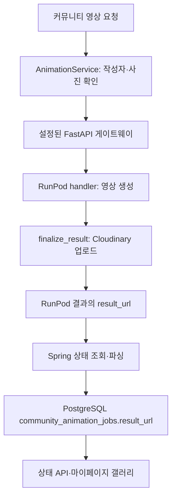
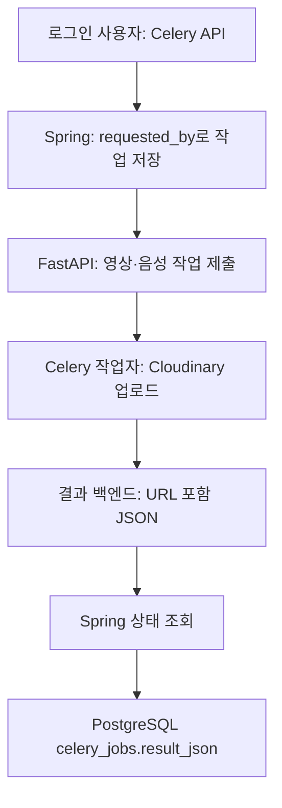
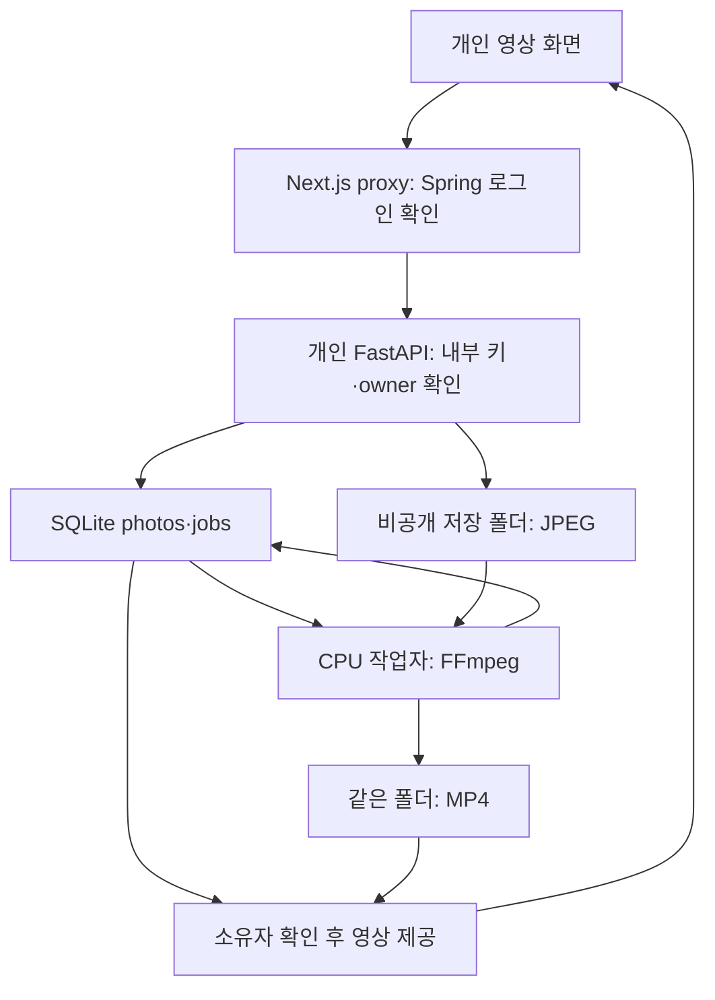
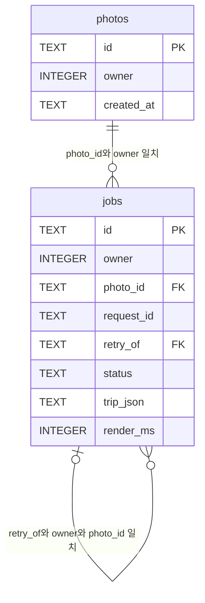

# KMovement 저장 후보·Cloudinary·RunPod·개인 영상 연결 조사

작성일: 2026-10-26, 한국 시간  
기준: 최신 main 커밋 `8f472c6040b686e6da0e5ec08cf75ad308b37f47`  
관련 변경: [PR #299](https://github.com/feed-mina/KMovement/pull/299), 2026-10-25 22:25:53 한국 시간 병합

## 1. 결론

**`saved_item`과 Cloudinary 영상 업로드를 연결하는 실행 코드는 확인되지 않았다.** `saved_item`은 사용자가 고른 아티스트·일정·상품의 번호를 저장한다. 기존 영상 결과에는 PostgreSQL의 `community_animation_jobs.result_url` 또는 `celery_jobs.result_json`에 보존하는 경로가 있다. PR #299의 개인 사진·영상 서비스는 별도 SQLite의 `photos`·`jobs`와 같은 저장 폴더의 JPEG·MP4 파일을 사용한다.

지금 모든 데이터를 한 테이블에 합칠 필요는 없다. 기존 소유권 검사와 저장 구조를 유지하면서, 필요한 경우 **내 목록과 내 영상의 탐색·조회 화면을 연결**하는 것이 최소 변경이다. 개인 영상을 RunPod나 Cloudinary로 자동 이전하면 비공개 파일 제공 방식과 외부 전송 범위가 바뀌므로 별도 기능으로 설계해야 한다.

여기서 확인은 기준 커밋의 코드에 대한 판단이다. 운영 DB의 행·제약·적용 이력, 실행 이미지, 외부 저장 파일은 조회하지 않았다. 운영 데이터와 애플리케이션 코드는 변경하지 않았다.

## 2. 조사 방법과 판정 기준

- GitHub main과 PR #299 메타데이터를 읽어 기준 커밋을 고정했다.
- Git 객체에서 소스를 별도 조사 폴더로 추출했다. 기존 PR 작업 폴더 HEAD와 최신 main의 Git tree는 모두 `1065d362bfd3578ade51e8463d8f0ef7eddc21e1`로 일치했다. 오래된 최상위 작업 폴더의 수정 파일을 최신 main으로 간주하지 않았다.
- 전체 커밋의 Python·Java·SQL·TypeScript에서 `saved_item`, `item_ref`, `cloudinary`, `workflow.sqlite3`, `photo_video` 참조를 검색하고 호출자·서비스·모델·마이그레이션을 읽었다.
- 아래 근거 링크는 기준 커밋에 고정했다. 운영에만 존재하는 별도 코드·DB 트리거·수동 작업은 이 조사로 확인할 수 없다.

| 표기 | 의미 |
|---|---|
| 코드 확인 | 함수 호출, 조회·저장문, 스키마 정의를 직접 확인 |
| 간접 연결 | 중간 API·카탈로그·인증 관계를 거쳐 연결 |
| 독립 경로 | 조사한 실행 코드에 상호 호출·조인·동기화가 없음 |
| 운영 검증 필요 | 실행 설정, 실제 행·제약, 외부 파일, 로그인 재생 검증이 필요 |
| 제안 | 이번에 구현·실행하지 않은 변경안 |

DB(Database)는 데이터베이스, API(Application Programming Interface)는 프로그램끼리 요청을 주고받는 창구다. URL(Uniform Resource Locator)은 파일이나 서비스의 주소다. DB에 주소를 저장하는 것과 영상 파일을 저장하는 것은 다르다.

## 3. 저장 위치와 소유권

| 대상 | 보존 위치 | 파일·주소 | 소유권 기준 |
|---|---|---|---|
| 저장 후보 | PostgreSQL `saved_item` | `item_type`과 숫자 `item_ref`. 영상 URL 컬럼 없음 | `user_sqno` [S01] [S02] |
| 새 내 목록의 아티스트·일정 | `artist_follow`, `event_bookmark` | 카탈로그 번호. 상품만 `saved_item` 사용 | `user_sqno` [S03] [S04] |
| 커뮤니티 원본 사진 | PostgreSQL `post_image.storage_url`와 파일 메타데이터 | Supabase Storage 업로드 객체의 공개형 주소 | 게시글 `author_sqno` [S05] [S33] |
| 커뮤니티 영상 | PostgreSQL `community_animation_jobs` | RunPod 작업 번호, `result_url`. 영상 파일은 Cloudinary 업로드 경로 | `post_id → community_post.author_sqno` [S06] [S07] [S34] |
| Celery 영상·음성 | PostgreSQL `celery_jobs.result_json` | 영상 JSON의 `result_url`, 음성의 `url` | `requested_by` [S08] [S42] [S43] [S09] |
| Celery 중간 결과 | 설정된 결과 백엔드, 기본값 Redis | 작업 상태·JSON. 코드 설정상 결과 1시간 후 만료 | 내부 API·작업 토큰 [S10] |
| 개인 사진 | SQLite `photos` | `${PHOTO_VIDEO_DATA_DIR}/{photoId}.jpg` | `owner` [S11] [S12] |
| 개인 영상 작업 | 같은 SQLite `jobs` | 사진·요청·재시도 번호, 상태, `trip_json`, 처리 시간 | `owner` 및 복합 외래키 [S11] |
| 개인 영상 파일 | 개인 서비스 저장 폴더 | `{jobId}.mp4`. 재생 주소는 응답 시 조립 | 매 요청의 `id AND owner` 검사 [S12] [S13] |

## 4. `item_ref`의 참조 대상과 Spring 저장 API

### 4.1 유형에 따라 다른 카탈로그 번호

| `item_type` | `item_ref`의 논리적 대상 | `findApprovedReference()` 처리 |
|---|---|---|
| `ARTIST` | `artist.artist_id` | 승인된 아티스트 조회 |
| `EVENT` | `event.event_id` | 승인된 이벤트와 소속 아티스트 조회 |
| `PRODUCT_CANDIDATE` | `product_candidate.product_candidate_id` | 승인된 상품 후보 조회 |

예를 들어 `PRODUCT_CANDIDATE / 42`는 상품 후보 42번이며 `ARTIST / 42`와 다른 대상이다. `item_ref`는 `BIGINT` 정수다. RunPod 작업 ID나 SQLite UUID(Universally Unique Identifier, 전역 고유 식별자)를 가리키는 코드는 없다. [S02]

### 4.2 실제 함수 호출

1. 상품 화면 `KpopProducts.tsx`의 `toggleSaved()`가 `{itemType: 'PRODUCT_CANDIDATE', itemRefId: candidate.id}`로 `POST /api/v1/kpop/saved-items`를 요청한다. [S14]
2. `KpopController.saveItem()`이 인증 객체의 `userSqno`를 `KpopProductService.saveItem()`에 전달한다. 브라우저가 보낸 소유자를 채택하지 않는다. [S15]
3. `saveItem()`이 유형·양수 번호를 검사하고 `requireApprovedReference() → findApprovedReference()`로 실제 승인 대상을 확인한다.
4. `INSERT ... ON CONFLICT (user_sqno,item_type,item_ref)`로 중복 저장을 막고 저장 번호를 반환한다.
5. `hydrateSavedItem() → hydrateSavedRow()`가 카탈로그 정보를 붙인다. 목록 조회와 삭제도 `user_sqno`로 한정한다. [S02]

현재 `/view/KPOP_SAVED_ITEMS`는 `PersonalSavedScreen`으로 등록되어 `/api/v1/kpop/me/saved/{kind}`를 사용한다. `PersonalSavedService.kind()`는 아티스트를 `artist_follow`, 일정을 `event_bookmark`, 상품을 `saved_item`으로 나눈다. **내 목록 전체가 `saved_item` 하나에 저장되는 것은 아니다.** 공개 여부는 `kpop_saved_catalog` 뷰로 다시 확인한다. [S03] [S04][S16] [S37]

### 4.3 DB 제약의 범위

- V82: 기본키, 필수값, `(user_sqno,item_type,item_ref)` 유일성, 세 유형의 CHECK 제약. [S01]
- V85: `user_sqno → users.user_sqno` 외래키를 `NOT VALID`로 추가한다. 기존 행 전체 검증은 보류하면서 새로 쓰는 행에는 제약을 적용하는 설계다. 운영의 검증 완료 여부는 미확인이다. [S17]
- **`item_ref`를 세 카탈로그에 연결하는 DB 외래키는 확인되지 않았다.** 대상 존재·승인 검사는 서비스가 수행한다. 앱을 우회하는 SQL이나 확인 직후 대상 삭제까지 DB가 완전히 방어하는 구조는 아니다.
- V109의 아티스트 번호 정리와 V119의 샘플 이벤트 정리는 유형별 `item_ref`를 갱신·정리한다. 이는 카탈로그 참조의 증거다. 이번에 실행하지 않았다. [S18] [S35]

## 5. 기존 RunPod → Cloudinary → PostgreSQL

### 5.1 입력 사진과 제출

커뮤니티 사진의 기본 업로드 구현은 `SupabaseStorageService`다. `CommunityPostService.createPost()`가 게시글을 저장하고 `upload()` 반환값을 `PostImage.storageUrl`로 보존한다. 반환 주소는 `.../storage/v1/object/public/...` 형태다. 실제 버킷·객체 접근 설정은 운영 검증이 필요하다. [S05] [S33]

`POST /api/v1/community/posts/{postId}/animate` 또는 `/animate/batch`는 다음 순서로 이어진다.

| 단계 | 실제 함수·데이터 |
|---|---|
| 소유자 확인 | `prepareSubmission()`이 작성자와 로그인 사용자를 비교하고 동시·일일 한도를 검사 |
| 입력 확인 | `resolvePostImage(postId,postImageId)`로 같은 게시글의 사진인지 확인 |
| 요청 조립 | `submitAnimation()`·`submitBatchAnimation()`이 `PostImage.storageUrl`을 `image_url`로 전달 |
| 외부 제출 | `submitToGateway()`가 `/jobs/runpod`·`/jobs/runpod/batch` 호출 |
| 초기 저장 | 응답의 RunPod `id`를 `runpodJobId`에 넣어 `QUEUED` 작업 저장 |

이 함수들은 `saved_item`을 읽거나 쓰지 않는다. [S06]

### 5.2 게이트웨이 선택

Spring 접속 대상은 `kride.fastapi.url`이다. 소스에는 프록시 API의 두 구현이 있다.

- `src/api/fastapi_server.py`: `runpod_proxy()`, `runpod_batch_proxy()`, `runpod_status()`.
- `deploy/cloud_gateway/app.py`: 같은 이름·경로의 함수들.

둘 다 RunPod `/v2/{endpoint}/run`으로 제출하고 `/status/{job_id}`로 결과를 조회한다. Tora 단일 영상과 일반 미디어·배치를 엔드포인트별로 나눈다. **운영이 어느 구현을 사용하는지는 미확인이다.** 두 게이트웨이를 순서대로 모두 거친다고 해석하면 안 된다. [S19] [S20]

### 5.3 URL 생성과 보존

1. RunPod `handler()`가 이미지를 다운로드하고 선택된 생성 함수 또는 `run_batch_video_case()`를 실행한다.
2. `_encode_artifacts()` → `finalize_result()` → `upload_to_cloudinary()`로 이어진다.
3. `finalize_result()`는 `kind='final_video'` 파일을 `kride/media/{case_id}` 폴더, `video` 유형으로 업로드한다.
4. 업로드 응답의 `secure_url`을 우선 사용하고 없으면 `url`을 쓴다. 주소를 `result['result_url']`과 최종 파일 항목의 `url`에 넣는다. **이 Python 업로드 함수는 PostgreSQL에 기록하지 않는다.** [S21] [S38] [S22]
5. Spring 상태 조회 또는 60초 간격 `AnimationJobPollingScheduler.pollRunPodJobs()`가 `refreshAnimationJob()`을 호출한다.
6. `applyRunPodStatus()` → `AnimationRunPodOutput.parse()`가 완료 결과에서 `result_url`, `resultUrl`, 파일·업로드 항목 URL을 찾는다.
7. `setResultUrl()` 후 저장소 `save()`가 **`community_animation_jobs.result_url`에 보존**한다. URL 없는 완료는 실패로 처리한다. [S06] [S07] [S34] [S23] [S41]

`KRIDE_RESULT_URL_REQUIRED=true`이면 공개 결과 URL을 만들지 못할 때 실패를 반환한다. 꺼져 있으면 작은 파일을 응답에 포함하는 대체 동작이 가능하지만 Spring 파서는 여전히 URL 없는 영상 완료를 실패로 처리한다. RunPod 완료 표시만으로 재생 가능하다고 판단하면 안 된다. [S21] [S38] [S23] [S41]

마이페이지 V72 쿼리는 작업과 게시글을 조인하고 `author_sqno=:userSqno`로 조회한다. `result_url`은 갤러리에 쓰이지만 `saved_item`과의 조인은 없다. [S24]

### 5.4 보존·접근의 한계

- 생성·초기화는 작성자로 제한되지만 커뮤니티 GET은 보안 설정상 공개이고 상태 컨트롤러는 비소유자에게도 결과 URL을 응답하는 구조다. 개인 영상 조회에 그대로 재사용하면 안 된다. [S25] [S36]
- `resetAnimationStatus()`는 종료 작업 DB 행을 삭제하며 Cloudinary 객체 삭제 호출은 없다. V55는 게시글 삭제 시 작업 행의 `ON DELETE CASCADE`를 정의한다. DB 저장 경로가 있어도 삭제 후 이력까지 보장하지 않는다. [S06] [S07] [S34]
- 업로드 함수는 `public_id`도 반환하지만 `finalize_result()`는 URL만 결과에 옮긴다. 작업 엔티티에도 Cloudinary 객체 식별자 전용 필드가 없다. [S21] [S38] [S22][S07] [S34]

## 6. 추가 발견: Celery 영상·음성 결과 보존

Celery는 오래 걸리는 작업을 별도 작업자에게 맡기는 도구다. RunPod와 일부 생성 코드를 공유하지만 제출·결과 보존 경로는 별개다.

1. `POST /api/v1/celery/jobs/video`·`/tts` → `CeleryJobController.submitJob()` → 로그인 사용자 번호 전달.
2. `CeleryJobService.submitJob()` → FastAPI `/jobs/celery/{taskType}` → `task_generate_video()`·`task_generate_tts()`.
3. 영상은 `finalize_result()`를 재사용해 `result_url`을, 음성은 업로드 함수를 직접 호출해 `url`을 반환한다.
4. 결과 백엔드가 JSON을 보관한다. 코드 기본값은 Redis, `result_expires=3600`이다.
5. Spring `refreshJob() → applyCeleryStatus()`가 성공 결과를 문자열로 변환해 **`celery_jobs.result_json`**에 저장한다. 소유자 조회와 30초 간격 스케줄러가 갱신 경로다. [S08] [S42] [S43] [S09][S10] [S26]

외부 업로드 성공과 PostgreSQL 저장 성공은 다르다. Spring이 결과 만료 전에 조회·반영해야 한다. Spring을 거치지 않고 Python API나 RunPod 클라이언트를 직접 호출하면 해당 코드가 DB 행을 대신 만들지 않는다. 실제 운영 이력 누락 여부는 미확인이다.

K-POP 의상 분석도 `celery_jobs`를 사용한다. 분석 상품이 `kpop_analysis_candidate.product_candidate_id`로 연결되고 사용자가 그 상품을 저장하면 같은 상품 번호를 공유할 수 있다. 이는 **분석 → 상품 후보 → 사용자 저장의 간접 관계**다. 영상 URL이나 RunPod 작업을 `saved_item`에 연결하는 관계가 아니다. [S02] [S17]

## 7. PR #299 개인 사진·영상 경로

### 7.1 로그인부터 재생까지

1. `/travel/video`가 `/api/travel-video/photos`, `/jobs`로 업로드·생성을 요청하고 `/jobs?page=...`로 이전 작업을 읽는다. [S27]
2. Next.js `proxy()`가 `PHOTO_VIDEO_ENABLED`, 변경 요청 Origin을 확인한다. Spring `/api/auth/me`에 쿠키를 전달해 로그인 상태와 양수 `userSqno`를 검증한다.
3. 서버가 내부 키와 인증된 사용자 번호를 `X-Photo-Video-Key`, `X-Photo-Video-Owner`로 개인 FastAPI에 전달한다. 브라우저의 소유자 헤더를 그대로 전달하지 않는다. [S28]
4. 개인 FastAPI `owner()`가 내부 키와 번호를 확인한다. `upload()`가 사진을 다시 디코딩·정규화해 JPEG로 저장하고 SQLite `photos` 행을 쓴다.
5. `enqueue()`가 같은 소유자의 사진인지 확인하고 `jobs` 행을 만든다. `request_id`로 중복 생성을 막는다.
6. `worker.run_once()` → `render_photo()`가 CPU(Central Processing Unit, 중앙 처리 장치)에서 FFmpeg로 사진 확대·이동 영상 5초를 만든다. 생성형 AI 모델은 호출하지 않는다.
7. MP4 검증 후 상태·처리 시간을 SQLite에 저장한다.
8. `job_response()`가 완료 작업의 `/api/travel-video/jobs/{jobId}/video` 주소를 조립한다. `video()`가 소유자·완료 상태·파일 존재를 다시 확인한다. **DB에는 Cloudinary URL이나 재생 URL 저장 컬럼이 없다.** [S11] [S12][S13]

### 7.2 SQLite·파일·외래키

기본 DB는 `/data/photo-video/workflow.sqlite3`이며 실제 위치는 `PHOTO_VIDEO_DATA_DIR`에 따른다. Compose는 API·작업자에 같은 볼륨을 연결하고 Hostinger 추가 설정은 `kmovement-photo-video-data` 외부 볼륨을 사용한다. **SQLite와 JPEG·MP4를 함께 백업해야 한다.** Compose 정의가 실제 운영 마운트의 증거는 아니다. [S29] [S40]

ERD(Entity Relationship Diagram)는 데이터 연결 그림이다. SQLite의 실제 규칙은 다음과 같다. [S11]

- `(photo_id,owner) → photos(id,owner)`: 남의 사진 연결 방지.
- `(retry_of,owner,photo_id) → jobs(id,owner,photo_id)`: 같은 소유자·사진의 원작업만 재시도.
- 트리거: 원작업의 `FAILED` 상태, 같은 `trip_json`, 연결 키 변경 금지, 재시도된 원작업의 실패 상태 유지.
- 부분 유일 인덱스: 같은 원작업의 `QUEUED`·`RUNNING`·`COMPLETED` 재시도 중복 제한.
- 공통 `connect()`가 연결마다 외래키 검사를 켠다. 다른 프로그램이 직접 SQLite를 열면서 검사를 끄면 같은 보장을 기대할 수 없다.
- `owner`는 Spring 사용자 번호와 의미를 공유하지만 **PostgreSQL `users`를 향하는 물리적 외래키는 없다.** 탈퇴·계정 삭제와 SQLite·파일 정리의 자동 연동은 이 경로에서 확인되지 않았다.

### 7.3 코스와의 간접 연결

코스에서 넘어오면 Next.js가 `/api/public/itinerary/video-context`를 호출한다. 서명·사용자·유효기간·카탈로그 버전·장소를 검증한 자료가 `jobs.trip_json`에 보존된다. `saved_item`과의 조인도, 사진의 실제 촬영 장소를 판별한 결과도 아니다. 재시도는 기존 자료를 유지하며 최신 코스로 재검증됐다는 의미가 아니다. [S28] [S30] [S39]

`initialize_schema()`는 기존 SQLite를 백업한 뒤 한 트랜잭션으로 이전하고 잘못된 관계가 있으면 삭제해서 고치는 대신 실패한다. 이번 조사에서는 운영 DB에 실행하지 않았다. [S11]

## 8. 직접 연결·간접 연결·독립 경로

| 두 대상 | 판정 | 근거·한계 |
|---|---|---|
| `saved_item` ↔ 카탈로그 | 서비스 직접 조회 | 유형별 SQL. `item_ref`의 DB 외래키는 없음 |
| `saved_item` ↔ Cloudinary 업로드 | 독립 | 저장 API에 업로드 호출·영상 작업 번호·URL 저장이 없음 |
| 저장 후보 ↔ 카탈로그 이미지 | 간접 표시 가능 | `ARTIST` 조회가 `artist.image_url`을 응답함. 실제 행이 Cloudinary 주소라면 이미지 표시 가능하나 운영 값은 미확인 |
| RunPod ↔ Cloudinary | 직접 호출 | `handler → _encode_artifacts → finalize_result → upload_to_cloudinary` |
| Cloudinary ↔ 커뮤니티 작업 DB | 상태 조회를 통한 간접 저장 | 응답을 Spring이 조회·파싱·저장 |
| Cloudinary ↔ Celery 작업 DB | 결과 조회를 통한 간접 저장 | 성공 JSON을 `result_json`으로 저장 |
| 개인 영상 ↔ Spring 사용자 | 인증 API를 통한 간접 연결 | `/api/auth/me → userSqno → owner`. DB 간 외래키 없음 |
| 개인 영상 ↔ 여행 코스 | 검증 API를 통한 간접 연결 | 코스 검증 후 `trip_json` 저장 |
| 개인 영상 ↔ RunPod·Cloudinary | 독립 | 워커는 FFmpeg 실행. 외부 업로드·작업 제출 없음 |
| SQLite ↔ 저장 후보·커뮤니티 영상 | 독립 | 상호 참조 번호·복제·자동 게시 코드 없음 |
| 내 목록 ↔ 영상 갤러리 | 별도 조회 | 내 목록 API, 커뮤니티 갤러리 쿼리, 개인 영상 API가 다름 |

`next.config.ts`의 Cloudinary 도메인 허용은 브라우저 미디어 표시 허용이다. 저장 후보와 Cloudinary의 동기화 증거가 아니다. [S31]

## 9. 최소 변경 제안

### 9.1 우선 권장: 화면·조회만 연결

**DB 통합은 보류한다.** 후보 저장과 영상 작업은 역할·번호·공개 범위·재시도 규칙이 다르다. SQLite UUID를 `item_ref BIGINT`에 넣거나 기존 `item_type`에 영상 유형을 임의로 추가하지 않는다.

1. 마이페이지에서 내 목록과 `/travel/video`의 내 영상을 이동하도록 연결한다. 파일·작업 복사 없이 탐색 문제를 해결한다.
2. 한 화면 조회가 필요하면 인증된 서버에 읽기 전용 어댑터를 둔다. 각 서비스의 소유권 검사를 통과한 항목만 모으고 내부 키를 브라우저에 공개하지 않는다.
3. 응답을 `source`, `sourceId`, `status`, `createdAt`, `playbackUrl`, `visibility` 정도로 맞춘다. 번호는 문자열로 반환하고 출처와 함께 구분한다. 이는 제안 응답이며 기존 DB 컬럼이 아니다.
4. 개인 영상은 기존 소유자 검사 주소를 유지하고 커뮤니티 공개 영상과 접근 규칙을 구분한다. 서비스 장애를 빈 목록·삭제로 처리하지 않는다.
5. 날짜 정렬·원본별 페이지 처리·중복 식별자·계정 전환 후 캐시 제거를 검증한다. 새 DB 테이블도 필수는 아니다.

### 9.2 외부 AI 영상이 필요할 때만 별도 시도 기록

개인 사진의 RunPod 전송은 사용자가 동의·비용·전송 범위를 확인한 별도 기능으로 추가한다. 기존 FFmpeg 경로와 UUID·owner·원작업·재시도 이력을 보존한다.

| 제안 기록 | 목적 |
|---|---|
| 원작업·사진 번호, `owner` | 소유권·기존 이력 보존 |
| 제공업체·엔드포인트·외부 작업 번호 | 제출과 결과 연결 |
| 전송 동의 시각·범위 | 자동 외부 공개 방지 |
| 요청별 중복 방지 키 | 중복 제출·과금 억제 |
| 객체 식별자·리소스 유형·전달 방식 | Cloudinary 추적·삭제·공개 범위 관리 |
| 제출·생성·업로드·결과 저장 상태 | 외부 성공과 내부 저장 실패 구분 |

개인 사진을 공개 게시글에 먼저 올리는 방식으로 우회하지 않는다. 외부 작업에는 범위·기간을 제한한 파일 접근을 제공하고 결과 소유자를 원작업에서 재확인한다. 외부 요청과 DB 저장은 하나의 트랜잭션이 아니므로 재처리해도 중복되지 않게 설계한다. 공개 URL만으로 소유권을 증명하지 않는다.

### 9.3 PostgreSQL 이관은 운영 요구가 생길 때

여러 호스트의 작업자, 탈퇴 일괄 정리, 통합 백업·보존 정책이 필요해지면 개인 미디어 전용 테이블을 검토한다. `saved_item`을 영상 작업 테이블로 바꾸는 것은 권장하지 않는다.

이관 시 UUID·owner·상태·요청 번호·재시도 체인·시각·`trip_json`을 보존한다. 파일은 별도로 복사하고 해시·건수를 대조한다. 사본으로 먼저 검증하고 전환 시 짧은 쓰기 중단 또는 변경분 반영 절차를 정한다. 소유자 누락 행은 격리 검토하며 임의 계정에 배정·삭제하지 않는다. 원본 DB·파일과 복구 경로를 보존한다.

### 9.4 `saved_item` 외래키는 별도 보강

읽기 전용으로 사용자 외래키 검증 완료 여부와 유형별 고아 참조를 조사한다. 비공개로 전환되어 보존된 정상 저장과 대상 자체가 없는 참조를 구분한다. 기존 행을 보존하면서 유형별 참조 검사 트리거·유형별 연결 테이블·공통 카탈로그 키 중 범위에 맞는 방식을 고른다. 조회 통합의 선행 조건은 아니다. 서로 다른 DB를 복합 외래키 하나로 연결할 수는 없다.

## 10. 운영 검증 필요 목록

다음은 **미실행 목록**이며 완료 사실이 아니다.

| 대상 | 확인 내용 |
|---|---|
| 배포 버전 | Spring·Next.js·개인 API·워커의 이미지 커밋·활성 프로필 |
| 기능 활성화 | `PHOTO_VIDEO_ENABLED`, 공개 버튼 플래그, 내부 연결 설정. 키 값은 출력하지 않음 |
| 게이트웨이 | 실제 `kride.fastapi.url` 대상과 RunPod 라우팅 |
| Hostinger | 소스의 `hostinger-g1`은 FastAPI를 비활성 주소로 정의함. 실제 프로필·덮어쓰기는 미확인 [S32] |
| PostgreSQL | Flyway 이력, 실제 컬럼·제약, `fk_saved_item_user` 검증 여부, 유형별 참조 건전성 |
| Cloudinary | DB URL에 대응하는 객체·재생·공개 범위, 객체 식별자 추적 가능 여부 |
| Celery | 결과 백엔드·만료·폴링과 `result_json` 누락 여부 |
| SQLite·파일 | 실제 볼륨·스키마·읽기 전용 무결성, 대응하는 JPEG·MP4 존재 |
| 계정 정책 | 탈퇴·비활성화와 여러 DB·파일 정리 방식 |
| 실제 사용자 흐름 | 로그인 → 사진 → 생성 → 재생, 재시작 유지, 타 사용자 접근 거절 |

읽기 전용 조사와 달리 새 사진·영상 생성, 실제 업로드·재시도, 마이그레이션 시작은 데이터를 쓰거나 비용을 발생시킬 수 있다. 이번에는 수행하지 않았다.

## 11. 이번 검증 결과

- 기준 커밋에서 추출한 소스로 기존 시험을 실행했다. `test_result_delivery.py`와 `test_photo_video_database.py`: **32개 통과**.
- Cloudinary 호출은 모의 함수로 바꾸고 합성 파일·임시 SQLite만 사용했다. URL 응답, 필수 업로드 실패, 소유자·재시도·이전·백업 방어를 확인했다. 실제 Cloudinary 업로드·RunPod 과금 작업은 실행하지 않았다.
- 초기 실행에서 시험 도구와 상위 프로젝트 경로 설정 문제가 있어 분리된 환경·설정으로 다시 실행했다. 위 수치는 최종 성공 실행의 결과다.
- Spring 운영 DB 제약, 실제 계정 로그인·브라우저 재생·운영 배포는 이번 시험 범위가 아니다.

PR #299의 과거 시험과 이번 실행은 별개다. 운영 접속·배포·PR·커밋·마이그레이션·기존 데이터 정리를 수행하지 않았다. 최종 산출물은 이 Markdown 보고서다.

## 12. 근거 소스

모든 링크는 기준 커밋에 고정했다. S 번호는 문서 내부 근거 식별자다.

- [S01] 저장 후보 스키마: `subproject/SDUI/SDUI-server/src/main/resources/db/migration/V82__kpop_phase0.sql`, 86행.
- [S02] 저장·조회·삭제 및 유형별 검증: `subproject/SDUI/SDUI-server/src/main/java/com/domain/demo_backend/domain/kpop/service/KpopProductService.java`, 70행.
- [S03] 새 내 목록의 테이블 선택: `subproject/SDUI/SDUI-server/src/main/java/com/domain/demo_backend/domain/kpop/service/PersonalSavedService.java`, 16행.
- [S04] 저장 카탈로그 공개 여부: `subproject/SDUI/SDUI-server/src/main/resources/db/migration/V121__personal_saved_visibility.sql`, 3행.
- [S05] 커뮤니티 사진 업로드: `subproject/SDUI/SDUI-server/src/main/java/com/domain/demo_backend/domain/community/service/SupabaseStorageService.java`, 34행.
- [S06] 영상 제출·소유권·폴링·저장·초기화: `subproject/SDUI/SDUI-server/src/main/java/com/domain/demo_backend/domain/community/service/AnimationService.java`, 89행.
- [S07] 영상 엔티티·결과 URL: `subproject/SDUI/SDUI-server/src/main/java/com/domain/demo_backend/domain/community/domain/AnimationJob.java`, 9행.
- [S08] Celery 성공 결과 보존: `subproject/SDUI/SDUI-server/src/main/java/com/domain/demo_backend/domain/celery/service/CeleryJobService.java`, 268행.
- [S09] Celery 음성·영상 생성: `src/api/tasks.py`, 210행.
- [S10] 결과 백엔드·만료: `src/api/celery_app.py`, 23행.
- [S11] SQLite 외래키·트리거·백업·이전: `deploy/photo_video/database.py`, 42행.
- [S12] 개인 사진·영상 API·재생: `deploy/photo_video/app.py`, 45행.
- [S13] CPU 작업자·FFmpeg: `deploy/photo_video/worker.py`, 37행.
- [S14] 상품 저장 화면: `subproject/SDUI/metadata-project/components/plugins/kpop/KpopProducts.tsx`, 107행.
- [S15] Spring 저장 API: `subproject/SDUI/SDUI-server/src/main/java/com/domain/demo_backend/domain/kpop/controller/KpopController.java`, 290행.
- [S16] 새 내 목록 API: `subproject/SDUI/metadata-project/components/plugins/kpop/PersonalSaved.tsx`, 15행.
- [S17] 사용자 외래키·분석 상품 관계: `subproject/SDUI/SDUI-server/src/main/resources/db/migration/V85__kpop_product_catalog_and_saved_items.sql`, 46행.
- [S18] 아티스트 번호 정리: `subproject/SDUI/SDUI-server/src/main/resources/db/migration/V109__dedupe_kpop_artist_variants.sql`, 95행.
- [S19] FastAPI RunPod 프록시: `src/api/fastapi_server.py`, 1748행.
- [S20] 별도 Gateway 프록시: `deploy/cloud_gateway/app.py`, 354행.
- [S21] 최종 영상 업로드·URL 반환: `deploy/media_motion/result_delivery.py`, 32행.
- [S22] Cloudinary 업로드: `deploy/media_motion/cloudinary_upload.py`, 66행.
- [S23] RunPod 결과 파싱: `subproject/SDUI/SDUI-server/src/main/java/com/domain/demo_backend/domain/community/service/AnimationRunPodOutput.java`, 16행.
- [S24] 마이페이지 영상 쿼리: `subproject/SDUI/SDUI-server/src/main/resources/db/migration/V72__mypage_sdui_stats.sql`, 26행.
- [S25] 영상 상태 응답: `subproject/SDUI/SDUI-server/src/main/java/com/domain/demo_backend/domain/community/controller/AnimationController.java`, 73행.
- [S26] Celery 결과 폴링: `subproject/SDUI/SDUI-server/src/main/java/com/domain/demo_backend/domain/celery/scheduler/CeleryJobPollingScheduler.java`, 20행.
- [S27] 개인 영상 이력 조회: `subproject/SDUI/metadata-project/app/travel/video/page.tsx`, 37행.
- [S28] 인증·소유자 전달 프록시: `subproject/SDUI/metadata-project/app/api/travel-video/[...path]/route.ts`, 11행.
- [S29] 운영용 볼륨·네트워크: `deploy/photo_video/hostinger.compose.yml`, 36행.
- [S30] 영상 코스 검증 API: `src/api/public_itinerary.py`, 155행.
- [S31] Cloudinary 표시 허용: `subproject/SDUI/metadata-project/next.config.ts`, 58행.
- [S32] Hostinger G1 설정: `subproject/SDUI/SDUI-server/src/main/resources/application-hostinger-g1.yml`, 54행.
- [S33] 사진 주소 DB 저장: `subproject/SDUI/SDUI-server/src/main/java/com/domain/demo_backend/domain/community/service/CommunityPostService.java`, 56행.
- [S34] 영상 테이블·게시글 삭제 전파: `subproject/SDUI/SDUI-server/src/main/resources/db/migration/V55__community_animation_jobs.sql`, 5행.
- [S35] 샘플 이벤트 정리: `subproject/SDUI/SDUI-server/src/main/resources/db/migration/V119__seed_kpop_real_events.sql`, 25행.
- [S36] 커뮤니티 GET 공개: `subproject/SDUI/SDUI-server/src/main/java/com/domain/demo_backend/global/config/SecurityConfig.java`, 121행.
- [S37] 내 목록 화면 등록: `subproject/SDUI/metadata-project/components/plugins/kpop/register.ts`, 18행.
- [S38] RunPod 결과 전달 호출: `deploy/media_motion/runpod_handler.py`, 141행.
- [S39] 코스 서명·소유자·버전 검사: `src/api/course_context.py`, 56행.
- [S40] API·작업자의 공통 저장소: `deploy/photo_video/compose.yml`, 7행.
- [S41] RunPod 결과 폴링: `subproject/SDUI/SDUI-server/src/main/java/com/domain/demo_backend/domain/community/scheduler/AnimationJobPollingScheduler.java`, 29행.
- [S42] Celery 요청·소유권 API: `subproject/SDUI/SDUI-server/src/main/java/com/domain/demo_backend/domain/celery/controller/CeleryJobController.java`, 20행.
- [S43] Celery 결과 엔티티: `subproject/SDUI/SDUI-server/src/main/java/com/domain/demo_backend/domain/celery/domain/CeleryJob.java`, 32행.

[S01]: https://github.com/feed-mina/KMovement/blob/8f472c6040b686e6da0e5ec08cf75ad308b37f47/subproject/SDUI/SDUI-server/src/main/resources/db/migration/V82__kpop_phase0.sql#L86
[S02]: https://github.com/feed-mina/KMovement/blob/8f472c6040b686e6da0e5ec08cf75ad308b37f47/subproject/SDUI/SDUI-server/src/main/java/com/domain/demo_backend/domain/kpop/service/KpopProductService.java#L70
[S03]: https://github.com/feed-mina/KMovement/blob/8f472c6040b686e6da0e5ec08cf75ad308b37f47/subproject/SDUI/SDUI-server/src/main/java/com/domain/demo_backend/domain/kpop/service/PersonalSavedService.java#L16
[S04]: https://github.com/feed-mina/KMovement/blob/8f472c6040b686e6da0e5ec08cf75ad308b37f47/subproject/SDUI/SDUI-server/src/main/resources/db/migration/V121__personal_saved_visibility.sql#L3
[S05]: https://github.com/feed-mina/KMovement/blob/8f472c6040b686e6da0e5ec08cf75ad308b37f47/subproject/SDUI/SDUI-server/src/main/java/com/domain/demo_backend/domain/community/service/SupabaseStorageService.java#L34
[S06]: https://github.com/feed-mina/KMovement/blob/8f472c6040b686e6da0e5ec08cf75ad308b37f47/subproject/SDUI/SDUI-server/src/main/java/com/domain/demo_backend/domain/community/service/AnimationService.java#L89
[S07]: https://github.com/feed-mina/KMovement/blob/8f472c6040b686e6da0e5ec08cf75ad308b37f47/subproject/SDUI/SDUI-server/src/main/java/com/domain/demo_backend/domain/community/domain/AnimationJob.java#L9
[S08]: https://github.com/feed-mina/KMovement/blob/8f472c6040b686e6da0e5ec08cf75ad308b37f47/subproject/SDUI/SDUI-server/src/main/java/com/domain/demo_backend/domain/celery/service/CeleryJobService.java#L268
[S09]: https://github.com/feed-mina/KMovement/blob/8f472c6040b686e6da0e5ec08cf75ad308b37f47/src/api/tasks.py#L210
[S10]: https://github.com/feed-mina/KMovement/blob/8f472c6040b686e6da0e5ec08cf75ad308b37f47/src/api/celery_app.py#L23
[S11]: https://github.com/feed-mina/KMovement/blob/8f472c6040b686e6da0e5ec08cf75ad308b37f47/deploy/photo_video/database.py#L42
[S12]: https://github.com/feed-mina/KMovement/blob/8f472c6040b686e6da0e5ec08cf75ad308b37f47/deploy/photo_video/app.py#L45
[S13]: https://github.com/feed-mina/KMovement/blob/8f472c6040b686e6da0e5ec08cf75ad308b37f47/deploy/photo_video/worker.py#L37
[S14]: https://github.com/feed-mina/KMovement/blob/8f472c6040b686e6da0e5ec08cf75ad308b37f47/subproject/SDUI/metadata-project/components/plugins/kpop/KpopProducts.tsx#L107
[S15]: https://github.com/feed-mina/KMovement/blob/8f472c6040b686e6da0e5ec08cf75ad308b37f47/subproject/SDUI/SDUI-server/src/main/java/com/domain/demo_backend/domain/kpop/controller/KpopController.java#L290
[S16]: https://github.com/feed-mina/KMovement/blob/8f472c6040b686e6da0e5ec08cf75ad308b37f47/subproject/SDUI/metadata-project/components/plugins/kpop/PersonalSaved.tsx#L15
[S17]: https://github.com/feed-mina/KMovement/blob/8f472c6040b686e6da0e5ec08cf75ad308b37f47/subproject/SDUI/SDUI-server/src/main/resources/db/migration/V85__kpop_product_catalog_and_saved_items.sql#L46
[S18]: https://github.com/feed-mina/KMovement/blob/8f472c6040b686e6da0e5ec08cf75ad308b37f47/subproject/SDUI/SDUI-server/src/main/resources/db/migration/V109__dedupe_kpop_artist_variants.sql#L95
[S19]: https://github.com/feed-mina/KMovement/blob/8f472c6040b686e6da0e5ec08cf75ad308b37f47/src/api/fastapi_server.py#L1748
[S20]: https://github.com/feed-mina/KMovement/blob/8f472c6040b686e6da0e5ec08cf75ad308b37f47/deploy/cloud_gateway/app.py#L354
[S21]: https://github.com/feed-mina/KMovement/blob/8f472c6040b686e6da0e5ec08cf75ad308b37f47/deploy/media_motion/result_delivery.py#L32
[S22]: https://github.com/feed-mina/KMovement/blob/8f472c6040b686e6da0e5ec08cf75ad308b37f47/deploy/media_motion/cloudinary_upload.py#L66
[S23]: https://github.com/feed-mina/KMovement/blob/8f472c6040b686e6da0e5ec08cf75ad308b37f47/subproject/SDUI/SDUI-server/src/main/java/com/domain/demo_backend/domain/community/service/AnimationRunPodOutput.java#L16
[S24]: https://github.com/feed-mina/KMovement/blob/8f472c6040b686e6da0e5ec08cf75ad308b37f47/subproject/SDUI/SDUI-server/src/main/resources/db/migration/V72__mypage_sdui_stats.sql#L26
[S25]: https://github.com/feed-mina/KMovement/blob/8f472c6040b686e6da0e5ec08cf75ad308b37f47/subproject/SDUI/SDUI-server/src/main/java/com/domain/demo_backend/domain/community/controller/AnimationController.java#L73
[S26]: https://github.com/feed-mina/KMovement/blob/8f472c6040b686e6da0e5ec08cf75ad308b37f47/subproject/SDUI/SDUI-server/src/main/java/com/domain/demo_backend/domain/celery/scheduler/CeleryJobPollingScheduler.java#L20
[S27]: https://github.com/feed-mina/KMovement/blob/8f472c6040b686e6da0e5ec08cf75ad308b37f47/subproject/SDUI/metadata-project/app/travel/video/page.tsx#L37
[S28]: https://github.com/feed-mina/KMovement/blob/8f472c6040b686e6da0e5ec08cf75ad308b37f47/subproject/SDUI/metadata-project/app/api/travel-video/%5B...path%5D/route.ts#L11
[S29]: https://github.com/feed-mina/KMovement/blob/8f472c6040b686e6da0e5ec08cf75ad308b37f47/deploy/photo_video/hostinger.compose.yml#L36
[S30]: https://github.com/feed-mina/KMovement/blob/8f472c6040b686e6da0e5ec08cf75ad308b37f47/src/api/public_itinerary.py#L155
[S31]: https://github.com/feed-mina/KMovement/blob/8f472c6040b686e6da0e5ec08cf75ad308b37f47/subproject/SDUI/metadata-project/next.config.ts#L58
[S32]: https://github.com/feed-mina/KMovement/blob/8f472c6040b686e6da0e5ec08cf75ad308b37f47/subproject/SDUI/SDUI-server/src/main/resources/application-hostinger-g1.yml#L54
[S33]: https://github.com/feed-mina/KMovement/blob/8f472c6040b686e6da0e5ec08cf75ad308b37f47/subproject/SDUI/SDUI-server/src/main/java/com/domain/demo_backend/domain/community/service/CommunityPostService.java#L56
[S34]: https://github.com/feed-mina/KMovement/blob/8f472c6040b686e6da0e5ec08cf75ad308b37f47/subproject/SDUI/SDUI-server/src/main/resources/db/migration/V55__community_animation_jobs.sql#L5
[S35]: https://github.com/feed-mina/KMovement/blob/8f472c6040b686e6da0e5ec08cf75ad308b37f47/subproject/SDUI/SDUI-server/src/main/resources/db/migration/V119__seed_kpop_real_events.sql#L25
[S36]: https://github.com/feed-mina/KMovement/blob/8f472c6040b686e6da0e5ec08cf75ad308b37f47/subproject/SDUI/SDUI-server/src/main/java/com/domain/demo_backend/global/config/SecurityConfig.java#L121
[S37]: https://github.com/feed-mina/KMovement/blob/8f472c6040b686e6da0e5ec08cf75ad308b37f47/subproject/SDUI/metadata-project/components/plugins/kpop/register.ts#L18
[S38]: https://github.com/feed-mina/KMovement/blob/8f472c6040b686e6da0e5ec08cf75ad308b37f47/deploy/media_motion/runpod_handler.py#L141
[S39]: https://github.com/feed-mina/KMovement/blob/8f472c6040b686e6da0e5ec08cf75ad308b37f47/src/api/course_context.py#L56
[S40]: https://github.com/feed-mina/KMovement/blob/8f472c6040b686e6da0e5ec08cf75ad308b37f47/deploy/photo_video/compose.yml#L7
[S41]: https://github.com/feed-mina/KMovement/blob/8f472c6040b686e6da0e5ec08cf75ad308b37f47/subproject/SDUI/SDUI-server/src/main/java/com/domain/demo_backend/domain/community/scheduler/AnimationJobPollingScheduler.java#L29
[S42]: https://github.com/feed-mina/KMovement/blob/8f472c6040b686e6da0e5ec08cf75ad308b37f47/subproject/SDUI/SDUI-server/src/main/java/com/domain/demo_backend/domain/celery/controller/CeleryJobController.java#L20
[S43]: https://github.com/feed-mina/KMovement/blob/8f472c6040b686e6da0e5ec08cf75ad308b37f47/subproject/SDUI/SDUI-server/src/main/java/com/domain/demo_backend/domain/celery/domain/CeleryJob.java#L32
