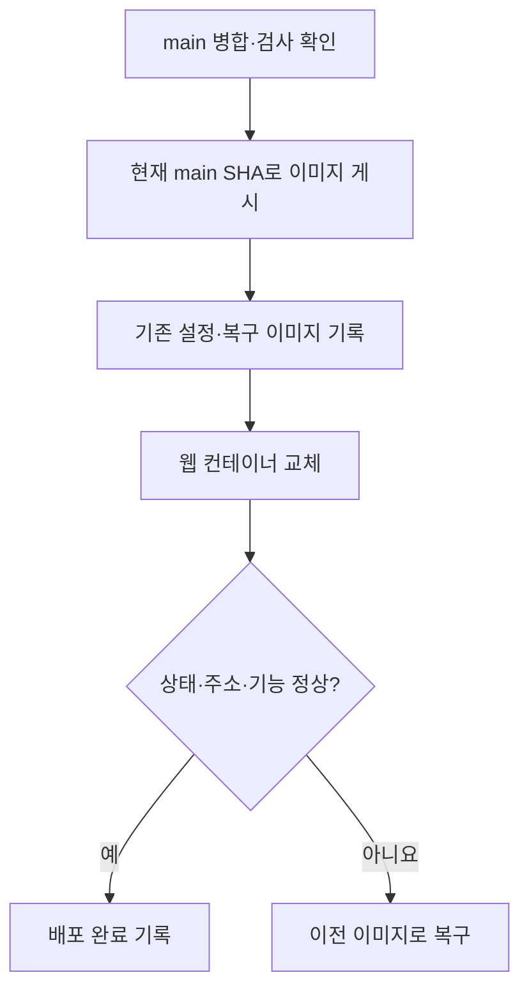

# main 반영 후 Hostinger 웹 배포 가이드

2026-10-25 개정: **기본 배포 경로는 main 검사 성공 → Hostinger 웹 자동 배포입니다.** 최초 SSH 연결 두 항목 등록과 실행 방법은 [자동 배포 안내](hostinger-auto-deploy.md)를 따릅니다. 연결값 등록과 첫 운영 배포 성공 여부는 별도로 확인해야 합니다.

기존 수동 이미지 발행·교체·복구 절차는 장애 대응과 수동 복구를 위해 아래에 보존했습니다. 아래의 “자동 배포하지 않는다”는 설명은 자동화 도입 전 기록입니다.

<details>
<summary>기존 수동 배포·복구 절차 펼치기</summary>

# main 반영 후 Hostinger 웹 배포 가이드

작성 기준: 2026-10-24. 대상은 `kmovement.srv1869569.hstgr.cloud`의 **기존 웹 서비스 업데이트**입니다.
최초 설치나 DB 변경 절차는 아닙니다. 아래 명령은 설명용으로 검토했으며, 이 문서 작성 중 운영 서버에서 실행하지 않았습니다.

## 먼저 구분할 세 가지

| 단계 | 뜻 | 이것만으로 운영 화면이 바뀌나요? |
|---|---|---|
| main 병합 | 수정한 소스를 기본 브랜치에 합침 | 아니요 |
| 이미지 게시 | GitHub Actions가 실행 가능한 웹 패키지를 만들어 GHCR에 저장 | 아니요 |
| 서버 배포 | Hostinger에서 그 이미지로 웹 컨테이너를 교체 | 이 단계와 확인까지 필요 |

- **SHA(Secure Hash Algorithm 해시)**: 여기서는 Git 커밋을 식별하는 40자리 값입니다.
- **이미지 digest**: 빌드된 이미지 내용을 식별하는 `sha256:...` 값입니다. 커밋 SHA와 서로 다릅니다.
- **GHCR(GitHub Container Registry)**: 이미지를 보관하는 GitHub 저장 공간입니다.
- **SSH(Secure Shell)**: 서버에 접속해서 명령을 실행하는 방법입니다.
- **롤백(rollback)**: 배포에 문제가 있을 때 이전 이미지로 돌아가는 작업입니다.



## 1. GitHub에서 병합과 검사 확인

1. PR(Pull Request, 변경 사항 병합 요청)이 **Merged** 상태인지 확인합니다.
2. 저장소 [Actions](https://github.com/feed-mina/KMovement/actions)에서 해당 변경의 검사 결과를 확인합니다. 실패한 검사를 해결하고 진행합니다.
3. 배포할 때마다 최신 main SHA를 다시 확인합니다. PR 브랜치의 SHA를 그대로 복사하지 않습니다. 병합 방식에 따라 main SHA가 달라질 수 있습니다.

Windows의 **프로젝트 폴더 안 Git Bash**에서:

```bash
git fetch origin main
git rev-parse origin/main
```

출력된 40자리 값을 복사합니다. 이 단계에서는 서버 화면이 바뀌지 않습니다.

### 자동으로 실행되는 작업과 수동 작업

| 파일 | 현재 동작 |
|---|---|
| `.github/workflows/ci.yml` | main push 및 PR에서 검사 |
| `.github/workflows/hostinger-web-publish.yml` | 수동 실행 시 Hostinger용 웹 이미지 게시. 서버 교체는 수행하지 않음 |
| `.github/workflows/deploy-ec2.yml` | 수동 실행 또는 저장소 변수 `KMOVEMENT_DEPLOY_TARGET=ec2`일 때 EC2 배포 작업 실행 |

**현재 설정에서 main 병합만으로 Hostinger가 자동 업데이트되지는 않습니다.**
Hostinger 배포를 위해 `Deploy K-Ride services to EC2`를 누르지 않습니다. 저장소의 과거 EC2 문서와 현재 Hostinger 운영 경로를 구분합니다.

## 2. 정확한 main 버전으로 웹 이미지 게시

[Publish Hostinger web image](https://github.com/feed-mina/KMovement/actions/workflows/hostinger-web-publish.yml)를 엽니다.

1. **Run workflow**를 누릅니다. 버튼이 없으면 현재 GitHub 계정에 Actions 실행 권한이 있는지 확인합니다.
2. 실행 브랜치는 `main`으로 선택합니다.
3. 입력값을 다음처럼 넣습니다.

| 입력란 | 넣을 값 |
|---|---|
| `expected_main_sha` | 1단계에서 확인한 **40자리 main SHA** |
| `source_ref` | `main` |

4. 실행 후 성공할 때까지 기다립니다.
5. 성공한 실행의 **Summary**에서 `release SHA`와 `immutable image`를 기록합니다.

이미지 주소 형식:

```text
ghcr.io/feed-mina/kmovement-web@sha256:64자리_이미지_digest
```

`latest`나 SHA 태그 대신 Summary에 있는 **digest 주소 전체**를 사용합니다.
실행 중 main이 바뀌어 SHA 검사가 실패했다면 최신 SHA를 확인하고 새로 게시합니다. 검사를 우회하지 않습니다.

지도 키는 기존 GitHub Secret `NEXT_PUBLIC_KAKAO_MAP_APP_KEY`를 사용합니다.
`NEXT_PUBLIC_*` 값은 웹 빌드에 들어가므로 변경하면 이미지를 다시 빌드해야 합니다. 카카오 JavaScript 키에는 운영 도메인이 등록되어 있어야 합니다.

## 3. 서버 접속과 현재 실행 설정 확인

이후 명령은 **Hostinger VPS의 Bash**에서 실행합니다. Windows PowerShell에 그대로 붙여 넣는 명령이 아닙니다.
아래 주소는 기존 배포 기록의 주소입니다. VPS가 이전되었다면 현재 서버 주소를 사용합니다.

```bash
ssh root@187.127.214.171
```

서버 안에서:

```bash
set -euo pipefail
umask 077

test "$(hostname)" = 'srv1869569'
docker compose version
python3 --version
docker compose up --help
```

`--wait`, `--wait-timeout`, `--pull`, `--no-deps`를 지원하지 않는 오래된 Compose에서는 아래 교체 명령을 실행하지 않고 버전에 맞는 절차를 먼저 준비합니다.

실행 중인 KMovement 웹 컨테이너가 정확히 하나인지 확인합니다.

```bash
KM_PROJECT='kmovement-web'
KM_HOST='kmovement.srv1869569.hstgr.cloud'
mapfile -t KM_IDS < <(docker ps \
  --filter "label=com.docker.compose.project=$KM_PROJECT" \
  --filter 'label=com.docker.compose.service=web' \
  --format '{{.ID}}')
test "${#KM_IDS[@]}" -eq 1
KM_CONTAINER="${KM_IDS[0]}"

docker inspect --format \
  'project={{index .Config.Labels "com.docker.compose.project"}} workdir={{index .Config.Labels "com.docker.compose.project.working_dir"}} files={{index .Config.Labels "com.docker.compose.project.config_files"}} envfiles={{index .Config.Labels "com.docker.compose.project.environment_file"}}' \
  "$KM_CONTAINER"
```

이 출력에서 **현재 사용 중인 Compose 파일과 환경 파일 경로**를 확인합니다.
환경 파일 값 자체나 전체 `docker inspect` 결과를 채팅·GitHub에 붙여 넣지 않습니다.

기존 설정에는 Spring·FastAPI 연결, 내부 토큰, 네트워크 설정 등이 있습니다.
최초 설치용 Compose 파일 하나만 내려받아 덮어쓰면 이 연결을 잃을 수 있습니다.

## 4. 이번 릴리스와 기존 파일 조합 지정

다음 두 값을 **실제 Summary 값**으로 바꿉니다. 예시 문구를 그대로 사용하면 검증에서 중단됩니다.

```bash
KM_SHA='40자리_main_SHA로_교체'
KM_IMAGE='ghcr.io/feed-mina/kmovement-web@sha256:64자리_digest로_교체'

[[ "$KM_SHA" =~ ^[0-9a-f]{40}$ ]]
[[ "$KM_IMAGE" =~ ^ghcr\.io/feed-mina/kmovement-web@sha256:[0-9a-f]{64}$ ]]

KM_WORKDIR="$(docker inspect --format '{{index .Config.Labels "com.docker.compose.project.working_dir"}}' "$KM_CONTAINER")"
KM_CONFIG_LIST="$(docker inspect --format '{{index .Config.Labels "com.docker.compose.project.config_files"}}' "$KM_CONTAINER")"
test -d "$KM_WORKDIR"
test -n "$KM_CONFIG_LIST"
IFS=',' read -r -a KM_FILES <<< "$KM_CONFIG_LIST"
for KM_FILE in "${KM_FILES[@]}"; do test -f "$KM_FILE"; done
```

아래는 **환경 파일 경로를 지정하는 부분**입니다. 기존 배포 기록이나 앞 단계의 `envfiles`에서 실제 경로를 확인해 넣습니다. 여러 파일을 사용한다면 기존 적용 순서대로 나열합니다.
`envfiles`가 표시되지 않으면 `.env`라고 추측하지 말고 기존 배포 기록을 확인합니다. 경로를 확정할 때까지 다음 단계로 넘어가지 않습니다.

```bash
KM_ENV_FILES=(
  '/실제로_사용하는_환경파일의_절대경로'
)
for KM_FILE in "${KM_ENV_FILES[@]}"; do test -f "$KM_FILE"; done

KM_BASE=(docker compose --project-directory "$KM_WORKDIR" -p "$KM_PROJECT")
for KM_FILE in "${KM_ENV_FILES[@]}"; do KM_BASE+=(--env-file "$KM_FILE"); done
for KM_FILE in "${KM_FILES[@]}"; do KM_BASE+=(-f "$KM_FILE"); done

KM_RELEASE="/docker/kmovement-web/releases/${KM_SHA}-$(date -u +%Y%m%dT%H%M%SZ)"
install -d -m 0700 "$KM_RELEASE"
export KM_RELEASE KM_SHA KM_IMAGE KM_CONTAINER KM_PROJECT KM_HOST
printf '릴리스 기록 폴더: %s\n' "$KM_RELEASE"
```

다음 단계부터 비밀값을 포함한 설정 사본을 서버 내부에 저장합니다. 저장 폴더는 소유자만 접근하도록 제한하며 Git에 추가하지 않습니다.

## 5. 기존 설정을 보관하고 이미지만 바꿀 준비

```bash
"${KM_BASE[@]}" config --quiet
"${KM_BASE[@]}" config --format json > "$KM_RELEASE/before.compose.json"
docker inspect "$KM_CONTAINER" > "$KM_RELEASE/before.container.json"
docker ps --format '{{.ID}}|{{.Names}}|{{.Image}}|{{.Status}}' \
  > "$KM_RELEASE/containers.before.txt"

# 재접속 후 복구할 수 있도록 비밀값이 없는 파일 경로와 명령을 기록합니다.
declare -p KM_BASE KM_PROJECT KM_HOST KM_RELEASE KM_SHA KM_IMAGE \
  > "$KM_RELEASE/session.sh"

python3 - <<'PY'
import json, os
from pathlib import Path

release = Path(os.environ['KM_RELEASE'])
config = json.loads((release / 'before.compose.json').read_text())
container = json.loads((release / 'before.container.json').read_text())[0]
web = config['services']['web']
active_env = dict(item.split('=', 1) for item in container['Config']['Env'])
for key, value in web.get('environment', {}).items():
    if value is None or active_env.get(key) != str(value):
        raise SystemExit('환경변수가 실행 중인 값과 일치하지 않습니다. 배포를 중단하고 기존 설정을 확인하세요.')

# 이미지 외의 Compose 설정은 변경하지 않습니다.
for filename, image in [
    ('image.override.json', os.environ['KM_IMAGE']),
    ('rollback.override.json', container['Image']),
]:
    (release / filename).write_text(json.dumps({'services': {'web': {'image': image}}}, indent=2) + '\n')

(release / 'release.json').write_text(json.dumps({
    'source_sha': os.environ['KM_SHA'], 'new_image': os.environ['KM_IMAGE'],
    'previous_local_image_id': container['Image'],
    'previous_image_reference': container['Config']['Image'],
    'project': os.environ['KM_PROJECT'], 'host': os.environ['KM_HOST'],
    'status': 'prepared',
}, indent=2) + '\n')
print('환경변수 일치 확인. 새 이미지와 이전 이미지의 복구 기록을 저장했습니다.')
PY

KM_NEXT=("${KM_BASE[@]}" -f "$KM_RELEASE/image.override.json")
"${KM_NEXT[@]}" config --quiet
"${KM_NEXT[@]}" config --format json > "$KM_RELEASE/next.compose.json"
```

`before.compose.json`, `next.compose.json`, `before.container.json`에는 비밀값이 포함됩니다. 이 파일을 GitHub에 올리지 않습니다.
이 절차를 진행하는 동안 기존 Compose 파일과 환경 파일을 수정하거나 이전 이미지를 삭제하지 않습니다.

비밀값을 화면에 출력하지 않고, 두 설정의 차이가 `services.web.image` 하나뿐인지 확인합니다.

```bash
python3 - <<'PY'
import json, os
from pathlib import Path
p = Path(os.environ['KM_RELEASE'])
before = json.loads((p / 'before.compose.json').read_text())
after = json.loads((p / 'next.compose.json').read_text())
before['services']['web']['image'] = os.environ['KM_IMAGE']
if before != after:
    raise SystemExit('이미지 외 설정도 바뀝니다. 배포하지 말고 설정 차이를 확인하세요.')
print('이미지 외 설정 변경 없음')
PY
```

## 6. 새 이미지 확인 후 웹만 교체

아직 기존 웹을 내리지 않고 이미지를 먼저 받습니다.

```bash
docker pull "$KM_IMAGE"
test "$(docker image inspect --format '{{index .Config.Labels "org.opencontainers.image.revision"}}' "$KM_IMAGE")" = "$KM_SHA"
test "$(docker image inspect --format '{{.Config.User}}' "$KM_IMAGE")" = 'nextjs'
```

이미지를 받을 수 없으면 주소·공개 pull 가능 여부·Registry 접근 권한을 확인합니다.
`unauthorized`라고 나왔다고 기존 웹을 중지하거나 임의의 다른 이미지를 쓰지 않습니다.

다음 명령이 실제 운영 웹을 교체합니다. **단일 웹 컨테이너이므로 잠깐의 접속 끊김이 생길 수 있습니다.**

```bash
"${KM_NEXT[@]}" up -d --no-deps --no-build --pull never \
  --wait --wait-timeout 120 web
"${KM_NEXT[@]}" ps web
```

- `web`: 웹 서비스만 대상으로 지정합니다.
- `--no-deps`: 연결된 Spring·DB·Redis 등을 함께 시작하거나 교체하지 않습니다.
- `--no-build`: 서버에서 소스를 새로 빌드하지 않습니다.
- `--pull never`: 바로 앞에서 검증한 로컬 이미지를 사용합니다.
- `--wait`: 실행 및 health 상태를 확인합니다. 실패하면 완료로 기록하지 말고 8단계로 이동합니다.

## 7. 실제 배포 버전과 화면 확인

```bash
KM_NEW_CONTAINER="$("${KM_NEXT[@]}" ps -q web)"
test -n "$KM_NEW_CONTAINER"
test "$(docker inspect --format '{{.Image}}' "$KM_NEW_CONTAINER")" = \
     "$(docker image inspect --format '{{.Id}}' "$KM_IMAGE")"
docker inspect --format 'health={{.State.Health.Status}}' "$KM_NEW_CONTAINER"

for KM_PATH in / /view/TOUR_EXPLORE /view/ROUTE_PLANNER; do
  curl -fLsS --max-time 20 -o /dev/null \
    -w "${KM_PATH} status=%{http_code}\n" "https://${KM_HOST}${KM_PATH}"
done
```

health는 `healthy`, 세 주소는 최종 HTTP 200이어야 합니다.
**HTTP 200은 화면의 세부 기능까지 정상이라는 뜻은 아닙니다.** 다음을 직접 확인합니다.

| 확인할 곳 | 정상 기준 |
|---|---|
| 홈 | 파스텔 배경과 제목 표시, 검색·링크 이동 가능 |
| 배경 제어 | ‘배경 움직임 멈춤’과 ‘재생’이 실제 동작 |
| 탐색 | 카테고리·지역·검색·정렬에 맞게 결과 변경 |
| 카드 | 등장 효과, 마우스 틸트, 상세 열기·닫기·초점 복원 |
| 저장 | 저장 후 새로고침해도 기존 브라우저 저장 상태 유지 |
| 지도 | 장소 좌표·핀 표시, 카드 선택과 핀 선택 연결 |
| 모바일 | 가로 넘침 없이 목록·지도 전환, 터치 시 틸트 없음 |
| 동작 줄이기 | OS/브라우저 설정을 켜면 배경·틸트 등 즉시 줄어들고 버튼은 작동 |
| 기존 기능 | 로그인 상태 및 주요 페이지 이동이 배포 전과 동일 |

코스 화면을 확인하기 위해 사용자의 동의를 자동으로 체크하거나 유료 생성 요청을 자동 실행하지 않습니다.
오래된 화면이 계속 보이면 새 창이나 강력 새로고침으로 확인합니다. 곧바로 사이트 데이터를 삭제하면 이 브라우저에 저장한 장소가 사라질 수 있습니다.

검증 결과는 `release.json`의 `status`를 `verified`로 바꾸고 확인 시각·경로·수동 시험 결과를 기록합니다.
운영 기록을 GitHub에 올릴 때는 커밋 SHA·이미지 digest·성공/실패·가린 화면만 포함합니다.

## 8. 실패하면 이전 이미지로 복구

교체 실패 또는 실제 기능 오류가 확인되면 같은 SSH 세션에서 실행합니다.
SSH가 끊겼다면 배포 시 출력한 정확한 릴리스 경로의 `session.sh`를 먼저 `source`합니다. 이 파일은 해당 서버에서 직접 만든 기록만 사용합니다.

```bash
# 재접속한 경우에만 실행: 경로를 실제 릴리스 폴더로 바꿉니다.
# source /docker/kmovement-web/releases/실제_릴리스_폴더/session.sh

KM_ROLLBACK=("${KM_BASE[@]}" -f "$KM_RELEASE/rollback.override.json")
"${KM_ROLLBACK[@]}" config --quiet
"${KM_ROLLBACK[@]}" up -d --no-deps --no-build --pull never \
  --wait --wait-timeout 120 web
"${KM_ROLLBACK[@]}" ps web

curl -fLsS --max-time 20 -o /dev/null -w 'home status=%{http_code}\n' \
  "https://${KM_HOST}/"
```

롤백은 새 웹으로 교체하기 직전의 로컬 이미지 ID를 사용합니다. 따라서 이전 이미지가 서버에 남아 있어야 합니다.
복구 후에도 홈·탐색·로그인 등 기존 기능을 확인하고 `release.json`에 `rolled_back`으로 기록합니다.
웹 교체·복구를 위해 `docker compose down`, 볼륨 삭제, `docker system prune`을 실행할 필요는 없습니다.

### 다음 배포에서 중요한 점

새 배포가 성공하면 실행 중 컨테이너의 Compose 파일 목록에 이번 `image.override.json`이 포함됩니다.
다음 배포는 다시 3단계에서 **실행 중 컨테이너의 파일 목록**을 읽으므로, 이전 릴리스 폴더를 무작정 삭제하지 않습니다.
필요한 릴리스·환경 파일 경로가 없어지면 다음 배포와 복구가 실패할 수 있습니다.

## 자주 막히는 부분

| 증상 | 확인할 것 |
|---|---|
| Run workflow 버튼 없음 | 현재 GitHub 계정의 Actions 실행 권한 |
| SHA 검증 실패 | 실행 입력값과 현재 main SHA가 같은지 |
| 이미지 게시만 성공, 화면은 이전 버전 | 서버 교체 단계가 실행되었는지, 실제 컨테이너 이미지 ID |
| 환경변수 일치 검사 실패 | 실제 사용 중인 env 파일과 Compose 조합인지. 값을 새로 만들지 말고 기존 기록과 대조 |
| 404 | Traefik의 Host 라벨과 접속 도메인 |
| 502 또는 unhealthy | 웹 health와 `docker compose logs --tail=100 web`. 로그의 비밀값은 가림 |
| 지도만 실패 | 빌드에 사용한 카카오 JavaScript 키, 허용 도메인, SDK 로딩 |
| 웹은 정상, API만 실패 | 기존 Spring·FastAPI 네트워크·환경 설정 유지 여부 |
| 복구 이미지 없음 | 이전 이미지가 정리되었는지. 이 경우 위 로컬 ID 복구 절차를 그대로 진행할 수 없음 |

## 앞으로 완전 자동 배포를 만들 때

현재는 **수동 이미지 게시 → 서버 교체 → 확인** 절차입니다. 이 문서가 자동 배포를 새로 구성했다는 뜻은 아닙니다.
나중에 자동화하려면 다음을 별도 구현합니다.

1. main 검사 성공 후 정확한 SHA로 웹 이미지 게시.
2. Hostinger용 배포 계정·SSH 접근 및 서버 호스트 키 검증 구성.
3. GitHub Environment `production`에서 필요한 승인과 동시 배포 제한 구성.
4. 기존 환경·이전 이미지 보존 → 웹만 교체 → health·HTTP 확인 → 실패 시 복구.
5. 실제 배포한 SHA·digest·결과 기록.

DB 변경이 있는 릴리스에는 마이그레이션·백업·호환성 절차가 추가로 필요합니다. 이번 모션 변경은 웹 배포 범위입니다.

## 근거 파일과 공식 문서

- [이미지 게시 워크플로](../../.github/workflows/hostinger-web-publish.yml)
- [기본 웹 Compose](../../deploy/hostinger/web.traefik.compose.yml)
- [기존 백엔드 연결 override](../../deploy/hostinger/f11-web.override.yml)
- [EC2 배포 조건](../../.github/workflows/deploy-ec2.yml)
- [이번 모션 변경과 시험 범위](../2026-10-24/kride-explore-motion/README.md)
- [Docker Compose config](https://docs.docker.com/reference/cli/docker/compose/config/)
- [Docker Compose up](https://docs.docker.com/reference/cli/docker/compose/up/)

</details>
