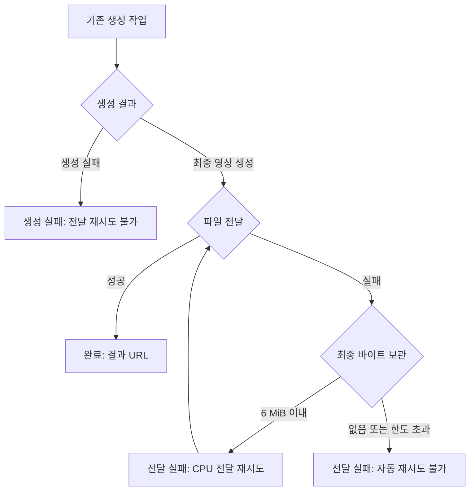

# 영상 작업 추적과 전달 전용 복구 — 2026-10-31

조사 기준: main 커밋 `1335531d15fdf6b4f17ff4d92c3ea782ec390e20`. 운영 서버·운영 DB를 조회하거나 변경한 결과가 아니라 코드 조사와 로컬 테스트 결과다.

## 기존 구현 비교

| 항목 | 개인 영상 | 생성형 AI 미디어 |
| --- | --- | --- |
| 시작 | photo_video/app.py의 사진 업로드, /jobs | Spring AnimationService → cloud_gateway → RunPod |
| 실행 | photo_video/worker.py의 FFmpeg CPU 처리, 5초 확대·이동 | runpod_handler.py → CogVideoX/Tora/배치 등, 설정·실행 결과에 따라 실제 모델 또는 대체 처리 |
| 저장·상태 | 개인 SQLite, QUEUED/RUNNING/COMPLETED/FAILED, 시작·종료·처리시간 | Spring 작업 레코드와 RunPod 상태 조회, 실행 모델·대체 사유 일부 보존 |
| 중복 방지 | owner+requestId 유일성, 사진·코스 일치 검사, 진행 중 재시도 유일 인덱스 | 사용자·게시글 잠금, 진행 작업·일일 한도. 제출 요청번호 기반의 원격 제출 중복 방지는 별도 보강 필요 |
| 생성 실패 재시도 | 실패 작업을 부모로 새 작업 생성, 원본 기록 보존 | 일반 사용자용 전달 전용 재시도는 없었음 |
| 서버 중단 | 10분 넘은 RUNNING을 WORKER_INTERRUPTED 실패로 전환 | Spring 시간 제한, RunPod 조회 실패 시 이후 조회. 원격 제출 성공 후 DB 저장 실패에 대한 정합 보강은 별도 |
| 결과 전달 | 본인 인증 후 로컬 MP4 제공, 재생 오류 시 조회·다운로드 | result_delivery.py에서 Cloudinary 업로드. URL 필수인 경우 업로드 실패 시 artifacts/metadata가 사라지는 축약된 실패 응답 |
| 기존 화면 | 상태·이력·생성 재시도·방법 표시 | Spring 결과 모델 실행·대체 정보 제공. 전체 처리 과정의 전달 복구 연결은 미완성 |

개인 영상은 실제 CPU 작업이며 생성형 AI 실행 또는 모의 실행이 아니다. 모델 경로 이름에 real이 포함돼 있어도 실제 실행 증거를 대신하지 않는다.

## 이번 PR의 작은 구현 범위

1. worker의 생성 결과와 artifacts/metadata를 업로드 실패 응답에서도 유지한다. generation_status, delivery_status, failure_stage를 구분하고 final_video를 인라인 예산에서 우선한다.
2. 중계 서버가 완료 응답을 조회할 때 최종 영상 바이트가 포함되어 있으면 별도 SQLite에 보관한다. 최종 영상 최대 6 MiB. 파일 경로나 URL을 재시도 입력으로 받지 않는다.
3. 내부 인증을 사용하는 전달 전용 API가 보관된 바이트만 기존 Cloudinary 업로드 함수로 전달한다. RunPod 제출·모델 실행·이미지 다운로드는 호출하지 않는다.
4. SQLite 쓰기 트랜잭션으로 동시 전달 시도를 직렬화한다. 전달 성공 후 반복 호출은 기존 URL을 반환한다. 프로세스가 업로드 직후 중단되면 같은 CDN public_id로 재업로드할 수 있으나 모델 생성은 다시 하지 않는다.
5. 서버 재시작 후 같은 SQLite 경로를 연결하면 결과와 시도 횟수를 읽을 수 있다. 나중에 도착한 원래 RunPod 결과가 복구 성공을 덮어쓰지 않는다.
6. 운영자 화면 /jobs/delivery에서 생성 상태, 전달 상태, 실패 단계, 전달 재시도 가능 여부, 시도 횟수와 실행 방식을 확인한다. 인증키는 저장소에 저장하지 않는다.
7. 개인 영상 화면에 CPU 실제 처리임을 명시한다. 운영자 화면은 실제 모델 실행 기록, 모델 미실행, 대체 처리, 모의 처리, 미확인을 분리한다. mock/simulation 실행 기록이 있어야 모의 처리로 표시한다.
8. Gateway Docker 이미지에는 기존 업로드 helper만 복사하고 Cloudinary SDK를 추가한다. 모델 라이브러리는 가져오지 않는다. 기존 음성 전용 인라인 결과는 그대로 반환한다.

## 상태 흐름



RunPod의 외부 상태가 COMPLETED여도 내부 output의 전달은 실패할 수 있다. 이 화면은 두 상태를 분리한다.

## 활성화와 사용

기본값은 비활성이다. 운영 배포와 볼륨 연결은 이 PR에서 수행하지 않았다.

- 중계 컨테이너에 기존 공개 미디어 경로와 겹치지 않는 영구 볼륨을 연결한다. 예: /data/delivery.
- 중계 컨테이너에 `KRIDE_DELIVERY_DIR=/data/delivery`를 설정한다. 공개 미디어 폴더 안이나 그 상위 경로는 거부한다.
- 중계 서버에 Cloudinary 인증 설정을 제공한다. 재시도는 CPU에서 실행하지만 CDN 저장·전송 비용은 발생할 수 있다.
- worker의 변경된 result_delivery.py가 포함된 이미지가 적용되어야 새 전달 실패 응답에 최종 바이트가 남는다.
- 운영자 화면에서 기존 내부 인증키와 RunPod 작업 번호를 입력하고 상태를 조회한다. 이 조회는 생성 요청을 제출하지 않는다.
- 보관된 최종 영상이 있는 전달 실패 작업에서만 재시도 버튼이 활성화된다.
- `GET /jobs/runpod/{job_id}/delivery`: 보관된 상태만 조회.
- `POST /jobs/runpod/{job_id}/delivery-retry`: 전달만 재시도. 실패 시 HTTP 200 안의 delivery_status=failed와 retry_available을 확인한다. 없는 작업 404, 보관본 없는 재시도 409, 기능 미설정 501.
- `GET /jobs/runpod/{job_id}`: 기존 조회를 재사용하며, 보관본이 있으면 복구된 output과 delivery 요약을 반환한다.
- 전달 SQLite에는 영상이 들어 있으므로 접근을 운영자와 서비스 계정으로 제한하고 용량을 관찰한다. 이번 구현에는 자동 삭제 정책이 없다.

## 실제 검증

로컬 Python 3.11에서 아래 명령으로 **31개 통과**.

```bash
python -m pytest -q tests/test_cloud_gateway_runpod_auth.py tests/test_hostinger_media_relay.py tests/test_result_delivery.py tests/test_delivery_recovery.py
```

- 신규 복구 테스트 19개 + 기존 전달·인증·중계 테스트 12개.
- 전달 실패 시 artifacts/metadata 유지, 최종 파일의 인라인 우선순위.
- 재시작 후 보관본 재사용, 업로드 오류 후 재복구.
- 동시·반복 호출에서 성공 업로드 1회, 원래 상태 조회가 복구 성공을 덮어쓰지 않음.
- 잘못된·누락된·한도 초과 바이트는 재시도 불가.
- 생성 실패를 전달 실패로 잘못 판정하지 않음.
- 인증키 없을 때 401, 존재하지 않는 작업과 설정 누락 처리.
- 실제 RunPod HTTP와 Cloudinary 업로드는 모의 함수로 교체.
- 호스트의 RunPod 인증 설정은 모두 없음을 값 노출 없이 확인.
- 운영자 화면 HTML 응답과 표시 문구, 화면 JavaScript 문법 검사 통과.
- 테스트 도구에서 Starlette/httpx 사용 중단 예정 경고 1개. 테스트 실패 아님.

## 미검증과 후속 작업

- 유료 GPU 작업, 실제 모델 실행, 실제 Cloudinary 업로드, 운영 배포를 실행하지 않았다.
- 테스트 영상 바이트는 작은 임시 바이트다. 실제 MP4 생성·재생·화질·브라우저 클릭 동작·Next.js 전체 빌드·Docker 이미지 빌드는 이번 로컬 검증에 포함하지 않았다.
- 이 PR은 운영자용 복구 첫 단계다. Spring AnimationJob의 FAILED 상태를 자동 갱신하거나 일반 사용자 화면에서 전달 재시도하는 기능은 아직 없다. Spring은 종결 상태의 재조회를 중단하므로, 게이트웨이에서 복구해도 기존 게시글 상태가 자동으로 복구되지는 않는다.
- 다음 단계는 Spring에 전달 실패 상태·사용자 소유권을 확인하는 재시도 API를 추가하고, 성공한 같은 작업의 URL을 갱신하는 것이다. 기존 기록을 삭제하거나 새 GPU 작업을 제출하는 방식으로 우회하지 않는다.
- 큰 영상은 인라인 응답 한도 안에 들어오지 않는다. 장기적으로 worker가 영구 객체 저장소에 먼저 저장하고, 별도 CPU 전달 작업이 그 객체를 읽는 구조가 필요하다. worker의 임시 경로만으로 다른 서버에서 복구할 수 있다고 표시하지 않는다.
- 기존 응답에서 이미 사라진 파일·아직 폴링하지 않은 결과·복구 폴더 자체가 유실된 경우는 복구를 보장하지 않는다.
- 실패 단계 상세 분해(입력 다운로드/모델/음성/인코딩), 요청부터 전달까지의 단계별 타임라인, 원격 제출 요청번호 중복 방지는 후속 범위다.
- 운영 데이터베이스 마이그레이션, 삭제, 기존 서비스 재시작, main 병합은 수행하지 않았다.
