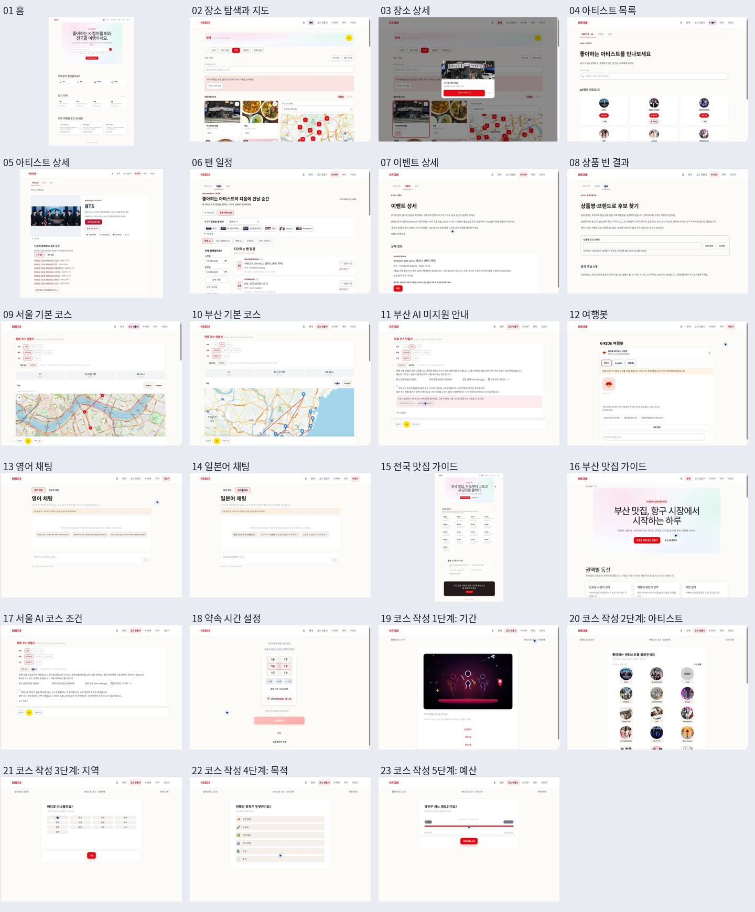

# KMovement 실제 화면과 60초 UX 소개

2026-10-29 운영 화면을 카카오 로그인 후 확인해 만든 자료입니다.

## 파일

- [60초 소개 영상](KMovement-UX-60s.mp4) · 1920×1080, 30fps, H.264, 무음
- [주요 화면 23장 ZIP](KMovement-screenshots-23.zip) · 원본 PNG, index.html 보기 페이지, README 포함
- [화면 전체 미리보기](KMovement-capture-overview.jpg)

## 개인 프로젝트 참여 정보

- 진행 형태: 개인 프로젝트
- 본인 참여율: 100%
- 참여 기간: 2026년 2월부터 현재까지 진행 중
- 위 정보는 2026-10-29 사용자 확인을 기준으로 기재했습니다.

## 구성과 확인 범위

홈 → 장소 탐색·지도 → 장소 상세 → 아티스트 → 일정 → 지역 맛집 → 코스 조건 → 여행봇 흐름을 60초로 편집했습니다. 실제 화면 캡처에 한국어 설명, 확대와 전환 효과를 넣은 소개 영상이며 실시간 연속 화면녹화는 아닙니다.

캡처에는 코스 작성 1~5단계, 서울·부산 기본 코스, 서울 AI 조건, 부산 AI 미지원, 영어·일본어 텍스트 채팅 화면도 포함합니다. 모든 지역·아티스트의 상세 페이지를 전수 캡처한 자료는 아닙니다. 계정 이메일과 로그인 인증 화면은 제외했습니다.

## 확인된 제한

- 장소 탐색: 지역 목록 재조회 실패 안내가 표시되며 기본 장소 목록과 지도는 표시됩니다.
- 기본 당일 코스: 서울 26시간 5분, 부산 31시간 5분으로 표시되어 실제 당일 방문 가능성 검증이 필요합니다.
- AI 코스: 서울 당일 조건 화면만 확인했고 생성 요청은 제출하지 않았습니다. 부산은 준비 중 안내입니다.
- 상품: 공개 후보 0건으로 상품 상세는 확보하지 못했습니다.
- 여행봇·외국어 채팅: 시험 운영 화면을 확인했으며 이번 촬영에서 답변 생성은 시험하지 않았습니다.
- 최종 아티스트 코스와 영상 생성 요청은 제출하지 않았습니다.

## 재사용

위시켓 등 포트폴리오에는 원본 캡처에서 주요 화면을 골라 첨부할 수 있습니다. 위시켓 포트폴리오에는 위 참여 정보와 함께 실제 화면을 골라 첨부합니다. 위시켓 등록 여부는 별도로 확인합니다.

원본 서비스: https://kmovement.srv1869569.hstgr.cloud/
